# CCC Unity中核ロジック関係図

> [ドキュメント一覧](../../README.md) / 区分: 設計解説

> **対象範囲**: `Ccc.Core.Model`、`Ccc.Core.Logic`、`Ccc.Core.UseCases`、およびそれらと直接対峙する Presentation 境界

---

## 1. このドキュメントの読み方

本ドキュメントは、CCC の中核ロジックの全体像および構成要素の関係を理解するための解説資料とする。以下のステップ順で参照すること。

1. **全体像の把握**: [2. 全体像：3つの塊](#2-全体像3つの塊) で、ゲーム処理の流れを3つの大きなブロックとして理解すること。
2. **詳細構造の参照**: 実装する機能に応じて、[4. 詳細A](#4-詳細amodelの構成とデータ所有) 〜 [7. 詳細D](#7-詳細dmission抽選とtimer) の詳細図を確認すること。
3. **データ保持者の確認**: 「どのオブジェクトが何のデータを保持するか」は [8. 所有関係とlifetime](#8-所有関係とlifetime) を確認すること。
4. **クラスAPIの特定**: 各クラスの具体的なAPI定義は [9. 実装時のクラス別参照先](#9-実装時のクラス別参照先) から [CCC Unityクラス設計](../unity-class-design.md) の該当節へ移動して確認すること。

### 図中の記号・矢印の凡例

| 表現 | 意味 |
| --- | --- |
| `A --> B` | AがBを呼び出す、または参照する |
| `A *-- B` | AがBをセッション中の所有構成要素として保持する（コンポジション） |
| `A o-- B` | AがBへの参照を保持するが、ライフタイムは外部（DI Scope等）が管理する（集約） |
| **実線の矢印** | 実行時の呼び出し、またはデータの直接移動 |
| **点線の矢印** | 生成物、通知、読み取りなどの間接的な関係 |

※ Modelは原則として**不変（Immutable）**とする。図中で「保持する」とある場合も、Modelのインスタンスを内部で書き換えるのではなく、「現在値への参照を保持し、状態更新時に新しい不変インスタンスへ差し替える」ことを意味する。

---

## 2. 全体像：3つの塊

中核ロジックを構成する以下の3つの大きなブロック（役割）を把握すること。

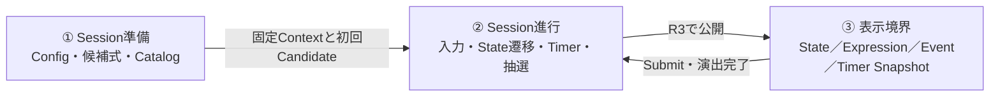

- **① Session準備**: セッション開始時に一度だけ実行され、セッション固定の `GameplaySessionContext` を生成する。
- **② Session進行**: セッション中の処理を `GameplayController` が集中的に制御する。編集中の数式は `ExpressionInput`、セッションの節目（状態遷移）は `GameplayReducer`、時間管理は `ISectionTimer` が担当する。
- **③ 表示境界**: `GameplayPresenter` が公開されたストリームを購読し、UIへ反映する。Presenter および View は Core の内部状態を直接変更できない。

### 3つのブロックの内部構造と協調関係

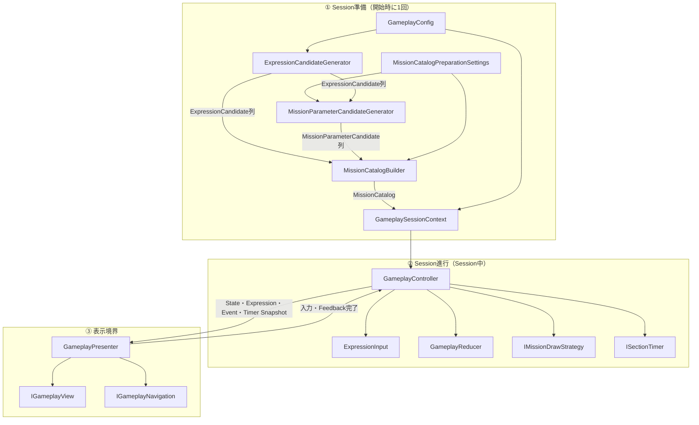

---

## 3. 通常プレイの大まかな流れ

> **状態更新に関する重要ルール**  
> プレイヤーによる数字や演算子の変更操作は `ExpressionInput` 内部で閉じて完結し、`GameplayReducer` を経由しないこと。  
> `GameplayReducer` を経由するのは、セッション進行上の節目となる以下の4つの操作（Command）のみとする。
> 
> 1. **Submit**（数式の提出）
> 2. **TimeExpired**（セッション制限時間の切れ）
> 3. **FeedbackCompleted**（画面演出の完了通知）
> 4. **PresentMission**（新しい Mission の提示）

---

## 4. 詳細A：Modelの構成とデータ所有

本図のコンポジション関係（`*--`）は、「各不変スナップショットがどのデータを内包して保持するか」を表す。

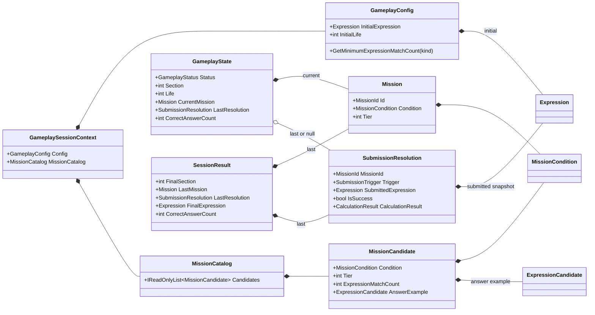

> **重要な境界・設計制約**
> - **`GameplaySessionContext`**: セッション期間を通じて変更されない設定（Config）とカタログ（Catalog）を保持する。
> - **`GameplayState`**: セクション、ライフ、現在の Mission、直前の提出結果などを保持するセッション進行の不変スナップショットとする。
> - **編集中の式**: 編集中の数式は `GameplayState` には含めず、`ExpressionInput.Current` が独立して保持すること。
> - **提出時の式**: `SubmissionResolution.SubmittedExpression` は、提出ボタンが押された瞬間、または時間切れが確定した瞬間にスナップショット化された式とする。
> - **最終結果の式**: `SessionResult.FinalExpression` は `LastResolution.SubmittedExpression` から導出すること。
> - **正解数の導出**: 正解数 `CorrectAnswerCount` は、State や Result 内部に直接値を保持せず、現在の Section 数から動的に導出すること。

---

## 5. 詳細B：Catalog構築

### 5.1 クラス関係

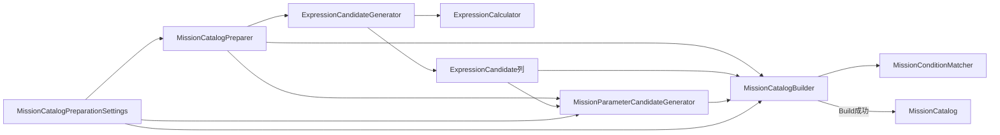

`MissionCatalogPreparer`が候補式生成、Missionパラメータ候補準備、Catalog構築を順に呼び出し、`GameplayController`とシミュレーションはこれを共有する。`MissionKindDefinitionCatalog`はパラメータ構造、固定肯定Tier、Negated可否・Tierを一元管理する。`MissionCatalogPreparer`、`MissionParameterCandidateGenerator`、`MissionCatalogBuilder`は状態を持たないためDI登録しない。

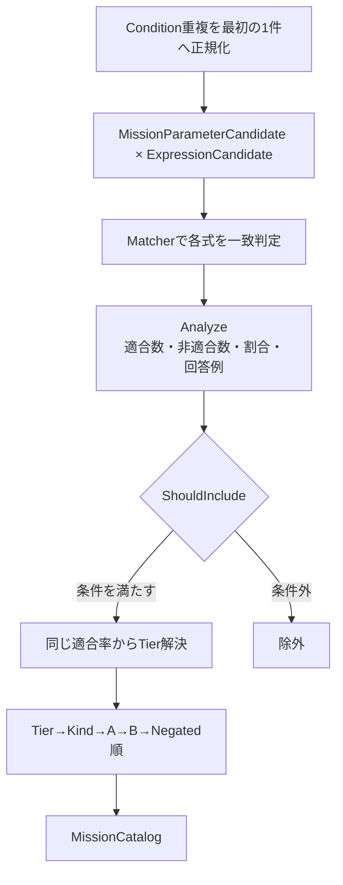

### 5.2 選出条件の責務配置

| 判定条件 | 判定を担当する場所 | 参照元データ |
| --- | --- | --- |
| Mission条件と計算結果の一致確認 | `MissionConditionMatcher` | `MissionCondition`、`CalculationResult` |
| 適合数・非適合数・適合割合の計算 | `MissionCatalogBuilder.Analyze` | 正常な `ExpressionCandidate` 配列 |
| 適合割合が許容範囲内かの検証 | `MissionCatalogBuilder.ShouldInclude` | `MissionCatalogEvaluationPolicy` |
| 最小適合式数の取得 | `MissionCatalogEvaluationPolicy.GetMinimumMatchCount` | `MissionKind` |
| Tier解決 | `MissionCandidateTierResolver` | `MissionKindDefinitionCatalog`、分析済み`Rational`適合率 |
| 重複排除と規定順へのソート | `MissionCatalogBuilder` | Tier、Kind、ParameterA、ParameterB、IsNegated |

---

## 6. 詳細C：Session進行

### 6.1 状態保持クラスと純粋Reducer

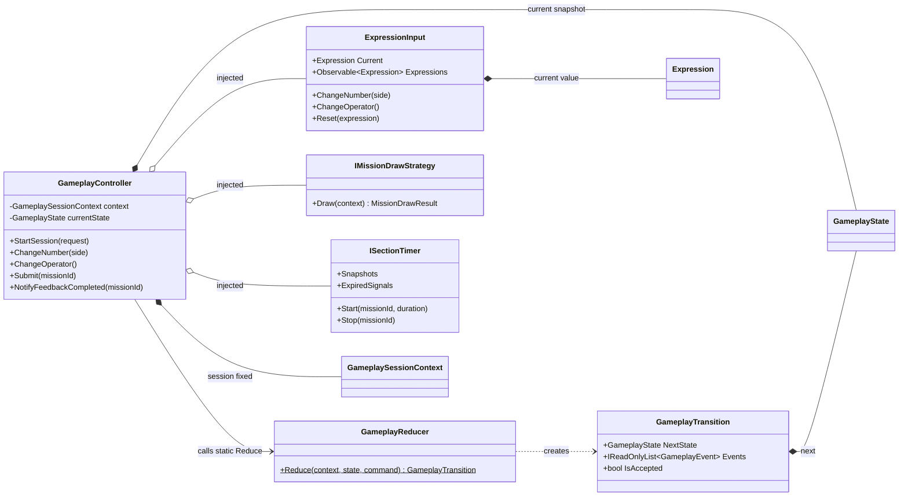

- **`GameplayReducer`**: `static` クラスとして設計され、一切の内部状態を持たない。現在の Context、State、Command を受け取り、純粋関数として次の State と Event を返却すること。
- **`GameplayController`**: セッション中の現在状態（State）を保持し、イベントやデータの配信順序を管理すること。

### 6.2 Command、Transition、Event

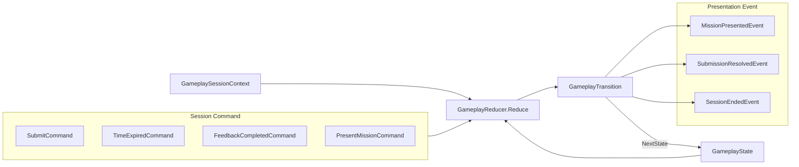

| 入力アクション | Commandに含まれるスナップショット | 主な出力イベント |
| --- | --- | --- |
| 手動Submit（提出） | MissionId、`ExpressionInput.Current` | `SubmissionResolvedEvent` |
| Timer期限切れ（時間切れ） | MissionId、`ExpressionInput.Current` | `SubmissionResolvedEvent` |
| 演出完了（Feedback完了） | MissionId | 次抽選の許可、または `SessionEndedEvent` |
| 次Candidate提示 | 直前MissionId、MissionCandidate | `MissionPresentedEvent` |

### 6.3 Controllerが保証する処理順序

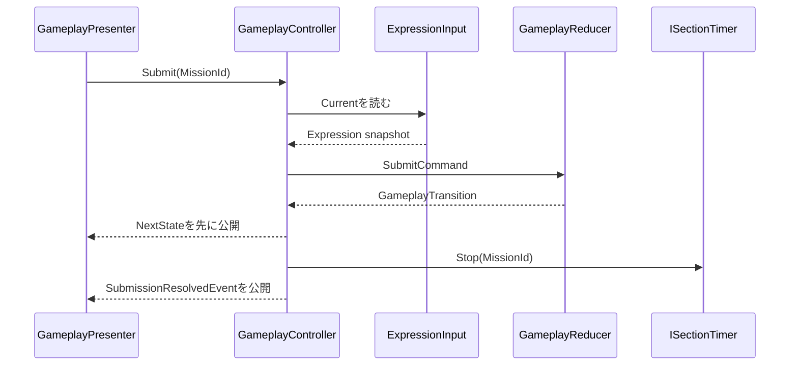

※ 不整合な MissionId による Submit、2重送信、または `Playing` 以外の状態での Submit / TimeExpired は、Reducer が `IsAccepted == false` として拒否すること。Controller は拒否された Transition に対してタイマー停止やイベント公開を行わない。

---

## 7. 詳細D：Mission抽選とTimer

### 7.1 Mission抽選Strategy

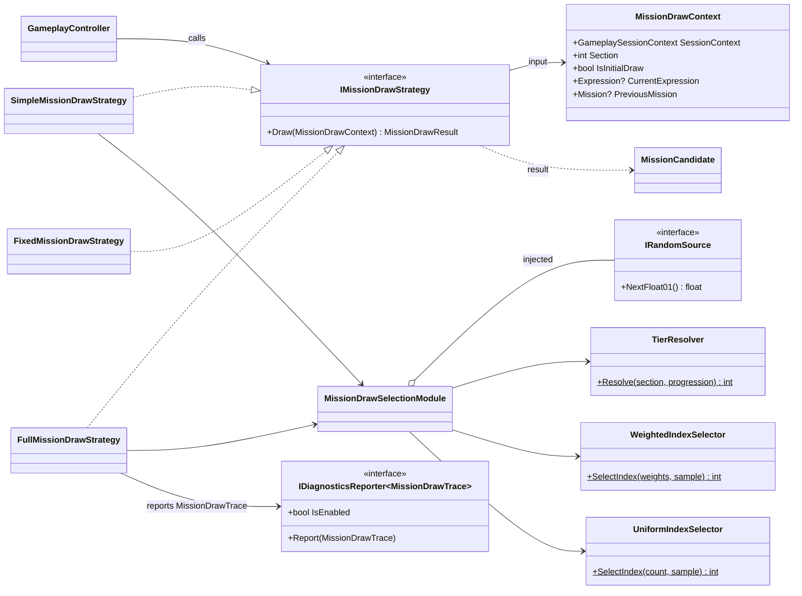

本実装版は、2問目以降に解放済み候補を現在式で達成できる群と達成できない群へ分割し、`GameplayConfig.CurrentExpressionSatisfiedMissionSelectionRatio`の直接確率で先に候補群を選ぶ。両群が存在するときだけ乱数を1回消費し、sampleが比率未満なら達成できる群、以上なら達成できない群を選ぶ。片方の群しかない場合、および比率0/1で選択先が確定する場合は乱数を消費しない。その後にTier、極性、直前Mission、Kind、目標適合率上位候補の順で選定する。

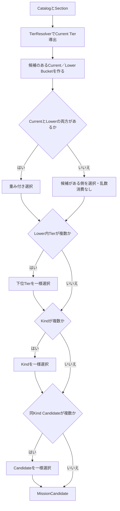

※ `IRandomSource` から乱数値を取得するのは、選択肢が2つ以上存在する場合のみとする。Selector クラス群は与えられたサンプル値からインデックスを算出する純粋関数であり、乱数生成器の存在を直接知ることはない。

### 7.2 Timerと数式スナップショット

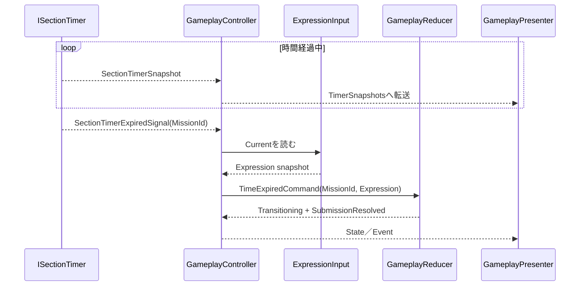

- `ISectionTimer` の実装クラスは、MissionId、開始時刻、残り時間、期限切れ通知の有無を保持する。
- `SectionTimerSnapshot` はUI表示用の構造体であり、`GameplayState` には格納しないこと。
- 時間切れシグナル自体は数式データを保持しない。シグラル受信時に `GameplayController` が `ExpressionInput.Current` の最新スナップショットを読み込んで Command に設定すること。
- 手動 Submit と時間切れが同時に競合した場合でも、Reducer の Status チェックおよび MissionId ガードにより、先に受理された一方のみを有効とすること。

---

## 8. 所有関係とライフタイム（Lifetime）

「所有」には、**データの現在値を保持する責務**と、**インスタンスを破棄管理するライフタイム責務**の2種類がある。

### 8.1 実行時（Runtime）データの保持者

| データ / インスタンス | 現在値の保持者 | 生成・更新を行う場所 | ライフタイム・破棄 |
| --- | --- | --- | --- |
| `GameplaySessionContext` | `GameplayController` | セッション開始時に Controller が生成 | Gameplay Scope |
| `GameplayConfig` | `GameplaySessionContext` | `GameplayConfigAsset.CreateRuntimeConfig` | セッション期間中不変 |
| `MissionCatalogPreparationSettings` | `GameplayStartRequest` | `GameplayEntryPoint`がProfile/Presetから変換 | Session開始要求中不変 |
| `MissionCatalog` | `GameplaySessionContext` | `MissionCatalogBuilder.Build` | セッション期間中不変 |
| 現在の `GameplayState` | `GameplayController` | 初期値は Controller、更新値は Reducer | 不変インスタンスを Controller が差し替え |
| 編集中の `Expression` | `ExpressionInput` | `ChangeNumber` / `ChangeOperator` / `Reset` | Scoped / Disposable |
| タイマー内部状態 | `ISectionTimer` 実装 | `Start` / Tick / `Stop` | Scoped / Disposable |
| `SectionTimerSnapshot` | Timer が生成し Controller が転送 | `ISectionTimer` 実装 | 通知ごとの一時値 |
| `SubmissionResolution` | `GameplayState.LastResolution` | Reducer | 不変値 |
| `SessionResult` | `SessionEndedEvent` の Payload | Reducer | Result画面へ引き渡す不変値 |
| State/Event 配信 Subject | `GameplayController` | Controller | Gameplay Scope 終了時に破棄 |

### 8.2 DI（依存注入）における所有構造

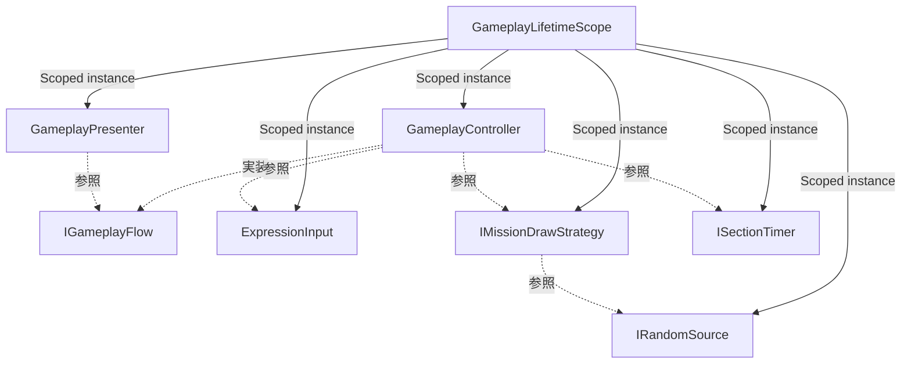

- インスタンスの生成および破棄の管理は、すべて `GameplayLifetimeScope` が所有すること。
- `GameplayController` は注入された `ExpressionInput`、Strategy、Timer を進行上の協調オブジェクトとして参照すること。（Controller が直接 `new` しないこと）
- `GameplayReducer`、`ExpressionCalculator`、Matcher、候補Generator、Builder、Tier Resolver、Selectorは状態を持たない`static`クラスであり、DI登録の対象外とする。
- Presenter は公開ストリームの購読者であり、`GameplayState` やタイマー内部状態の所有者ではない。

### 8.3 状態の変更権限マトリクス

| 変更対象データ | 変更を指示できるクラス | 直接変更が禁止されているクラス |
| --- | --- | --- |
| 編集中の数式 | `GameplayController` を経由した `ExpressionInput` | Presenter、View、Reducer |
| セッション State | `GameplayReducer` の Transition を適用する `GameplayController` | Presenter、View、Timer、Strategy |
| タイマー状態 | `GameplayController` | Presenter、View、Reducer |
| 次 Mission 候補 | `IMissionDrawStrategy` を呼び出す `GameplayController` | Presenter、View、Reducer 単独 |
| 表示用 DTO | `GameplayPresenter` | Core、View |
| Unity Asset | Unity Editor / Infrastructure層 | Core Model / Logic |

---

## 9. 実装時のクラス別参照先ドキュメント

| 実装対象 | 役割概要 | 詳細API定義のリンク |
| --- | --- | --- |
| `Rational` | 正確な有理数計算と同値性 | [クラス設計 §4.1](../unity-class-design.md) |
| `CalculationResult` | 正常値とゼロ除算エラーの分離 | [クラス設計 §4.2](../unity-class-design.md) |
| `Expression` | 左数字・演算子・右数字の数式構造 | [クラス設計 §4.3](../unity-class-design.md) |
| `MissionCondition` | Missionクリア条件の不変値 | [クラス設計 §4.4](../unity-class-design.md) |
| `Mission` / `MissionId` | 提示中Missionおよびセッション内連番 | [クラス設計 §4.5](../unity-class-design.md) |
| `MissionCatalog` / `MissionCandidate` | セッション固定の出題候補リスト | [クラス設計 §4.6](../unity-class-design.md) |
| `GameplayConfig` | 数値範囲・閾値・重み設定 | [クラス設計 §4.7](../unity-class-design.md) |
| `GameplayState` / `GameplaySessionContext` | 進行状態スナップショットと固定Context | [クラス設計 §4.8](../unity-class-design.md) |
| `SessionResult` | ゲームオーバー時の最終実績データ | [クラス設計 §4.9](../unity-class-design.md) |
| `ExpressionCalculator` | 数式評価ロジック | [クラス設計 §5.1](../unity-class-design.md) |
| `ExpressionCandidateGenerator` | 正常な候補式の網羅的生成 | [クラス設計 §5.2](../unity-class-design.md) |
| `MissionConditionMatcher` | Mission条件への一致判定 | [クラス設計 §5.3](../unity-class-design.md) |
| `MissionParameterCandidateGenerator` | Profileと到達可能結果から候補生成 | [クラス設計 §5.4](../unity-class-design.md) |
| `MissionCatalogBuilder` | 候補分析・選出・Catalog構築 | [クラス設計 §5.4](../unity-class-design.md) |
| `WeightedIndexSelector` / `UniformIndexSelector` | サンプル値からのインデックス決定 | [クラス設計 §5.5](../unity-class-design.md) |
| `GameplayReducer` | 4つのセッション状態遷移 | [クラス設計 §6](../unity-class-design.md) |
| `ExpressionInput` | プレイヤーによる数式編集状態 | [クラス設計 §7.2](../unity-class-design.md) |
| `GameplayController` | 状態保持と副作用の調停層 | [クラス設計 §7.3](../unity-class-design.md) |
| `IMissionDrawStrategy` | カタログからの次 Mission 抽選 | [クラス設計 §7.4](../unity-class-design.md) |
| `ISectionTimer` | タイマースナップショットと時間切れ通知 | [クラス設計 §7.1 / §7.5](../unity-class-design.md) |

---

## 10. クラス境界判断のための原則ルール

- **データと不変条件** → `Ccc.Core.Model` に配置すること。
- **入力と出力が1対1の同期的・決定的な計算** → `Ccc.Core.Logic` に配置すること。
- **現在状態の保持、乱数、タイマー、非同期イベントの調停** → `Ccc.Core.UseCases` に配置すること。
- **数字や演算子の入力変更操作** → `ExpressionInput` のみ更新すること。
- **セッションの節目（状態遷移）** → Command を生成し `GameplayReducer` に渡すこと。
- **Reducerの制約** → Reducer 内から Unity API、R3 Subject、タイマー、乱数生成器を呼び出さないこと。
- **PresenterとViewの役割** → Presenter は Core の出力を DTO / 演出データへ変換し、View は完成された DTO を描画・表示するのみとすること。
- **Coreの完全隔離** → Unity アセットや `MonoBehaviour` を Core の Model / Logic に渡さないこと。
