# CCC Unity中核ロジック関係図

> [ドキュメント一覧](../../README.md) / 区分: 設計解説
>
> 正本: [Cosense「CCC Unity中核ロジック関係図」](https://scrapbox.io/proto-TeamL/CCC%20Unity%E4%B8%AD%E6%A0%B8%E3%83%AD%E3%82%B8%E3%83%83%E3%82%AF%E9%96%A2%E4%BF%82%E5%9B%B3)
> 取得時点の原文更新日時: 2026-08-28T09:48:31.000Z

> 対象：`Ccc.Core.Model`、`Ccc.Core.Logic`、`Ccc.Core.UseCases`と、その直接のPresentation境界

## 1. このページの読み方

このページは、中核ロジックを次の順番で把握するための図解である。

- 1. §2でゲーム全体を3つの塊として把握する。
- 2. 実装対象に応じて§4〜§7の詳細図を見る。
- 3. 「誰が何を保持するか」は§8で確認する。
- 4. 各クラスのAPI定義は§9から[CCC Unityクラス設計](../unity-class-design.md)の該当節へ移動して確認する。

図の矢印と記号は次の意味で使用する。

| 表現 | 意味 |
| --- | --- |
| `A --> B` | AがBを呼ぶ、または参照する |
| `A *-- B` | AがBをSession中の構成要素として保持する |
| `A o-- B` | AがBへの参照を保持するが、lifetimeはDI scopeなど外側が管理する |
| 実線の処理矢印 | runtimeの呼び出しまたはデータ移動 |
| 点線の矢印 | 生成物、通知、読み取りなどの間接的な関係 |

Modelは原則として不変である。図中の「保持」は、Modelを後から書き換えるという意味ではなく、現在値への参照を保持し、更新時には新しい値へ差し替えることを表す。

## 2. 全体像：3つの塊

最初は個別クラスではなく、次の3ブロックだけを押さえる。

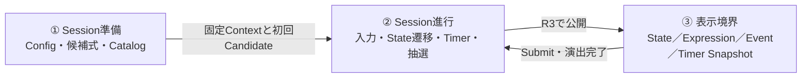

- **Session準備**は開始時に1回だけ実行し、`GameplaySessionContext`を作る。
- **Session進行**の中心は`GameplayController`である。編集中の式は`ExpressionInput`、Sessionの節目は`GameplayReducer`、時間は`ISectionTimer`が担当する。
- **表示境界**では`GameplayPresenter`が公開ストリームを購読する。PresenterとViewはCoreの状態を直接変更しない。

3ブロックの内部構成は次のとおりである。

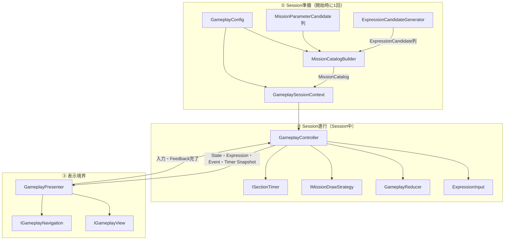

## 3. 通常プレイの大まかな流れ

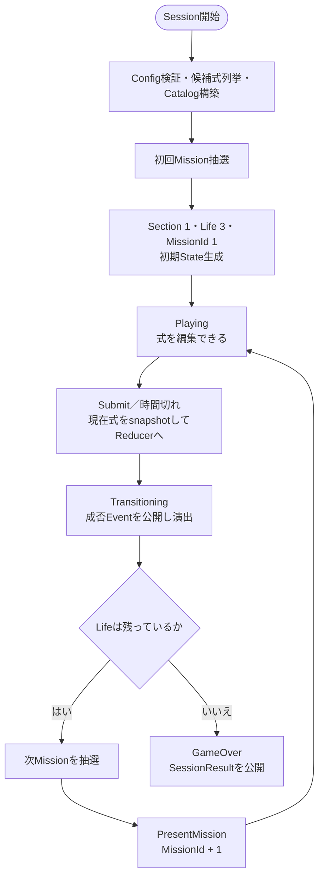

式の数字・演算子変更は`ExpressionInput`内で完結し、`GameplayReducer`を通らない。Reducerを通るのは次の4つのSession遷移だけである。

- Submit
- TimeExpired
- FeedbackCompleted
- PresentMission

## 4. 詳細A：Modelの構成とデータ所有

この図の合成関係は「その不変スナップショットがどのデータを内包するか」を示す。

重要な境界は次のとおりである。

- `GameplaySessionContext`はSession中に変わらないConfigとCatalogをまとめる。
- `GameplayState`はSection、Life、現在Mission、最後の提出結果を持つSession進行スナップショットである。
- 編集中の式は`GameplayState`に入らず、`ExpressionInput.Current`が持つ。
- `SubmissionResolution.SubmittedExpression`は提出または時間切れの瞬間に確定した式である。
- `SessionResult.FinalExpression`は`LastResolution.SubmittedExpression`から導出する。
- `CorrectAnswerCount`はState／ResultのどちらでもSectionから導出し、格納しない。

## 5. 詳細B：Catalog構築

### 5.1 クラス関係

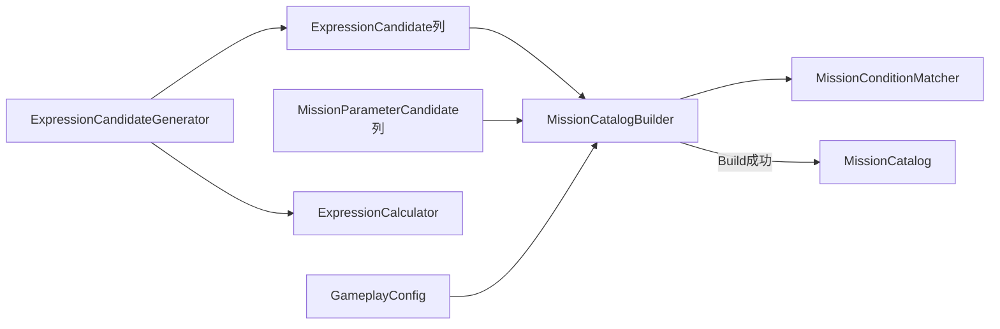

`MissionCatalogBuilder`内の候補分析と選出判定はprivate static methodであり、独立クラスではない。

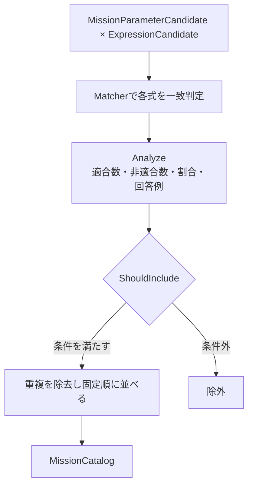

### 5.2 選出条件の所有者

| 条件 | 判定する場所 | 参照元 |
| --- | --- | --- |
| Mission条件と計算結果が一致するか | `MissionConditionMatcher` | `MissionCondition`、`CalculationResult` |
| 適合数・非適合数・割合 | `MissionCatalogBuilder.Analyze` | 正常な`ExpressionCandidate`列 |
| 割合が許容範囲内か | `MissionCatalogBuilder.ShouldInclude` | `GameplayConfig` |
| 必要な最小適合式数 | `GameplayConfig.GetMinimumExpressionMatchCount` | MissionKind |
| Zero／Primeは1件以上、その他は2件以上 | `GameplayConfig`の設定をBuilderが適用 | `ZeroAndPrimeMinimumExpressionMatchCount`／`MinimumExpressionMatchCount` |
| 重複排除と固定順 | `MissionCatalogBuilder` | Tier、Kind、ParameterA、ParameterB、IsNegated |

## 6. 詳細C：Session進行

### 6.1 状態を持つクラスと純粋Reducer

`GameplayReducer`はstaticで内部状態を持たない。現在のContext、State、Commandをすべて引数で受け、次StateとEventを返す。対して`GameplayController`はSession中の現在値と配信順序を管理する。

### 6.2 Command、Transition、Event

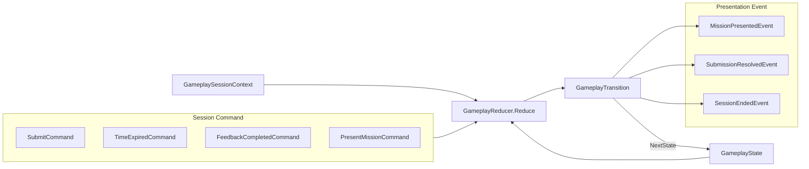

| 入力 | Commandに入るsnapshot | 主な出力 |
| --- | --- | --- |
| 手動Submit | MissionId、`ExpressionInput.Current` | `SubmissionResolvedEvent` |
| Timer期限切れ | MissionId、`ExpressionInput.Current` | `SubmissionResolvedEvent` |
| 演出完了 | MissionId | 次抽選の許可、または`SessionEndedEvent` |
| 次Candidate提示 | 直前MissionId、MissionCandidate | `MissionPresentedEvent` |

### 6.3 Controllerが保証する処理順

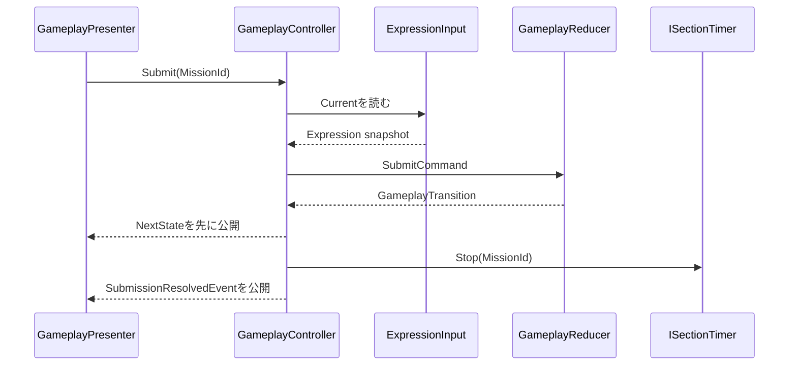

無効なMissionId、2回目のSubmit、`Playing`以外のSubmit／TimeExpiredはReducerが`IsAccepted == false`として拒否する。Controllerは拒否されたTransitionからTimer操作やPresentation Event公開を行わない。

## 7. 詳細D：Mission抽選とTimer

### 7.1 Mission抽選Strategy

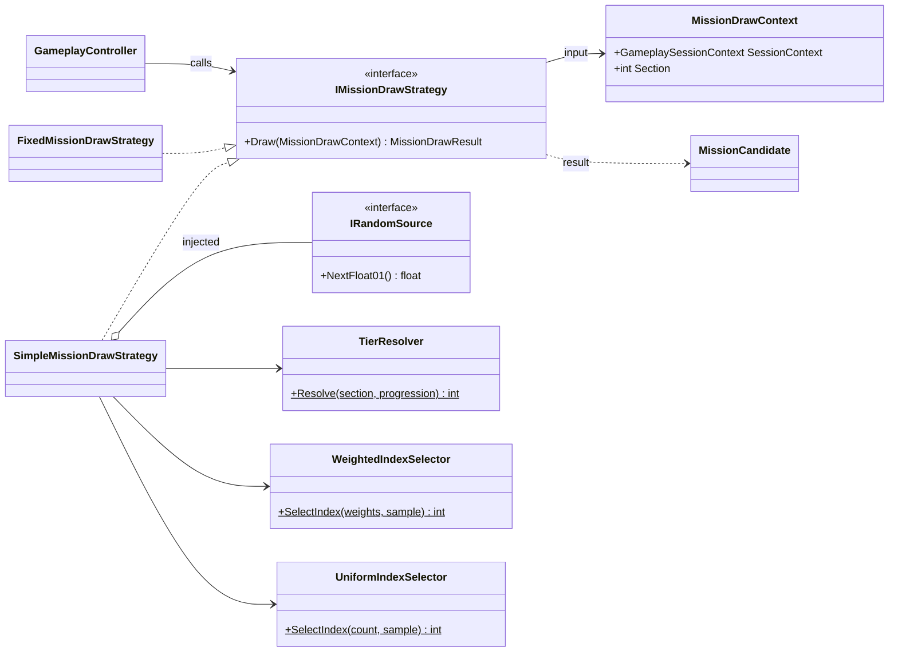

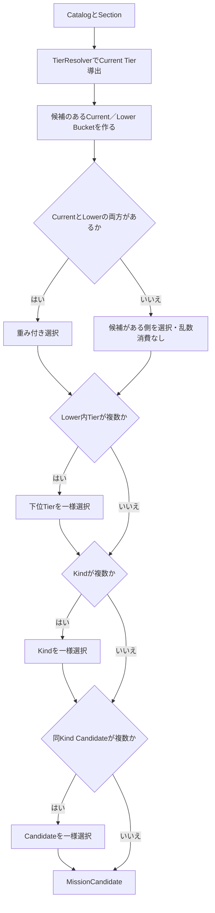

`IRandomSource`から値を取るのは選択肢が2件以上ある段階だけである。Selectorは受け取ったsampleからIndexを求める純粋関数であり、乱数源を知らない。

### 7.2 Timerと式snapshot

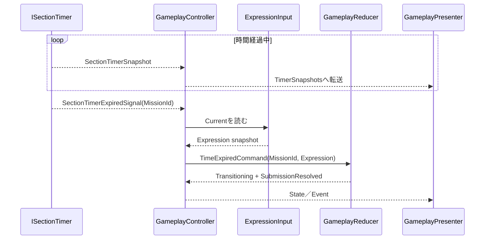

- `ISectionTimer`実装が保持するのはMissionId、開始時刻、残り時間、期限切れ通知済みかどうかである。
- `SectionTimerSnapshot`は表示専用で、`GameplayState`には入れない。
- Expired Signal自体は式を持たない。受信時点でControllerが`ExpressionInput.Current`を読み、Commandへ格納する。
- 手動Submitと期限切れが競合しても、ReducerのStatusとMissionIdガードにより先に届いた一方だけが受理される。

## 8. 所有関係とlifetime

「所有」には、データの現在値を保持する責務と、instanceを破棄するlifetime責務の2種類がある。両者を混同しない。

### 8.1 Runtimeデータの保持者

| データ／instance | 現在値の保持者 | 値を作る／更新する場所 | lifetime・破棄 |
| --- | --- | --- | --- |
| `GameplaySessionContext` | `GameplayController` | Session開始時にControllerが組み立てる | Gameplay scope |
| `GameplayConfig` | `GameplaySessionContext` | `GameplayConfigAsset.CreateRuntimeConfig` | Session中は不変 |
| `MissionCatalog` | `GameplaySessionContext` | `MissionCatalogBuilder.Build` | Session中は不変 |
| 現在の`GameplayState` | `GameplayController` | 初期値はController、次値はReducer | 不変値をControllerが差し替える |
| 編集中の`Expression` | `ExpressionInput` | `ChangeNumber`／`ChangeOperator`／`Reset` | `ExpressionInput`はScoped／Disposable |
| Timer内部状態 | `ISectionTimer`実装 | `Start`／Tick／`Stop` | Scoped／Disposable |
| `SectionTimerSnapshot` | Timerが生成しControllerが転送 | `ISectionTimer`実装 | 通知ごとの値 |
| `SubmissionResolution` | `GameplayState.LastResolution` | Reducer | 不変値 |
| `SessionResult` | `SessionEndedEvent`のpayload | Reducer | Result遷移先へ渡す不変値 |
| State／Event配信Subject | `GameplayController` | Controller | Gameplay scope終了時に破棄 |

### 8.2 DI上の所有

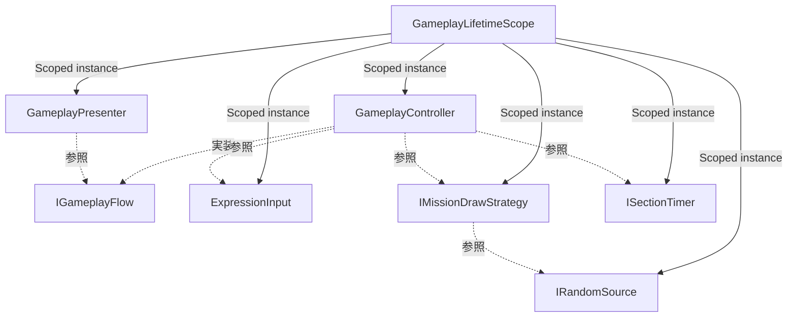

- instanceの生成・破棄は`GameplayLifetimeScope`が所有する。
- `GameplayController`は注入された`ExpressionInput`、Strategy、Timerを進行上の協力オブジェクトとして参照する。
- Controllerが協力オブジェクトを直接newしない。
- `GameplayReducer`、`ExpressionCalculator`、Matcher、Builder、Selectorは状態を持たないstatic classであり、DI登録しない。
- Presenterは公開ストリームの購読者であり、`GameplayState`やTimer内部状態の所有者ではない。

### 8.3 変更権限

| 対象 | 変更を指示できるクラス | 直接変更してはいけないクラス |
| --- | --- | --- |
| 編集中の式 | `GameplayController`経由の`ExpressionInput` | Presenter、View、Reducer |
| Session State | `GameplayReducer`のTransitionを採用する`GameplayController` | Presenter、View、Timer、Strategy |
| Timer | `GameplayController` | Presenter、View、Reducer |
| 次Mission候補 | `IMissionDrawStrategy`を呼ぶ`GameplayController` | Presenter、View、Reducer単独 |
| 表示DTO | `GameplayPresenter` | Core、View |
| Unity Asset | Unity Editor／Infrastructure | Core Model／Logic |

## 9. 実装時のクラス別参照先

| 実装対象 | 役割 | API定義 |
| --- | --- | --- |
| `Rational` | 正確な有理数と同値性 | [クラス設計 §4.1](https://scrapbox.io/proto-TeamL/CCC_Unityクラス設計#6a902ea2c9a3d3000000150cd6) |
| `CalculationResult` | 正常値と0除算の分離 | [クラス設計 §4.2](https://scrapbox.io/proto-TeamL/CCC_Unityクラス設計#6a902ea2c9a3d300000026ba99) |
| `Expression` | 左数字・共有演算子・右数字 | [クラス設計 §4.3](https://scrapbox.io/proto-TeamL/CCC_Unityクラス設計#6a902ea2c9a3d3000000fad28d) |
| `MissionCondition` | Mission条件の不変値 | [クラス設計 §4.4](https://scrapbox.io/proto-TeamL/CCC_Unityクラス設計#6a902ea2c9a3d30000005b2c36) |
| `Mission`／`MissionId` | 提示済みMissionとSession内連番 | [クラス設計 §4.5](https://scrapbox.io/proto-TeamL/CCC_Unityクラス設計#6a902ea2c9a3d300000012ed52) |
| `MissionCatalog`／`MissionCandidate` | Session固定の出題候補 | [クラス設計 §4.6](https://scrapbox.io/proto-TeamL/CCC_Unityクラス設計#6a902ea2c9a3d30000002a8c0c) |
| `GameplayConfig` | 数字範囲・閾値・重み | [クラス設計 §4.7](https://scrapbox.io/proto-TeamL/CCC_Unityクラス設計#6a902ea2c9a3d30000004ce412) |
| `GameplayState`／`GameplaySessionContext` | Session進行値と固定Context | [クラス設計 §4.8](https://scrapbox.io/proto-TeamL/CCC_Unityクラス設計#6a902ea2c9a3d30000009743bf) |
| `SessionResult` | GameOver時の最終snapshot | [クラス設計 §4.9](https://scrapbox.io/proto-TeamL/CCC_Unityクラス設計#6a902ea2c9a3d3000000b7d2ba) |
| `ExpressionCalculator` | 式評価 | [クラス設計 §5.1](https://scrapbox.io/proto-TeamL/CCC_Unityクラス設計#6a902ea2c9a3d3000000fade6a) |
| `ExpressionCandidateGenerator` | 正常な候補式列挙 | [クラス設計 §5.2](https://scrapbox.io/proto-TeamL/CCC_Unityクラス設計#6a902ea2c9a3d3000000c5509e) |
| `MissionConditionMatcher` | Mission一致判定 | [クラス設計 §5.3](https://scrapbox.io/proto-TeamL/CCC_Unityクラス設計#6a902ea2c9a3d3000000666d90) |
| `MissionCatalogBuilder` | 分析・選出・Catalog構築 | [クラス設計 §5.4](https://scrapbox.io/proto-TeamL/CCC_Unityクラス設計#6a902ea2c9a3d30000006088ac) |
| `WeightedIndexSelector`／`UniformIndexSelector` | sampleからIndexを決定 | [クラス設計 §5.5](https://scrapbox.io/proto-TeamL/CCC_Unityクラス設計#6a902ea2c9a3d3000000fd3362) |
| `GameplayReducer` | 4つのSession遷移 | [クラス設計 §6](https://scrapbox.io/proto-TeamL/CCC_Unityクラス設計#6a902ea2c9a3d300000084748b) |
| `ExpressionInput` | 編集中の式 | [クラス設計 §7.2](https://scrapbox.io/proto-TeamL/CCC_Unityクラス設計#6a902ea2c9a3d3000000857b1c) |
| `GameplayController` | 状態保持と副作用の調停 | [クラス設計 §7.3](https://scrapbox.io/proto-TeamL/CCC_Unityクラス設計#6a9119c8c9a3d300000038e43b) |
| `IMissionDrawStrategy` | Catalogから次Candidateを抽選 | [クラス設計 §7.4](https://scrapbox.io/proto-TeamL/CCC_Unityクラス設計#6a902ea2c9a3d3000000d9fb0b) |
| `ISectionTimer` | 時間snapshotと期限切れ通知 | [クラス設計 §7.1](https://scrapbox.io/proto-TeamL/CCC_Unityクラス設計#6a902ea2c9a3d3000000e675c0)／[§7.5](https://scrapbox.io/proto-TeamL/CCC_Unityクラス設計#6a902ea2c9a3d3000000ab8cd7) |

主要クラスの間をつなぐ補助型は次の位置づけである。

| 補助型 | 接続する場所 | 所有・状態 |
| --- | --- | --- |
| `RationalMath` | `Rational`を使う四則演算、剰余、桁取得 | static。状態を持たない |
| `TimerConfig`／`TierProgression` | `GameplayConfig`の構成値 | Configに内包され、Session中は不変 |
| `ExpressionCandidate` | Generatorの出力、Builderの分析対象、Candidateの回答例 | 不変値 |
| `MissionParameterCandidate` | Asset境界からBuilderへ渡すMission候補 | 不変値 |
| `GameplayStateQueries` | StateとContextから現在Tierなどを導出 | static。状態を持たない |
| `MissionCatalogBuildResult` | Builderの成功Catalogまたは理由付き失敗 | 呼び出しごとの戻り値 |
| `MissionDrawResult` | Strategyの成功Candidateまたは理由付き失敗 | 呼び出しごとの戻り値 |
| `GameplayStartResult` | ControllerのSession開始結果 | 呼び出しごとの戻り値 |
| `GameplayFlowFailure` | ControllerからPresentationへ公開する続行不能理由 | Eventストリーム上の値 |
| `SectionTimerSnapshot` | Timerから表示へ渡す残り時間 | 通知ごとの値。Stateへ格納しない |
| `SectionTimerExpiredSignal` | TimerからControllerへ渡す期限切れ事実 | 通知ごとの値。式はControllerが補う |

## 10. 境界を判断するための短い規則

- 値そのものと不変条件は`Ccc.Core.Model`へ置く。
- 同じ入力から同じ結果を返す計算は`Ccc.Core.Logic`へ置く。
- 現在値の保持、乱数、Timer、配信順序の調停は`Ccc.Core.UseCases`へ置く。
- 数字・演算子変更では`ExpressionInput`だけを更新する。
- Sessionの節目ではCommandを作り`GameplayReducer`へ渡す。
- ReducerからUnity API、R3 Subject、Timer、乱数を呼ばない。
- PresenterはCoreの出力をDTOと演出へ変換し、Viewは完成済みDTOを描画する。
- Unity AssetとMonoBehaviourをCore Model／Logicへ渡さない。
