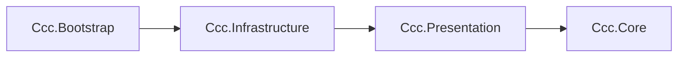

# CCC実装における設計原則

> [ドキュメント一覧](../README.md) / 区分: 設計原則

---

## 1. 依存方向の一方向化（単一方向依存の徹底）

- 矢印は参照可能な依存方向（依存先）を示す。
- 外側に位置するアセンブリは、より内側に位置する必要なアセンブリを直接参照できるが、**逆方向（内側から外側）の参照は厳禁**とする。
- プロダクションコードにおけるアセンブリ（asmdef）は、`Ccc.Core`、`Ccc.Presentation`、`Ccc.Infrastructure`、`Ccc.Bootstrap` の4つで構成すること。

---

## 2. Model層の責務と制約

- **標準C#の維持**: `Ccc.Core.Model` 名前空間は、純粋な標準C#コードのみで構築すること。
- **外部要素の排除**: 画面表示文字列、Scene、GameObject、システム時刻取得、乱数生成などの処理は、すべて外側のアセンブリに委ねること。
- **不変値オブジェクト**: 値オブジェクトはインスタンス生成時に不正値を拒否（例外送出）し、状態を変更できない不変型（Immutable）として設計すること。
- **シリアライズとモデルの分離**: Unityのシリアライズ対象（`ScriptableObject`等）は Infrastructure層に、純粋なC#モデルは Core層に定義すること。
- **スナップショットと状態遷移**: `GameplayState` はセッション進行状態の不変スナップショットであり、次の State への遷移処理は Reducer が担当すること。
- **入力状態の保持**: プレイヤーが編集中の計算式データは `ExpressionInput` が管理すること。

---

## 3. Core.Logicの同期性・決定性の担保

- **純粋関数的な状態遷移**: `GameplayReducer` は「計算式の提出」「時間切れ」「演出完了」「次Missionの提示」などのセッション遷移を扱い、同一の State と Command の組み合わせに対して**常に全く同じ Transition（結果）を同期的に返却すること**。
- **有理数計算の採用**: 数式評価および Mission 条件判定の内部基準値には、浮動小数点数誤差を防ぐため `Rational`（有理数型）を使用すること。
- **副作用の隔離**: 時刻取得や乱数生成などの副作用を伴う処理は `Ccc.Core.UseCases` 層が担当すること。
- **乱数供給のインターフェース化**: Mission抽選 Strategy は `IRandomSource` から 0以上1未満の `float` 値を取得し、`Ccc.Core.Logic` の重み付き / 一様インデックス選択処理へ渡すこと。
- **View用表示データの保持**: UI表示用の文字列、カラーコード、アニメーション名などは Presentation層の DTO が保持すること。

---

## 4. 副作用の境界隔離

- **リアクティブ配信（R3）**: R3 による状態・イベントの配信処理は `Ccc.Core.UseCases` 以降の層で行うこと。
- **非同期演出待機（UniTask）**: UniTask を用いた演出待機や非同期処理は Presentation層以降で行うこと。
- **Unity機能との非結合**: Input System、DOTween、`ScriptableObject`、および `MonoBehaviour` での `[Inject]` 属性指定は Infrastructure層に閉じ込めること。
- **コンストラクタインジェクション**: 通常の pure C# クラスにはコンストラクタインジェクションを採用すること。
- **VContainerの範囲**: VContainer による依存関係の登録、ライフタイム選択、EntryPoint 登録は Bootstrap層が集中して扱うこと。`Core` および `Presentation` 層は VContainer を直接参照しないこと。

---

## 5. Mission抽選の実装スコープ

- **プロダクション設定**: 本番動作時は `FullMissionDrawStrategy` を使用すること。
- **開発確認用設定**: `FixedMissionDrawStrategy` は開発・デバッグ時の動作検証用として使用すること。
- **必須対応範囲**: Normalモード、LifeEndlessモード、Tier 1〜2、および本実装版 Mission 抽選ロジックを完成範囲とすること。
- **将来の拡張点**: Tier 3〜4、Mission候補の自動生成、`NegatedMission`候補のカタログ供給、および複合 Mission は、将来の拡張ポイントとして設計を確保すること。

---

## 6. 命名規則

詳細については [命名規則](../project/naming-conventions.md) を参照すること。

---

## 7. クラス設計ドキュメントの記載要件（完成条件）

各クラスの設計仕様を記述する章には、少なくとも以下の項目を明記すること。

1. **配置情報**: 配置ファイルパス、アセンブリ（asmdef）、および名前空間。
2. **型定義（Signature）**: 公開型（public class/struct/interface）、コンストラクタ、プロパティ、メソッドのシグネチャ。
3. **入力と例外**: 正常な入力値、不正な入力値、および発生し得る例外型と `ParamName`。
4. **不変条件・状態遷移**: オブジェクトが保持すべき不変条件と状態遷移のルール。
5. **通知仕様**: 外部へ通知する値および通知の実行順序。
6. **ライフサイクル管理**: 所有権（Ownership）、ライフタイム（Lifetime）、および `Dispose` 呼び出し後の動作。
7. **DI仕様**: DI対象クラスの場合のみ、公開API直後にDIブロックを設け、Scope、Lifetime、解決される型、登録時期、登録コード例を記載すること。（※DI対象外クラスにはDIブロックを設けない）
8. **具体的な適用例**: 具体的コード例またはシーケンス図。
9. **実装上の制約**: 実装側の自由裁量範囲と禁止事項。
10. **受け入れ条件**: 外部から観測可能なテスト可能な受け入れ条件。
11. **一元管理リンク**: 値や文言の定義を別ドキュメントに委ねる場合の直接リンク。

> **明確な境界定義の重要性**  
> 単に「〜を担当する」「不正値を拒否する」といった曖昧な記述で終わらせず、呼び出し側が条件分岐を正確に実装できるよう、戻り値・送出例外・無視条件まで確定させること。一方で、`private` ヘルパーメソッド名、内部コレクションの選定、公開挙動に影響を与えない局所的な最適化手法などは固定せず、実装者に委ねること。

---

## 8. AIコンテキストへの適用単位

複雑でないクラスを実装依頼する場合、そのクラスの解説章のみをコンテキストに含めれば実装可能な状態を目指すこと。複数クラスが相互に協調する場合は、対象の章と、章内で直接リンクされている参照ページをまとめて含めること。

> **AIプロンプト作成時の必須記載項目**
> - 対象クラスおよび該当章
> - 参照を許可する直接リンク一覧
> - プロトスプリントリーグ版における必須実装範囲
> - 変更を許可する対象ファイル一覧
> - 実装完了時に確認すべき受け入れ条件

※ 仕様書に記載のないプロダクト値、画面文言、Mission候補等をAIが独自に推測・補完して追加させないこと。リンク先で未決定事項がある場合は、勝手な既定値を設けず「実装を停止して確認すべき境界」として報告させること。また、既存の不整合は明確な解消指示がない限り、一方へ統合しないこと。

---

## 9. 公開契約と実装の自由裁量

### 9.1 公開契約として固めるべき事項（変更不可）
- 型およびメンバーの名前、引数、戻り値の型。
- 例外型、ならびに Result 型の成功 / 失敗判定条件。
- State（状態）および Event（イベント）の発生順序。
- 乱数消費回数、コレクションの順序、境界区間など、結果の再現性に影響を与える規則。
- Scene / Scope / Session を跨ぐオブジェクトの所有権（Ownership）。

### 9.2 実装側に委ねる事項（自由裁量）
- `private` メソッドの分割方法。
- 同等の計算量と順序性を保つ内部コレクションの選択。
- ログメッセージの細かな文言。
- XML ドキュメントコメント、ローカル変数名。
- 公開挙動を変更しない範囲での防御的最適化。

> **アンチパターンの防止**  
> 自由裁量として認めた事項を、安易に新しい公開APIとして増やさないこと。仕様に規定されていないフォールバック（fallback）、`static Singleton`、`Service Locator`、および暗黙的なクラムピング（`Mathf.Clamp`等）を実装に追加することは禁止する。
