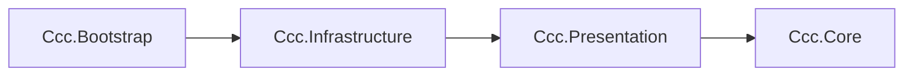

# CCC実装における設計原則

> [ドキュメント一覧](../README.md) / 区分: 設計原則
>
> 正本: [Cosense「CCC実装における設計原則」](https://scrapbox.io/proto-TeamL/CCC%E5%AE%9F%E8%A3%85%E3%81%AB%E3%81%8A%E3%81%91%E3%82%8B%E8%A8%AD%E8%A8%88%E5%8E%9F%E5%89%87)
> 取得時点の原文更新日時: 2026-08-28T23:45:16.000Z

### 1 依存方向を一方向にする

矢印は参照可能な依存先を表す。外側のassemblyは必要な内側のassemblyを直接参照できるが、逆方向の参照は禁止する。製品コードのasmdefは`Ccc.Core`、`Ccc.Presentation`、`Ccc.Infrastructure`、`Ccc.Bootstrap`の4つとする。

### 2 Modelの責務

- `Ccc.Core.Model`名前空間は標準C#で構成する。
- 表示文字列、Scene、GameObject、時間取得、乱数生成は外側のassemblyが所有する。
- 値オブジェクトは生成時に不正値を拒否する不変型とする。
- Unityのシリアライズ対象はInfrastructure、純C# ModelはCoreに定義する。
- `GameplayState`はSession進行の不変スナップショットであり、次StateはReducerが生成する。
- 編集中の式は`ExpressionInput`が保持する。

### 3 Core.Logicは同期かつ決定的にする

- `GameplayReducer`は提出、時間切れ、演出完了、次Mission提示のSession遷移を扱い、同じStateとCommandから必ず同じTransitionを返す。
- 式評価とMission判定の基準値には`Rational`を使用する。
- 時刻取得と乱数生成は`Ccc.Core.UseCases`が担当する。
- Mission抽選Strategyが`IRandomSource`から0以上1未満の`float`を取得し、`Ccc.Core.Logic`の重み付き／一様Index選択へ渡す。
- View向けの文言、色、Animation名はPresentation DTOが保持する。

### 4 副作用は外側へ閉じ込める

- R3による状態・Event配信は`Ccc.Core.UseCases`以降で行う。
- UniTaskによる演出待機はPresentation以降で行う。
- InfrastructureがInput System、DOTween、ScriptableObjectとMonoBehaviourの`[Inject]`メソッドを扱う。
- 通常classはコンストラクタインジェクションを使用する。
- BootstrapがVContainerの依存登録、Lifetime選択、EntryPoint登録を扱う。
- CoreとPresentationはVContainerを参照しない。

### 5 プロトスプリントリーグ版の実装範囲

- 製品設定は`SimpleMissionDrawStrategy`を使用する。
- `FixedMissionDrawStrategy`は開発確認用に使用する。
- 完成範囲はNormal、LifeEndless、Tier 1〜2、簡易版Mission抽選である。
- Tier 3〜4、本実装版抽選、NegatedMission、複合Missionは拡張点として扱う。

### 6 命名規則

[命名規則](../project/naming-conventions.md)を参照

### 7 クラス設計ページの完成条件

実装対象classの章は、少なくとも次を含める。

- 配置file、assembly、namespace。
- public型、constructor、property、methodのsignature。
- 正常入力、不正入力、例外型とParamName。
- 不変条件と状態遷移。
- 外部へ通知する値と通知順。
- ownership、lifetime、Dispose後の挙動。
- DI対象classだけは公開API直後にDIブロックを置き、Scope、Lifetime、解決型、登録時期、登録例を書く。DI対象外にはDI記述を足さない。
- 具体例またはSequence。
- 実装側の自由裁量と禁止事項。
- 観測可能な受け入れ条件。
- 値や文言を別正本へ委ねる場合の直接リンク。

「責務を担当する」「不正値を拒否する」だけで終わらせず、呼び出し側が分岐を実装できる戻り値、例外、無視条件まで確定する。一方、private helper名、内部Collection、公開挙動へ影響しない最適化は固定しない。

### 8 AIへ渡す単位

複雑でないclassは、そのclassの章だけを渡して実装可能な状態を目標とする。複数classの協調が必要な場合は、対象章と章内で直接リンクされたページを渡す。

AIへの実装依頼には次を含める。

- 対象class／章。
- 参照を許可する直接リンク。
- プロトスプリントリーグ版の必須範囲。
- 変更してよいfile。
- 完了時に確認する受け入れ条件。

章にない製品値、画面文言、Mission候補をAIが推測して追加しない。直接リンク先で未決定なら、勝手な既定値ではなく実装を止める境界として報告する。既存の矛盾は、解消依頼がない限り一方へ統合しない。

### 9 公開契約と実装自由度

公開契約として固定するもの：

- 型とmemberの名前、引数、戻り値。
- 例外型、Resultの成功／失敗条件。
- State／Eventの順序。
- 乱数消費回数、Collection順、境界区間など再現性へ影響する規則。
- Scene／Scope／Sessionをまたぐownership。

実装側へ任せるもの：

- private methodの分割。
- 同じ計算量と順序を保つ内部Collection。
- log messageの細かな文面。
- XML comment、局所変数名。
- 公開挙動を変えない防御的な最適化。

自由裁量にした事項を別の公開APIとして増やさない。仕様にないfallback、static Singleton、Service Locator、暗黙clampを追加しない。
