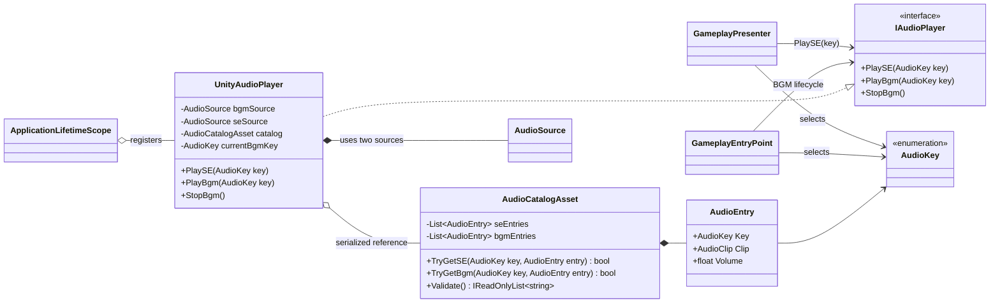
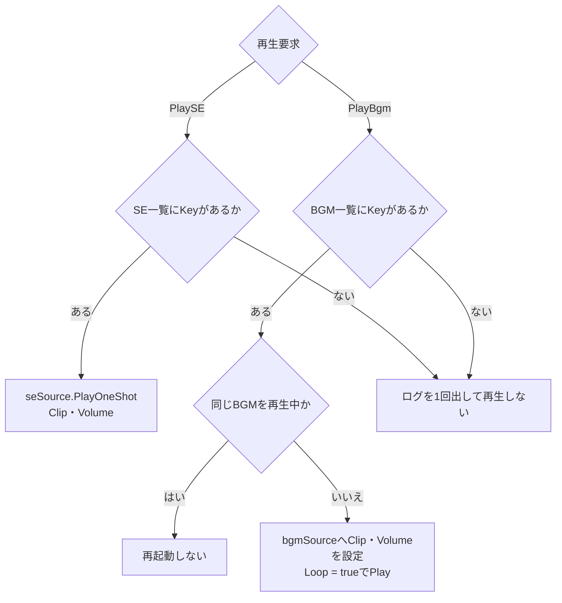
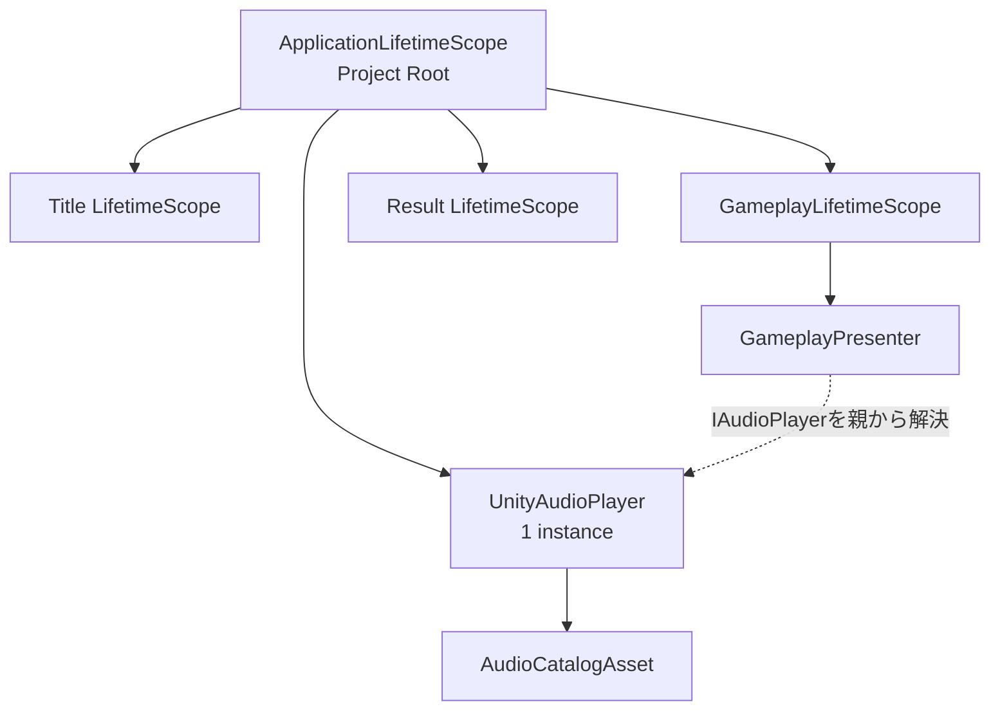

# CCC UnityAudioクラス設計

> [ドキュメント一覧](../../README.md) / 区分: クラス設計
>
> 正本: [Cosense「CCC UnityAudioクラス設計」](https://scrapbox.io/proto-TeamL/CCC%20UnityAudio%E3%82%AF%E3%83%A9%E3%82%B9%E8%A8%AD%E8%A8%88)
> 取得時点の原文更新日時: 2026-08-28T23:41:54.000Z

> 対象：SE／BGMの指定、Unity Audio再生、Clip設定、DI lifetime

## 1. 目的

Audioの責務を、ゲーム上の再生判断とUnity上の再生処理へ分離する。

- PresenterまたはEntryPointが「いつ、どの音を鳴らすか」を`AudioKey`で指定する。
- `IAudioPlayer`はSE再生、BGM再生、BGM停止を受け付ける出力ポートとする。
- `UnityAudioPlayer`はSE／BGMそれぞれのKeyから設定を検索し、対応する`AudioSource`で再生する。
- `AudioCatalogAsset`はKeyとSE／BGM用`AudioClip`の紐付けをUnity Editorで編集可能にする。

## 2. 設計判断

KeyとClipの紐付けにはScriptableObjectを使用する。

理由：

- Clipの差し替えをコード変更なしで行える。
- Audio担当者がInspector上で設定できる。
- Key重複、Clip欠落、音量範囲をSession開始前に検証できる。
- Presenterは`AudioClip`や`AudioSource`を参照せず、意味のあるEnumだけを指定できる。
- Title、Gameplay、Resultで同じCatalogを共有できる。

JSONやResourcesの文字列Keyは使用しない。プロトスプリントリーグ版では、SE一覧とBGM一覧を持つ単一の`AudioCatalogAsset`と、BGM用／SE用の2つの`AudioSource`で構成する。SEはすべて`PlayOneShot`で再生し、BGMはLoop再生する。

## 3. Assemblyと名前空間

| 型 | assembly／名前空間 | 理由 |
| --- | --- | --- |
| `AudioKey` | `Ccc.Presentation.Audio` | Presenter／EntryPointが指定する表示・演出上の意味 |
| `IAudioPlayer` | `Ccc.Presentation.Audio` | Presentationから外側へ向けた出力ポート |
| `AudioEntry` | `Ccc.Infrastructure.Audio` | `AudioClip`を含むUnity用設定 |
| `AudioCatalogAsset` | `Ccc.Infrastructure.Audio` | Inspector編集用ScriptableObject |
| `UnityAudioPlayer` | `Ccc.Infrastructure.Audio` | `AudioSource`を扱うMonoBehaviour実装 |
| `ApplicationLifetimeScope` | `Ccc.Bootstrap` | 全画面から同じAudio instanceを解決するComposition Root |

依存方向は`Bootstrap -> Infrastructure -> Presentation`とする。`Ccc.Core`はAudio関連型を参照しない。

## 4. クラス関係



`GameplayPresenter`はGameplay Eventや入力に応じてKeyを選ぶ。BGMは各画面のEntryPointまたはPresenterが画面開始時に選び、Gameplayでは`GameplayEntryPoint`が担当する。

## 5. 公開API

### 5.1 AudioKey

```csharp
namespace Ccc.Presentation.Audio;

public enum AudioKey
{
    None = 0,

    BgmTitle,
    BgmGameplay,
    BgmResult,

    SEUIInput,
    SEMissionPresented,
    SESubmit,
    SESuccess,
    SEFailure,
    SETimeWarning,
    SEGameOver
}
```

- Key名は`Bgm`または`SE`で始め、Inspector上でも用途を判断可能にする。
- `None`は未設定値であり、Catalogへの登録と`PlaySE`／`PlayBgm`への指定を禁止する。
- 同じClipを複数Keyへ割り当てることは許可する。
- コードはClip名やAsset pathを参照しない。

### 5.2 IAudioPlayer

```csharp
namespace Ccc.Presentation.Audio;

public interface IAudioPlayer
{
    void PlaySE(AudioKey key);
    void PlayBgm(AudioKey key);
    void StopBgm();
}
```

`PlaySE`はCatalogのSE一覧、`PlayBgm`はBGM一覧からKeyを検索する。呼び出し側は`AudioSource`、Clip、Volumeを知らない。

`PlaySE`と`PlayBgm`は再生要求を同期的に受け付ける。演出進行はAudioの再生完了を待たない。再生完了待ちが必要になった場合は、既存APIを変更せず別の演出用APIとして追加する。

## 6. ScriptableObject設計

### 6.1 AudioCatalogAsset

```csharp
namespace Ccc.Infrastructure.Audio;

[CreateAssetMenu(menuName = "CCC/Audio Catalog")]
public sealed class AudioCatalogAsset : ScriptableObject
{
    [SerializeField]
    private List<AudioEntry> seEntries;

    [SerializeField]
    private List<AudioEntry> bgmEntries;

    public bool TryGetSE(AudioKey key, out AudioEntry entry);
    public bool TryGetBgm(AudioKey key, out AudioEntry entry);
    public IReadOnlyList<string> Validate();
}
```

### 6.2 AudioEntry

```csharp
[Serializable]
public sealed class AudioEntry
{
    [SerializeField]
    private AudioKey key;

    [SerializeField]
    private AudioClip clip;

    [SerializeField, Range(0f, 1f)]
    private float volume = 1f;

    public AudioKey Key => key;
    public AudioClip Clip => clip;
    public float Volume => volume;
}
```

Catalogの検証条件：

- `AudioKey.None`が登録されていない。
- SE一覧とBGM一覧をまたいでKeyが重複していない。
- 実際に使用する全Keyが1件ずつ登録されている。
- `AudioClip`がnullではない。
- Volumeが0以上1以下であり、`NaN`または無限大ではない。
- `SE`接頭辞のKeyはSE一覧、`Bgm`接頭辞のKeyはBGM一覧へ登録されている。

検証エラーは一覧で返す。起動時にエラーをログへ出し、該当Keyの再生を行わない。Audio設定不正によってGameplayのCore進行は停止させない。

## 7. UnityAudioPlayer

```csharp
namespace Ccc.Infrastructure.Audio;

public sealed class UnityAudioPlayer : MonoBehaviour, IAudioPlayer
{
    [SerializeField]
    private AudioCatalogAsset catalog;

    [SerializeField]
    private AudioSource bgmSource;

    [SerializeField]
    private AudioSource seSource;

    private AudioKey currentBgmKey;

    public void PlaySE(AudioKey key);
    public void PlayBgm(AudioKey key);
    public void StopBgm();
}
```

#### DI

Application Rootの1 componentを`IAudioPlayer`として登録する。LifetimeはApplication固定。

```csharp
builder.RegisterComponent(audioPlayer)
   .As<IAudioPlayer>();
```

子Scopeへ再登録しない。Presenter／EntryPointはconstructorで`IAudioPlayer`を受ける。

再生処理：



- SEは`AudioSource.PlayOneShot`で再生し、複数SEの重なりを許可する。
- BGMは専用`AudioSource`を使用し、常にLoop再生する。LoopしないジングルはSEとして登録する。
- 同じBGM Keyが再指定された場合は先頭から再生し直さない。
- 別BGM Keyが指定された場合は現在BGMを停止して切り替える。
- プロトスプリントリーグ版ではフェード、SE pool、同時発音数制限を実装範囲に含めない。

## 8. 再生判断の担当

Audio固有のEventはCoreへ追加しない。既存の論理Event、View入力、画面lifecycleをPresentation側でAudioKeyへ変換する。

| タイミング | 判断するクラス | 入力 | 指定するKey |
| --- | --- | --- | --- |
| Title開始 | TitleのPresenter／EntryPoint | 画面開始 | `PlayBgm(BgmTitle)` |
| Gameplay開始 | `GameplayEntryPoint` | Gameplay scope開始 | `PlayBgm(BgmGameplay)` |
| Result開始 | ResultのPresenter／EntryPoint | Result画面開始 | `PlayBgm(BgmResult)` |
| 数字・演算子操作 | `GameplayPresenter` | `GameplayInput` | `PlaySE(SEUIInput)` |
| Submit操作 | `GameplayPresenter` | Submit入力 | `PlaySE(SESubmit)` |
| Mission提示 | `GameplayPresenter` | `MissionPresentedEvent` | `PlaySE(SEMissionPresented)` |
| 成功確定 | `GameplayPresenter` | 成功した`SubmissionResolvedEvent` | `PlaySE(SESuccess)` |
| 失敗確定 | `GameplayPresenter` | 失敗した`SubmissionResolvedEvent` | `PlaySE(SEFailure)` |
| 残り3秒以下への到達 | `GameplayPresenter` | `SectionTimerSnapshot` | `PlaySE(SETimeWarning)` |
| Session終了 | `GameplayPresenter` | `SessionEndedEvent` | `PlaySE(SEGameOver)` |

`SETimeWarning`は同じMissionId・同じ整数秒で1回だけ鳴らす。Timer Snapshotが同じ秒に複数届いても再生しない。新しいMissionIdで警告済み秒をリセットする。

入力音はPresenterがView入力を受けてControllerへ渡す箇所で再生する。Transitioning中はViewを操作不可表示にし、Controllerが拒否する状態で入力音を鳴らさない。

## 9. DIとlifetime

BGMをTitle、Gameplay、Resultで共有するため、`UnityAudioPlayer`はProject Rootの`ApplicationLifetimeScope`へ1 instance登録する。各画面のLifetimeScopeはその子Scopeとし、`IAudioPlayer`を親から解決する。



```csharp
public sealed class ApplicationLifetimeScope : LifetimeScope
{
    [SerializeField]
    private UnityAudioPlayer audioPlayer;

    protected override void Configure(IContainerBuilder builder)
    {
        builder.RegisterComponent(audioPlayer)
            .AsImplementedInterfaces();
    }
}
```

- `ApplicationLifetimeScope` prefabをVContainerSettingsのRoot Lifetime Scopeへ設定する。
- `UnityAudioPlayer`と2つの`AudioSource`を同じRoot prefabへ配置する。
- Presenterはconstructorで`IAudioPlayer`を受け取る。
- `AudioManager.Instance`、static accessor、`FindObjectOfType`を使用しない。
- AudioPlayerはGameplay Eventを自分で購読しない。

## 10. Presenterとの接続例 （高草木等が担当）

```csharp
public sealed class GameplayPresenter : IDisposable
{
    private readonly IGameplayFlow flow;
    private readonly IGameplayView view;
    private readonly IAudioPlayer audio;

    public GameplayPresenter(
        IGameplayFlow flow,
        IGameplayView view,
        IAudioPlayer audio)
    {
        this.flow = flow;
        this.view = view;
        this.audio = audio;
    }

    private void HandleEvent(GameplayEvent gameplayEvent)
    {
        switch (gameplayEvent)
        {
            case MissionPresentedEvent:
                audio.PlaySE(AudioKey.SEMissionPresented);
                break;

            case SubmissionResolvedEvent e when e.Resolution.IsSuccess:
                audio.PlaySE(AudioKey.SESuccess);
                break;

            case SubmissionResolvedEvent:
                audio.PlaySE(AudioKey.SEFailure);
                break;

            case SessionEndedEvent:
                audio.PlaySE(AudioKey.SEGameOver);
                break;
        }
    }
}
```

AudioのためにView契約を増やさない。

## 11. 実装範囲

プロトスプリントリーグ版で実装するもの：

- `AudioKey`
- `IAudioPlayer`
- `AudioCatalogAsset`／`AudioEntry`
- `UnityAudioPlayer`
- BGM用／SE用`AudioSource`
- Presenter／EntryPointからのKey指定
- Catalog Validation

後から必要に応じて追加するもの：

- BGMクロスフェード
- AudioMixerの設定画面連携
- SE同時発音数制限
- 3D Audio
- AddressablesによるClip読み込み
- Audio再生完了待ち

## 12. 受け入れ条件

- 呼び出し側が`PlaySE(AudioKey)`、`PlayBgm(AudioKey)`、`StopBgm()`で再生を制御できる。
- KeyとClip、Volumeの対応をSE一覧／BGM一覧としてInspectorで編集できる。
- Audio設定不正を起動時に一覧で検出できる。
- Presenter／EntryPointが再生タイミングとKeyを決定する。
- `UnityAudioPlayer`はゲームルールやGameplay Eventの意味を判断しない。
- Coreが`AudioKey`、`AudioClip`、`AudioSource`を参照しない。
- 同じAudio instanceを子LifetimeScopeから`IAudioPlayer`として解決できる。
- static Singletonを使用しない。

## 13. 実装パケット

### 13.1 ファイル配置

| 型 | 配置 |
| --- | --- |
| `AudioKey`、`IAudioPlayer` | `Assets/CCC/Scripts/Presentation/Audio/` |
| `AudioEntry`、`AudioCatalogAsset`、`UnityAudioPlayer` | `Assets/CCC/Scripts/Infrastructure/Audio/` |
| `ApplicationLifetimeScope` | `Assets/CCC/Scripts/Bootstrap/` |

1 public型1ファイルを基本とし、ファイル名を型名と一致させる。`AudioEntry`だけはAudioCatalogAsset.csと同居してもよい。

### 13.2 UnityAudioPlayerの初期化と失敗契約

Awakeでcatalog、bgmSource、seSourceのnullを検証する。Inspector参照欠落は`InvalidOperationException`として起動を失敗させ、名前検索、GetComponent自動取得、Resources.Loadで補わない。2つのAudioSourceが同一instanceなら`InvalidOperationException`。

Catalogの`Validate()`は全項目を最後まで確認し、入力順のエラー配列を返す。UnityAudioPlayerは起動時に全エラーを各1回ログへ出すが、正常entryの再生は許可する。Catalog全体の不正でGameplay Flowを止めない。

Play method：

- `AudioKey.None`、種別違い、未登録、null Clipは例外にせず、Keyと理由をWarningへ1回だけ記録して再生しない。
- 同じ不正Keyを繰り返しても同じ理由のWarningを増やさない。
- PlaySEは`seSource.PlayOneShot(entry.Clip, entry.Volume)`。
- PlayBgmは別Keyまたは停止中なら、Stop、Clip設定、Volume設定、Loop true、Playの順。
- 同じKeyかつ`bgmSource.isPlaying == true`なら何もしない。
- StopBgmはStop後にclipをnull、currentBgmKeyをNoneへ戻す。停止済みでも安全。
- 公開methodはUnity main threadから呼ぶ。async処理を開始しない。

AudioSourceの基本volumeは1とし、entry.Volumeを最終再生volumeとして使う。seSource側のvolumeとPlayOneShotのvolumeScaleを二重適用しない。

### 13.3 Catalog検索契約

`TryGetSE`／`TryGetBgm`はNone、種別違い、未登録でfalseとし、out entryはnull。重複Keyがある不正Catalogでは最初のentryを返すが、Validateで必ず重複エラーを報告する。

検索をDictionaryへcacheするかListを線形探索するかは自由とする。ただしInspectorでCatalogが変更されたEditor再生開始時に古いcacheを再利用しない。Asset自体へScene依存の状態やAudioSourceを持たせない。

### 13.4 Audio接続の順序

- Title EntryPoint：View接続後にBgmTitle。
- GameplayEntryPoint：Config／Catalog／Session開始成功後にBgmGameplay。
- Result表示：GameScreenModelがResultへ切り替わった後にBgmResult。
- MainMenu復帰：TitleScene起動後にBgmTitle。ロード前にBGMを止めて無音区間を作らない。
- Session終了SE：BgmResultへ切り替える前にSEGameOverを1回。

SETimeWarningの重複抑止状態はGameplayPresenterが`MissionId + 整数残り秒`で保持する。UnityAudioPlayerはTimer、MissionId、Gameplay Eventを参照しない。

### 13.5 Audio受け入れ条件

- Audio関連型と接続はプロトスプリントリーグ版の必須実装範囲に含まれる。
- 正常KeyのSEとBGMをInspector割当どおり再生できる。
- 同じBGMの再指定で先頭へ戻らない。
- Stop後の同じBGM指定では再生を開始する。
- 不正Key／設定でCore進行が止まらず、Warningが無限に増えない。
- Title、Gameplay、Resultで同じIAudioPlayer instanceを使用する。
- Scene往復後もAudioSourceが重複生成されない。
- AudioPlayerがGameplay Eventを購読せず、Presenter／EntryPointがKeyを決める。
