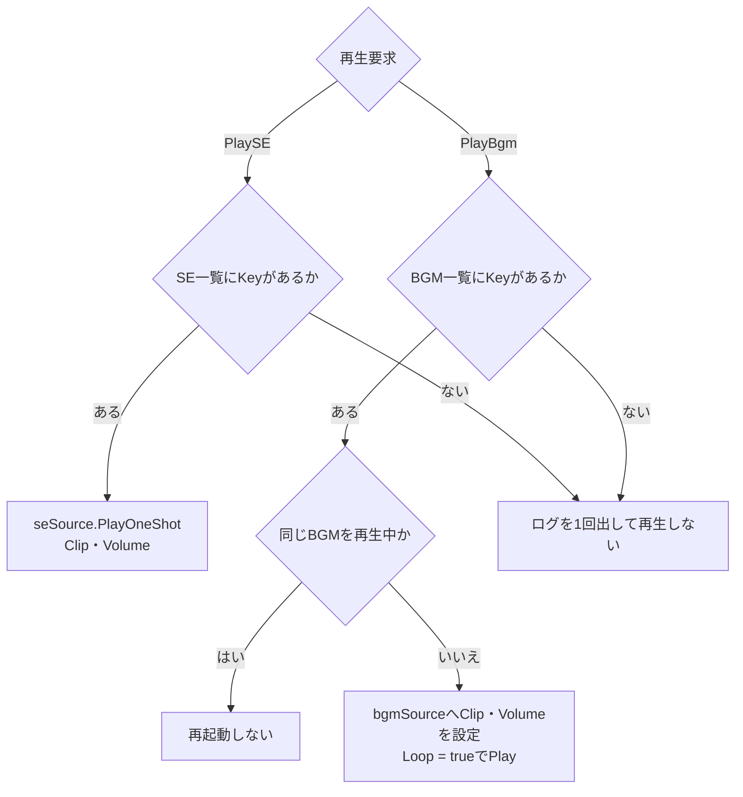
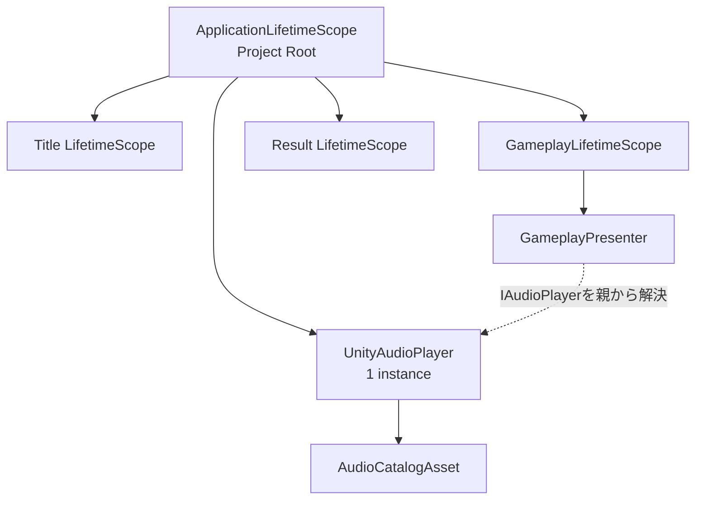

# CCC Unity Audio クラス設計

> [ドキュメント一覧](../../README.md) / 区分: クラス設計

> **対象範囲**: SE / BGM の指定、Unity Audio 再生処理、Clip 設定、DI ライフタイム管理

---

## 1. 目的

オーディオ（Audio）の責務を、「ゲーム上の再生トリガー判断（いつ、どの音を鳴らすか）」と「Unity上の実際の再生処理」に明確に分離すること。

- Presenter、EntryPoint、または Title 画面の操作に対応する SE 再生クラス（`TitleScreenTransitionSoundPlayer` / `TitleSelectorChangeSoundPlayer`）がサウンドの再生タイミングにおいて `AudioKey` を指定すること。
- `IAudioPlayer` は SE再生、BGM再生、BGM停止を受け付ける出力ポート（インターフェース）を提供すること。
- `UnityAudioPlayer` は SE / BGM の各 Key から対応する設定を検索し、適切な `AudioSource` を使用して再生処理を行うこと。
- `AudioCatalogAsset` は `AudioKey` と実際の `AudioClip` の紐付けを Unity Inspector 上で安全に編集・設定可能とすること。

---

## 2. 設計方針・判断理由

Key と `AudioClip` の紐付け管理には `ScriptableObject` を採用する。

> **採用理由**
> - スクリプトコードの変更なしに Inspector 上で Sound Assets（AudioClip）の差し替えが可能。
> - オーディオ担当者が Inspector 上で直感的にボリュームやアセットの設定・調整を行える。
> - Key の重複、Clip の割り当て欠落、音量範囲の異常などをセッション開始前に事前検証できる。
> - Presenter は `AudioClip` や `AudioSource` などの Unity API 型に依存せず、意味を持つ enum（`AudioKey`）のみを指定できる。
> - Title、Gameplay、Result などの各画面で同一のカタログアセットを共有可能。

※ JSON や Resources による文字列指定の Key は採用しない。  
※ プロトスプリントリーグ版では、SE一覧およびBGM一覧を保持する単一の `AudioCatalogAsset` と、BGM用・SE用の2つの `AudioSource` コンポーネントで構成する。SEはすべて `PlayOneShot` で重ねて再生し、BGMはループ再生（Loop = true）すること。

---

## 3. アセンブリと名前空間

| 型名 | 配置アセンブリ / 名前空間 | 役割・分類の理由 |
| --- | --- | --- |
| `AudioKey` | `Ccc.Presentation.Audio` | Presenter / EntryPoint / SE 再生クラスが指定する演出上の意味的なサウンド識別子 |
| `IAudioPlayer` | `Ccc.Presentation.Audio` | Presentation層から外部へ向けたサウンド再生の出力ポート |
| `AudioEntry` | `Ccc.Infrastructure.Audio` | `AudioClip` や音量設定を含む Unity 依存の設定構造 |
| `AudioCatalogAsset` | `Ccc.Infrastructure.Audio` | Inspector 編集用の `ScriptableObject` 実装 |
| `UnityAudioPlayer` | `Ccc.Infrastructure.Audio` | `AudioSource` を操作する `MonoBehaviour` 具象クラス |
| `ApplicationLifetimeScope` | `Ccc.Bootstrap` | 全画面で同一の Audio インスタンスを解決・提供する Composition Root |

※ 依存関係の方向は `Bootstrap` → `Infrastructure` → `Presentation` とすること。`Ccc.Core` は Audio 関連の型を一切参照しない。

---

## 4. クラス関係図


- `GameplayPresenter` は Gameplay イベントやプレイヤー入力に応じて適切な `AudioKey` を選択する。
- BGM の選定・制御は、各画面の EntryPoint または Presenter が画面遷移タイミングで行い、Gameplay 画面では `GameplayEntryPoint`、Title 画面では `TitleEntryPoint` が担当する。
- Title 画面内の遷移 SE は `TitleScreenTransitionSoundPlayer` が `TitleScreenModel.ScreenTransitioned` の遷移方向から選択する。詳細は [画面遷移クラス設計](../presentation/scene-navigation.md#73-titlescreentransitionsoundplayer) を参照すること。
- Title 画面の難易度・音量の change SE は `TitleSelectorChangeSoundPlayer` が選択値の切り替えから `SEChangeClick` を選択する。Gameplay の change 操作と同じ Key を用いること。詳細は [画面遷移クラス設計](../presentation/scene-navigation.md#75-titleselectorchangesoundplayer) を参照すること。

---

## 5. 公開API定義

### 5.1 AudioKey (enum)

```csharp
namespace Ccc.Presentation.Audio;

public enum AudioKey
{
    None = 0,

    BgmTitle,
    BgmGameplay,
    BgmResult,

    SEUIInput,
    SEMissionPresented,
    SESubmit,
    SESuccess,
    SEFailure,
    SETimeWarning,
    SEGameOver
}
```

- Key の名称は `Bgm` または `SE` のプレフィックスから始め、Inspector 上でも直感的に用途を識別できるようにすること。
- `None` は未設定状態を表すデフォルト値であり、Catalog への登録や `PlaySE` / `PlayBgm` への指定は禁止とする。
- 同一の `AudioClip` を複数の `AudioKey` に割り当てることは許可する。
- ロジックコードが AudioClip のファイル名やアセットパスを文字列で直接参照しないこと。

### 5.2 IAudioPlayer (interface)

```csharp
namespace Ccc.Presentation.Audio;

public interface IAudioPlayer
{
    void PlaySE(AudioKey key);
    void PlayBgm(AudioKey key);
    void StopBgm();
}
```

- `PlaySE` は Catalog の SE 一覧から、`PlayBgm` は BGM 一覧から該当する Key を検索して再生すること。呼び出し側は `AudioSource` や `AudioClip`、Volume などの詳細を知る必要はない。
- `PlaySE` および `PlayBgm` は再生要求を同期的に受け付けること。画面演出の進行はサウンドの再生完了をブロックして待たない。

---

## 6. ScriptableObject の設計仕様

### 6.1 AudioCatalogAsset

```csharp
namespace Ccc.Infrastructure.Audio;

[CreateAssetMenu(menuName = "CCC/Audio Catalog")]
public sealed class AudioCatalogAsset : ScriptableObject
{
    [SerializeField]
    private List<AudioEntry> seEntries;

    [SerializeField]
    private List<AudioEntry> bgmEntries;

    public bool TryGetSE(AudioKey key, out AudioEntry entry);
    public bool TryGetBgm(AudioKey key, out AudioEntry entry);
    public IReadOnlyList<string> Validate();
}
```

### 6.2 AudioEntry

```csharp
[Serializable]
public sealed class AudioEntry
{
    [SerializeField]
    private AudioKey key;

    [SerializeField]
    private AudioClip clip;

    [SerializeField, Range(0f, 1f)]
    private float volume = 1f;

    public AudioKey Key => key;
    public AudioClip Clip => clip;
    public float Volume => volume;
}
```

> **Catalog（アセット）の検証・バリデーション条件**
> - `AudioKey.None` が登録されていないこと。
> - SE一覧および BGM一覧の中で Key が重複して登録されていないこと。
> - アプリケーションで使用するすべての Key がそれぞれ1件ずつ登録されていること。
> - 割り当てられている `AudioClip` が `null` でないこと。
> - `Volume` が 0.0 以上 1.0 以下の正常範囲であり、`NaN` や無限大でないこと。
> - `SE` プレフィックスの Key は SE一覧に、`Bgm` プレフィックスの Key は BGM一覧に正しく分類されていること。

※ 検証エラーは一覧として取得可能にし、アプリケーション起動時にエラーログを出力した上で該当 Key の再生を安全にスキップすること。オーディオ設定の不備によってゲームの中核ロジック（Core）が停止しないように設計すること。

---

## 7. UnityAudioPlayer の実装仕様

```csharp
namespace Ccc.Infrastructure.Audio;

public sealed class UnityAudioPlayer : MonoBehaviour, IAudioPlayer
{
    [SerializeField]
    private AudioCatalogAsset catalog;

    [SerializeField]
    private AudioSource bgmSource;

    [SerializeField]
    private AudioSource seSource;

    private AudioKey currentBgmKey;

    public void PlaySE(AudioKey key);
    public void PlayBgm(AudioKey key);
    public void StopBgm();
}
```

### DI登録
Application Root の単一コンポーネントとして `IAudioPlayer` インターフェースで登録すること。ライフタイムは Application 固定とする。

```csharp
builder.RegisterComponent(audioPlayer)
       .As<IAudioPlayer>();
```

※ 子 Scope に再登録しないこと。Presenter や EntryPoint はコンストラクタ経由で `IAudioPlayer` を受け取ること。

### 再生処理フロー



- SE再生は `AudioSource.PlayOneShot` を使用し、複数の効果音が重なって再生されることを許可すること。
- BGM再生は専用の `AudioSource` を使用し、常にループ再生を行うこと。
- 既に再生中の BGM と同じ `AudioKey` が再指定された場合は、曲を最初から再生し直さずにそのまま再生を維持すること。
- 異なる `AudioKey` の BGM が指定された場合は、現在の BGM を停止して新しい BGM へ速やかに切り替えること。

---

## 8. 再生判断の割り当てマトリクス

Core層に Audio 固有のイベントを設けないこと。既存の論理イベント、View 入力、および画面ライフサイクルを Presentation 側で受けて `AudioKey` へ変換・指定すること。

| 再生タイミング | 判断を行うクラス | 判定のトリガー | 指定する AudioKey |
| --- | --- | --- | --- |
| Title画面開始 | Title の Presenter / EntryPoint | 画面ロード完了 | `PlayBgm(BgmTitle)` |
| Gameplay開始 | `GameplayEntryPoint` | Gameplay Scope 開始 | `PlayBgm(BgmGameplay)` |
| Result画面開始 | Result の Presenter / EntryPoint | Result 画面表示 | `PlayBgm(BgmResult)` |
| 数字・演算子の変更 | `GameplayPresenter` | `GameplayInput` | `PlaySE(SEUIInput)` |
| Submit操作 | `GameplayPresenter` | Submit 入力 | `PlaySE(SESubmit)` |
| Mission提示 | `GameplayPresenter` | `MissionPresentedEvent` | `PlaySE(SEMissionPresented)` |
| 成功確定 | `GameplayPresenter` | 成功の `SubmissionResolvedEvent` | `PlaySE(SESuccess)` |
| 失敗確定 | `GameplayPresenter` | 失敗の `SubmissionResolvedEvent` | `PlaySE(SEFailure)` |
| 残り3秒以下到達 | `GameplayPresenter` | `SectionTimerSnapshot` | `PlaySE(SETimeWarning)` |
| Session終了 | `GameplayPresenter` | `SessionEndedEvent` | `PlaySE(SEGameOver)` |

※ `SETimeWarning` は同一 MissionId・同一整数秒において一度だけ再生すること。タイマー更新スナップショットが同一秒内で複数回届いても重複再生しないこと。

---

## 9. DIとライフタイム設計

BGM を Title、Gameplay、Result の各画面間でシームレスに引き継ぐため、`UnityAudioPlayer` は Project Root の `ApplicationLifetimeScope` に1つのインスタンスとして登録すること。各画面の LifetimeScope はその子 Scope となり、`IAudioPlayer` を親 Scope から解決して利用すること。



```csharp
public sealed class ApplicationLifetimeScope : LifetimeScope
{
    [SerializeField]
    private UnityAudioPlayer audioPlayer;

    protected override void Configure(IContainerBuilder builder)
    {
        builder.RegisterComponent(audioPlayer)
               .AsImplementedInterfaces();
    }
}
```

- `ApplicationLifetimeScope` プレハブを VContainerSettings の Root Lifetime Scope に設定すること。
- `UnityAudioPlayer` と2つの `AudioSource` コンポーネントを同じ Root プレハブ上に配置すること。
- `AudioManager.Instance` や `FindObjectOfType` などの Singleton / グローバルアクセスを使用しないこと。

---

## 10. 受け入れ条件（Acceptance Criteria）

- 呼び出し側が `PlaySE(AudioKey)`、`PlayBgm(AudioKey)`、`StopBgm()` を用いてサウンド再生を制御できること。
- Key と `AudioClip`、Volume の対応関係を Inspector 上で安全に編集・登録できること。
- 設定の不備（Key欠落・Clip未設定等）を起動時に一覧ログとして検出できること。
- `UnityAudioPlayer` がゲームルールや Gameplay イベントの意味を直接判断しないこと。
- `Ccc.Core` が `AudioKey`、`AudioClip`、`AudioSource` を一切参照しないこと。
- static Singleton を使用せず、VContainer 経由で依存関係が正常に注入されること。
