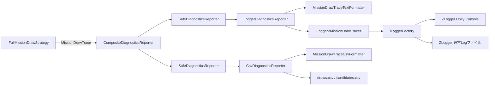

# CCC Log・診断出力クラス設計

> [ドキュメント一覧](../../README.md) / 区分: クラス設計

> **対象範囲**: アプリケーション全体のLog出力構成、UseCaseの構造化診断（Mission抽選Trace）のLog出力とCSV出力、Log設定アセット

---

## 1. 目的

Logと診断の責務を「何を記録するか（UseCase）」と「どう整形し、どこへ出すか（Infrastructure / Bootstrap）」に分離すること。

- UseCaseは、1行で完結するメッセージを `ILogger<T>` へ直接書き込むこと。
- UseCaseは、整形規則や件数設定を伴う構造化診断を不変の診断Traceとして `IDiagnosticsReporter<TTrace>` へ渡すこと。
- Infrastructureは、診断Traceの整形、出力件数の絞り込み、Log／CSVへの書き込みを担当すること。
- Bootstrapは、`LogSettingsAsset` から出力先・出力レベル・ファイル配置を構成すること。

---

## 2. 設計方針・判断理由

- **抽象の再発明をしない**: `Microsoft.Extensions.Logging.Abstractions` の `ILogger<T>` 自体を Core のLogポートとして扱い、独自のLog抽象を設けないこと。
- **構造化診断はTraceで渡す**: 件数・書式・出力先は出力側の関心事とし、UseCaseへ持ち込まないこと。Coreは診断の見せ方を知らないこと。
- **出力先の並列はComposite、横断処理はDecorator**: 対等な出力先（Log、CSV）は `CompositeDiagnosticsReporter<TTrace>` で並べ、例外保護は `SafeDiagnosticsReporter<TTrace>` で各出力先を個別に包むこと。1つの出力先の失敗が他の出力先とUseCaseへ波及しないこと。
- **整形とI/Oの分離**: Formatterは純粋な変換、Reporterは書き込みのみを担当すること。
- **有効・無効はLog設定で決める**: `IsDebugMode` でLoggerを差し替えないこと。出力可否は `LogSettingsAsset` のLogLevel設定とCSV有効設定で決めること。
- **設定はSOを直接参照する**: 設定を使うのはInfrastructureとBootstrapだけであるため、SOから純C#の設定値へ変換する層を設けないこと。SOとそのSerializable設定は読み取り専用プロパティだけを公開し、検証は `LogSettingsAsset.Validate()` に集約すること。
- **出力ProviderとCSVはEditor時のみ**: 実機でのLog出力は未決定のため、出力Provider（Unity Console、通常Logファイル）とCSV ReporterはEditor実行時だけ構成すること。

---

## 3. アセンブリと名前空間

| 型名 | 配置アセンブリ / 名前空間 | 役割 |
| --- | --- | --- |
| `IDiagnosticsReporter<TTrace>` | `Ccc.Core` / `Ccc.Core.UseCases` | UseCaseが診断Traceを渡す出力ポート |
| `MissionDrawTrace` / `CurrentExpressionCandidateGroup` | `Ccc.Core` / `Ccc.Core.UseCases` | Mission抽選1回分の不変の診断Trace |
| `LogSettingsAsset` / `LogCategoryLevelSetting` / `MissionDrawDiagnosticsSetting` | `Ccc.Infrastructure` / `Ccc.Infrastructure.Logging` | Inspectorで編集するLog設定（同一ファイル `LogSettingsAsset.cs` に配置） |
| `DiagnosticsSessionDescriptor` | `Ccc.Infrastructure` / `Ccc.Infrastructure.Logging` | CSV行に付与するSession情報 |
| `CompositeDiagnosticsReporter<TTrace>` / `SafeDiagnosticsReporter<TTrace>` / `LoggerDiagnosticsReporter<TTrace>` / `CsvDiagnosticsReporter<TTrace>` | `Ccc.Infrastructure` / `Ccc.Infrastructure.Logging` | 診断Reporter群 |
| `IDiagnosticsTextFormatter<TTrace>` / `ICsvTraceFormatter<TTrace>` / `CsvTableDefinition` / `CsvLineFormatter` | `Ccc.Infrastructure` / `Ccc.Infrastructure.Logging` | 整形の契約とCSV行の変換 |
| `MissionDrawTraceTextFormatter` / `MissionDrawTraceCsvFormatter` | `Ccc.Infrastructure` / `Ccc.Infrastructure.Logging` | Mission抽選Traceの整形 |
| `MissionCatalogCsvFormatter` | `Ccc.Infrastructure` / `Ccc.Infrastructure.Logging` | MissionCatalog全候補のCSV整形 |
| `LoggerFactoryComposer` / `LoggingRegistrationExtensions` / `MissionDrawDiagnosticsRegistrationExtensions` | `Ccc.Bootstrap` / `Ccc.Bootstrap.Log` | LoggerFactoryの構成と診断ReporterのDI登録 |

配置ファイルは `Assets/CCC/Scripts/Core/UseCases/`、`Assets/CCC/Scripts/Infrastructure/Logging/`、`Assets/CCC/Scripts/Bootstrap/` とする。

---

## 4. クラス関係図



---

## 5. 公開API定義

### 5.1 IDiagnosticsReporter&lt;TTrace&gt;

```csharp
public interface IDiagnosticsReporter<in TTrace>
{
    bool IsEnabled { get; }
    void Report(TTrace trace);
}
```

- 呼び出し側は `IsEnabled` がfalseの場合、Traceの組み立てを省略すること。
- 実装は `Report` で例外を送出してよい。UseCaseへの例外波及の防止は `SafeDiagnosticsReporter<TTrace>` が担当すること。

### 5.2 MissionDrawTrace

- 抽選段階ごとの候補数と選ばれた値、`RankedCandidates`（選択Kindの全候補を目標適合率との差の昇順に並べた一覧）、`PoolSize`、`SelectedCandidate`、`SelectedRank`、および抽選に使用した `GameplayConfig` を保持すること。
- `ExpressionStageCandidateCount` は `SelectedExpressionGroup` に対応する候補数を返すこと（`AllUnlocked` は解放済み候補数）。
- `SelectedRank` は生成時に `RankedCandidates` の先頭 `PoolSize` 件から参照一致で解決した1始まりの順位とすること。
- 入力と例外:
  - `config`、`rankedCandidates`、`selectedCandidate` がnullの場合は `ArgumentNullException`。
  - 候補数が負の場合は `ArgumentOutOfRangeException`（`ParamName` は該当引数名）。
  - `poolSize` が1未満または `rankedCandidates.Count` を超える場合は `ArgumentOutOfRangeException`（`ParamName` は `poolSize`）。
  - `selectedCandidate` がPool内の順位候補に含まれない場合は `ArgumentException`（`ParamName` は `selectedCandidate`）。
- `rankedCandidates` はコピーせず参照を保持する。Strategyは生成後に一覧を変更しないこと。

### 5.3 Reporter群

| 型 | `IsEnabled` | `Report` | 所有権・Dispose |
| --- | --- | --- | --- |
| `CompositeDiagnosticsReporter<TTrace>` | 子のいずれかが有効ならtrue | 有効な子へ登録順に配信 | 子を所有しない |
| `SafeDiagnosticsReporter<TTrace>` | 内側の判定。例外時はfalse | 内側の例外を `LogLevel.Warning` で記録し、伝播させない | 内側を所有しない |
| `LoggerDiagnosticsReporter<TTrace>` | `ILogger<TTrace>.IsEnabled(設定LogLevel)` | テキスト整形結果を設定LogLevelで書き込む | なし |
| `CsvDiagnosticsReporter<TTrace>` | Dispose前ならtrue | 初回報告時に表ごとのファイルをヘッダー付きで作成し、行を追記してFlush | ファイルを所有し、Disposeで閉じる |

`CsvDiagnosticsReporter<TTrace>` の詳細:

- ファイル名は `{SessionId}_{FileSuffix}.csv` とし、`FileMode.CreateNew` で作成すること。同名ファイルが存在する場合は上書きせず `IOException` とすること。
- エンコードはBOMなしUTF-8、改行はCRLFとすること。
- 通し番号は報告ごとに1から加算し、Session識別情報とともに `ICsvTraceFormatter<TTrace>.Format` へ渡すこと。
- Formatterは `(CsvTableDefinition Table, IReadOnlyList<string> Fields)` の行一覧を返すこと。未定義の表への行、または列数と一致しないフィールド数の行は `InvalidOperationException`、Dispose後の `Report` は `ObjectDisposedException` とすること。

### 5.4 Formatter

- `CsvLineFormatter.FormatLine` は区切り文字・引用符・改行を含むフィールドだけを引用符で囲み、引用符を二重化すること（RFC 4180）。nullは空文字として扱うこと。
- 2つのMission抽選Formatterは出力件数（`int`、負数は `ArgumentOutOfRangeException`）だけを受け取り、比率書式や極性名などの補助処理をそれぞれ内部に持つこと。
- `MissionDrawTraceTextFormatter` は見出し3行（抽選概要、段階別の選定結果、選出順位）の後に、`LogCandidateCount` 件と順位候補数の小さい方だけ候補行を出力すること。Pool内の候補には `[Pool]`、選出候補には `[Selected]` を付けること。
- `MissionDrawTraceCsvFormatter` は次の2表を出力すること。数値はカルチャ非依存、比率は小数点以下4桁とすること。

| 表（`FileSuffix`） | 1行の単位 | 列 |
| --- | --- | --- |
| `draws` | 抽選1回 | Session情報（SessionId、ConfigDisplayName、GameMode、Difficulty）、パラメータ（TargetExpressionMatchRatio、TargetExpressionMatchRatioReductionPerSection、MinimumTargetExpressionMatchRatio、MissionParameterSelectionPoolSize、NegatedMissionSelectionWeight、CurrentExpressionSatisfiedMissionSelectionRatio、CurrentTierDrawWeight、LowerTierDrawWeight、TierMinimumSections）、段階（DrawIndex、Section、IsInitialDraw、CurrentTier、EnabledCount、UnlockedCount、SatisfiedCount、UnmatchedCount、SelectedExpressionGroup、ExpressionStageCount、SelectedTier、TierStageCount、SelectedPolarity、PolarityStageCount、RepeatFilteredCount、SelectedKind、KindStageCount、TargetRatioLowerBound、TargetRatioUpperBound、TargetRatio、PoolSize）、選出候補（SelectedRank、SelectedParameterA、SelectedParameterB、SelectedMatchCount、SelectedEvaluatedCount、SelectedRatio、SelectedDifference） |
| `candidates` | 順位上位の候補1件（`CsvCandidateCount` 件まで） | SessionId、DrawIndex、Rank、Tier、Kind、ParameterA、ParameterB、IsNegated、MatchCount、EvaluatedCount、Ratio、Difference、IsInPool、IsSelected |

`draws` と `candidates` は SessionId と DrawIndex で結合できること。`TierMinimumSections` はTier順の開始Sectionを `;` で連結すること。`TargetRatioLowerBound`・`TargetRatioUpperBound` はその抽選で目標式適合割合を選んだ範囲、`TargetRatio` は範囲から選んだ値とすること。`SelectedDifference` と `candidates` の `Difference` は、設定の `TargetExpressionMatchRatio` ではなくその抽選の `TargetRatio` との差とすること。

- `MissionCatalogCsvFormatter` は引数を受け取らず、MissionCatalogの全候補をCatalog内の順序で次の1表へ出力すること。書式は `MissionDrawTraceCsvFormatter` と同じとし、報告の通し番号は行に含めないこと。

| 表（`FileSuffix`） | 1行の単位 | 列 |
| --- | --- | --- |
| `catalog` | Catalog候補1件 | SessionId、CatalogIndex（1始まり）、Tier、Kind、ParameterA、ParameterB、IsNegated、MatchCount、EvaluatedCount、Ratio |

`catalog` は SessionId と、Kind・ParameterA・ParameterB・IsNegated の組で `draws` の選出候補（SelectedKind・SelectedParameterA・SelectedParameterB・SelectedPolarity）および `candidates` と結合できること。

---

## 6. LogSettingsAsset の設計仕様

`[CreateAssetMenu(menuName = "CCC/Log Settings")]` の `ScriptableObject` とし、`ApplicationLifetimeScope` のInspectorから参照すること。

| 区画 | 項目 | 既定値 | 用途 |
| --- | --- | --- | --- |
| Output | `minimumLevel` | `Debug` | 全カテゴリの最低LogLevel |
| Output | `categoryLevelOverrides` | 空 | カテゴリ名接頭辞ごとの最低LogLevel上書き |
| Output | `isUnityConsoleEnabled` | true | Unity Console出力の有効化 |
| Output | `isGeneralFileEnabled` | true | 通常Logファイル出力の有効化 |
| File | `rootDirectoryRelativePath` | `Logs/Ccc` | プロジェクトルートからの出力ルート |
| File | `fileTimestampFormat` | `yyyyMMdd_HHmmss` | ファイル名とSessionIdの日時書式 |
| File | `generalDirectoryName` | `General` | 通常Logの種類別ディレクトリ |
| Diagnostics | `missionDrawDiagnostics.logLevel` | `Debug` | Mission抽選TraceのLog出力レベル |
| Diagnostics | `missionDrawDiagnostics.logCandidateCount` | 10 | Log出力に含める上位候補数 |
| Diagnostics | `missionDrawDiagnostics.isCsvEnabled` | true | CSV出力の有効化 |
| Diagnostics | `missionDrawDiagnostics.csvCandidateCount` | 10 | candidates表に含める上位候補数 |
| Diagnostics | `missionDrawDiagnostics.csvDirectoryName` | `MissionDraw` | CSVの種類別ディレクトリ |

- `Validate()` は技術的なエラー一覧を返すこと。空白の接頭辞・ディレクトリ名、ファイル名に使えない文字、絶対パスの出力ルート、不正な日時書式、負の候補数、`None` の診断LogLevelをエラーとすること。
- `ResolveCategoryDirectoryPath(categoryDirectoryName)` はプロジェクトルート（`Application.dataPath` の親）基準で種類別ディレクトリの絶対パスを返すこと。`FormatTimestamp(DateTime)` はファイル名とSessionIdの日時文字列を返すこと。
- 新しい診断種類を追加する場合は、Diagnostics区画にその種類のSerializable設定を同じファイルへ追加し、`Validate()` に検証を追加すること。

出力例:

```text
Logs/Ccc/General/20261005_143000.log
Logs/Ccc/MissionDraw/20261005_143012_draws.csv
Logs/Ccc/MissionDraw/20261005_143012_candidates.csv
```

`/[Ll]ogs/` は `.gitignore` で除外すること。

---

## 7. DIとライフタイム設計

### 7.1 Application Scope

- `LogSettingsAsset` が未設定、または `Validate()` がエラーを返す場合は `InvalidOperationException` とすること。
- `LogSettingsAsset` を `RegisterInstance` で登録すること。
- `ILoggerFactory` は `LoggerFactoryComposer.Create` から `Singleton` で登録すること。最低LogLevelとカテゴリ別上書きを常に適用し、Editor実行時だけ有効なProvider（ZLogger Unity Console、`AddZLoggerFile` による起動ごとの通常Logファイル）を追加すること。通常Logファイルの各行には日時、LogLevel、カテゴリを前置すること。

### 7.2 Gameplay Scope

```csharp
builder.Register<DiagnosticsSessionDescriptor>(
   resolver => CreateDiagnosticsSessionDescriptor(resolver),
   Lifetime.Scoped);
builder.RegisterMissionDrawDiagnostics();
builder.Register<IMissionDrawStrategy, FullMissionDrawStrategy>(
   Lifetime.Scoped);
```

- `DiagnosticsSessionDescriptor` は `GameplayConfigEntry` の表示名・GameMode・Difficultyと、最初の解決時刻を `FileTimestampFormat` で書式化したSessionIdから生成すること。
- `RegisterMissionDrawDiagnostics` は `ILogger<MissionDrawTrace>` と `IDiagnosticsReporter<MissionDrawTrace>` を `Scoped` で登録すること。Composite構成は次のとおりとする。
  - 常に: `Safe(LoggerDiagnosticsReporter)`
  - Editor実行時かつ `IsCsvEnabled` の場合: `Safe(CsvDiagnosticsReporter)`
- `CsvDiagnosticsReporter<MissionDrawTrace>` はScopeに `Scoped` で登録し、Scope破棄時にVContainerがDisposeすること。リトライはScene再読み込みでScopeを作り直すため、Session（Gameplay Scope）ごとに新しいCSVファイルとなる。

---

## 8. 実装上の制約

- Coreに整形、出力件数、出力先、ファイルパスを持ち込まないこと。
- `IsDebugMode` によるLogger・Reporterの差し替えを行わないこと。
- 診断の報告有無によって抽選結果、Pool、乱数消費を変えないこと。
- CSVファイルを上書きしないこと。
- 列名、ファイル名接尾辞、書式はFormatter内の名前付き定数・列定義で管理し、列名と値の対応を列定義の1箇所で保つこと。

---

## 9. 受け入れ条件（Acceptance Criteria）

- 診断Reporterが無効な場合、`FullMissionDrawStrategy` がTraceを報告しないこと。
- 診断Reporterが有効な場合、抽選成功ごとにTraceを1回報告し、各段階の候補数・選ばれた値・順位・Pool・選出候補が抽選経路と一致すること。
- 診断Reporterの有効・無効で抽選結果と乱数消費順が変わらないこと。
- 1つの出力先で例外が発生しても、他の出力先への配信と抽選が継続し、警告Logが記録されること。
- テキストLogが設定件数の候補行を出力し、Pool内と選出候補に印が付くこと。
- CSVがSessionごとに `draws` と `candidates` の2ファイルとして作成され、ヘッダー行と報告ごとの行が追記されること。
- 同名のCSVファイルが存在する場合に上書きしないこと。
- Editor実行時に、Unity Consoleと通常Logファイルの両方へ同じLogが出力されること。
