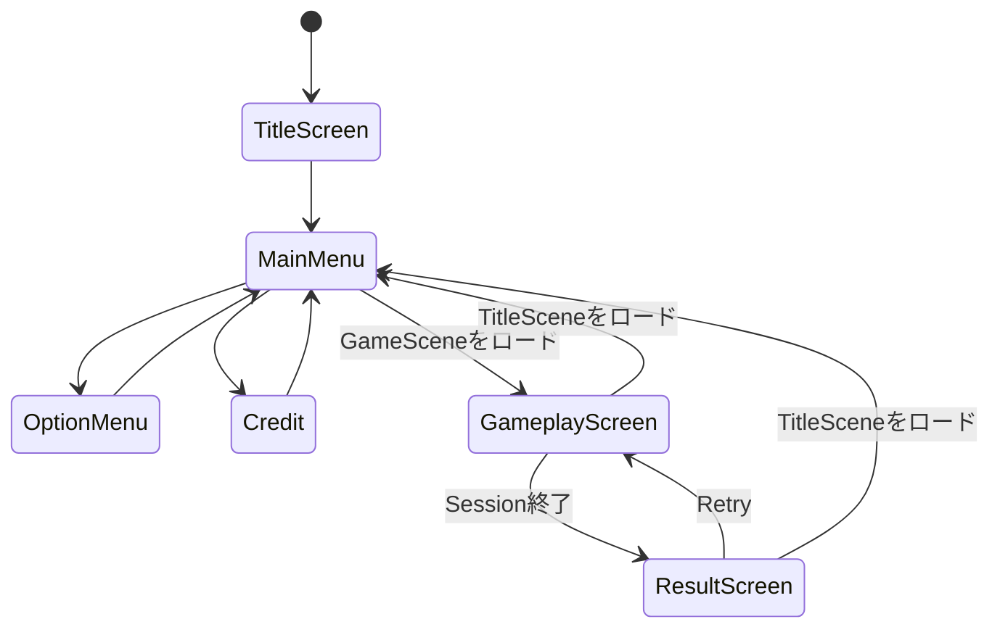
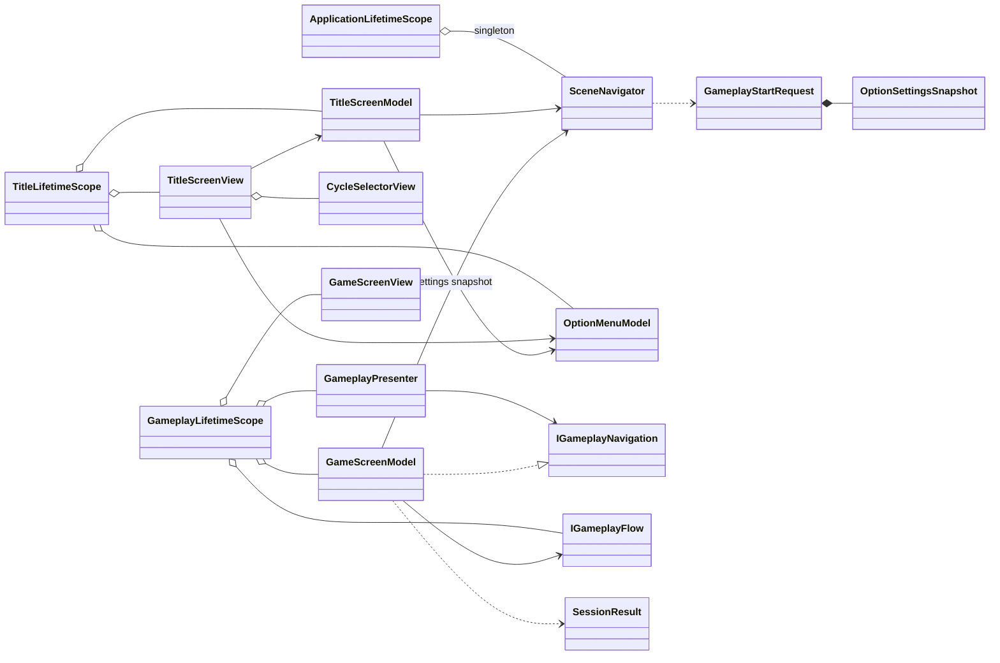

# CCC Unity 画面遷移クラス設計

> [ドキュメント一覧](../../README.md) / 区分: クラス設計

> **対象範囲**: TitleScene / GameScene 間の遷移、Scene内 Screen 切り替え、Gameplay 開始、Result 表示、Retry 制御

---

## 1. 目的

2つの Unity Scene（TitleScene / GameScene）および各 Scene 内部の画面（Screen）切り替えを、各 Scene 専用の Model と View を組み合わせて制御すること。

- **Scene間遷移**: Unity Scene を跨ぐ非同期ロード・遷移処理は `SceneNavigator` が一元管理すること。
- **Scene内Screen遷移**: シーン内部の表示画面切り替えおよび操作状態管理は、Scene ごとの Model（`TitleScreenModel` / `GameScreenModel`）が担当すること。
- **Viewの役割**: View コンポーネントは Model の公開状態（ReactiveProperty等）を購読し、対応する Screen GameObject の表示/非表示に反映すること。
- **ゲーム進行の委譲**: Gameplay の進行管理およびセッション終了判定は `IGameplayFlow` および `GameplayPresenter` へ委譲すること。
- **Retry処理**: リトライ実行時は同一の GameScene を破棄せず、新規セッションを開始すること。

---

## 2. 画面構成と遷移仕様

| Unity Scene | Scene内の画面（Screen）構成 |
| --- | --- |
| `TitleScene` | `TitleScreen`、`MainMenu`、`OptionMenu`、`Credit` |
| `GameScene` | `GameplayScreen`、`ResultScreen` |



- アプリケーションの通常起動時は `TitleScreen` から開始すること。
- GameScene から TitleScene へ戻った場合は `MainMenu` から開始すること。
- MainMenu のゲーム開始操作時は、ゲームモードを `LifeEndless`、難易度を `Normal` と指定した `GameplayStartRequest` を生成すること。

---

## 3. アセンブリと名前空間

| 型名 | 配置アセンブリ / 名前空間 | 役割概要 |
| --- | --- | --- |
| `TitleScreenState` / `GameScreenState` | `Ccc.Presentation.Navigation` | Unity API に依存しない純粋な画面状態 enum |
| `OptionMenuViewStateDto` / `OptionSettingsSnapshot` | `Ccc.Presentation.Navigation` | OptionMenu 表示データおよび Gameplay 開始時の不変設定スナップショット |
| `IGameplayNavigation` | `Ccc.Presentation` | GameplayPresenter から画面切り替えを依頼するためのポート |
| `SceneNavigator` | `Ccc.Infrastructure.Navigation` | Unity Scene アシンクロナスロードおよびリクエスト引き渡しの具象クラス |
| `TitleScreenModel` / `GameScreenModel` / `OptionMenuModel` | `Ccc.Infrastructure.Navigation` | シーン内の Screen 遷移状態および画面操作ロジック |
| `TitleScreenView` / `GameScreenView` | `Ccc.Infrastructure.Navigation` | 各 Scene 内の Screen 表示制御と入力イベンド検知 |
| `CycleSelectorView` | `Ccc.Infrastructure.UI` | Gameplay と OptionMenu で共有する循環選択 UI コンポーネント |
| `ApplicationLifetimeScope` | `Ccc.Bootstrap` | アプリケーション共通のシングルトンコンポーネント登録 |
| `TitleLifetimeScope` / `GameplayLifetimeScope` | `Ccc.Bootstrap` | 各シーンの DI 依存関係登録 |

---

## 4. 全体のクラス関係図



---

## 5. 画面状態と遷移リクエスト（Request）

### 5.1 画面状態 (State Enum)

```csharp
public enum TitleScreenState
{
    TitleScreen = 0,
    MainMenu,
    OptionMenu,
    Credit
}

public enum GameScreenState
{
    Gameplay = 0,
    Result
}
```

### 5.2 シーン開始リクエスト（Request）

```csharp
public sealed class GameplayStartRequest
{
    public GameMode GameMode { get; }
    public GameDifficulty Difficulty { get; }
    public OptionSettingsSnapshot OptionSettings { get; }

    public GameplayStartRequest(
        GameMode gameMode,
        GameDifficulty difficulty,
        OptionSettingsSnapshot optionSettings);
}

public sealed class TitleStartRequest
{
    public TitleScreenState InitialScreen { get; }
    public TitleStartRequest(TitleScreenState initialScreen);
}
```

- `GameplayStartRequest` は生成後の変更が不可能な不変オブジェクトとする。
- `GameMode` と `GameDifficulty` は `Ccc.Core.Model` の型を使用し、Presentation 層に同名の型を定義しないこと。
- MainMenu でのゲーム開始時は `OptionMenuModel.CreateSnapshot()` により設定スナップショットを生成し、`GameplayStartRequest` を構築してシーンロードを開始すること。
- リトライ実行時は、GameScene の LifetimeScope に保持された同一の `GameplayStartRequest` を再利用すること。

### 5.3 ナビゲーション処理結果（Navigation Result）

```csharp
public enum SceneNavigationFailureKind
{
    None = 0,
    AlreadyLoading,
    LoadFailed
}

public sealed class SceneNavigationResult
{
    public bool IsSuccess { get; }
    public SceneNavigationFailureKind FailureKind { get; }
    public string ErrorMessage { get; }
    public Exception? Cause { get; }
}

public interface ISceneNavigator
{
    bool IsLoading { get; }
    UniTask<SceneNavigationResult> LoadGameplayAsync(GameplayStartRequest request);
    UniTask<SceneNavigationResult> LoadTitleAsync(TitleStartRequest request);
}
```

---

## 6. SceneNavigator

`SceneNavigator` は、Project Root の `ApplicationLifetimeScope` に `ISceneNavigator` として Singleton 登録される純粋 C# クラスとする。

```csharp
public sealed class SceneNavigator : ISceneNavigator
{
    public bool IsLoading { get; }

    public UniTask<SceneNavigationResult> LoadGameplayAsync(GameplayStartRequest request);
    public UniTask<SceneNavigationResult> LoadTitleAsync(TitleStartRequest request);
}
```

> **ロード実行フローと安全制御**
> 1. リクエストが `null` の場合は即座に例外をスローすること。
> 2. `IsLoading == true` の場合は、二重ロードを防止するため即座に `AlreadyLoading` 結果を返却すること。
> 3. `LifetimeScope.Enqueue` を使用して、次に生成される Scene Scope へリクエスト・インスタンスを登録すること。
> 4. `SceneManager.LoadSceneAsync` を非同期で実行し、ロード完了まで待機すること。
> 5. 成功 / 失敗に応じて適切な `SceneNavigationResult` を返却し、`finally` ブロックで `IsLoading = false` に復帰させること。

---

## 7. TitleScene の設計

### 7.1 TitleScreenModel

```csharp
public sealed class TitleScreenModel : IDisposable
{
    public ReadOnlyReactiveProperty<TitleScreenState> CurrentScreen { get; }
    public ReadOnlyReactiveProperty<bool> IsBusy { get; }
    public ReadOnlyReactiveProperty<string> ErrorMessage { get; }

    public TitleScreenModel(
        ISceneNavigator sceneNavigator,
        OptionMenuModel optionMenuModel,
        TitleStartRequest startRequest);

    public void EnterMainMenu();
    public void OpenOptionMenu();
    public void CloseOptionMenu();
    public void OpenCredit();
    public void CloseCredit();
    public UniTask StartGameplayAsync();
    public void Dispose();
}
```

### 7.2 TitleScreenView

- `CurrentScreen` の変更を監視し、対応する画面（GameObject）のみをアクティブにすること。
- `IsBusy == true`（ロード中など）は、ボタンの連続タップや重複操作を無効化すること。

---

## 8. GameScene の設計

### 8.1 GameScreenModel

```csharp
public sealed class GameScreenModel : IGameplayNavigation, IDisposable
{
    public ReadOnlyReactiveProperty<GameScreenState> CurrentScreen { get; }
    public ReadOnlyReactiveProperty<SessionResult?> Result { get; }
    public ReadOnlyReactiveProperty<bool> IsBusy { get; }
    public ReadOnlyReactiveProperty<string> ErrorMessage { get; }

    public GameScreenModel(
        ISceneNavigator sceneNavigator,
        IGameplayFlow gameplayFlow,
        GameplayStartRequest startRequest);

    public void ShowResult(SessionResult result);
    public UniTask RetryAsync();
    public UniTask NavigateToMainMenuAsync();
    public void Dispose();
}
```

> **リトライ（RetryAsync）の挙動**
> 1. `IsBusy` を `true` に設定し、UI操作を一時ロックすること。
> 2. 保持していた `GameplayStartRequest` を用いて `IGameplayFlow.StartSession` を再呼び出しすること。
> 3. 成功時は `Result` をクリアし、`CurrentScreen` を `Gameplay` へ戻却すること。
> 4. 失敗時は `ResultScreen` 表示を維持したまま、エラーメッセージを表示すること。

---

## 9. 所有関係とライフタイム（Lifetime）マトリクス

| 所有責任者 | 管理する状態 / オブジェクト | ライフタイム |
| --- | --- | --- |
| `ApplicationLifetimeScope` | `SceneNavigator`、Audio共通インスタンス | Application（アプリ起動期間中） |
| `TitleScreenModel` | `TitleScreenState`、ロード状態、エラーメッセージ | TitleScene |
| `OptionMenuModel` | 設定候補、現在の選択Index、設定データ | TitleScene |
| `GameScreenModel` | `GameScreenState`、`SessionResult`、Retry状態 | GameScene |
| `GameplayController` | `GameplaySessionContext`、`GameplayState` | GameScene内セッション |
| `GameplayPresenter` | イベント購読、演出待機処理、UI用一時状態 | GameScene |

---

## 10. 受け入れ条件（Acceptance Criteria）

- タイトル画面からメインメニューへの移動、オプション画面・クレジット画面の開閉がスムーズに行えること。
- メインメニューでのゲーム開始操作時、設定スナップショットを含む `GameplayStartRequest` が正常に生成・渡されること。
- シーンロード中の重複タップによって二重ロードが発生しないこと（`AlreadyLoading` の検知）。
- ゲームオーバー時に `ResultScreen` へ切り替わり、リトライ操作によって同一シーン内で速やかに再スタートできること。
- シーン切替失敗時には元の画面表示が維持され、適切なエラーが表示されること。
