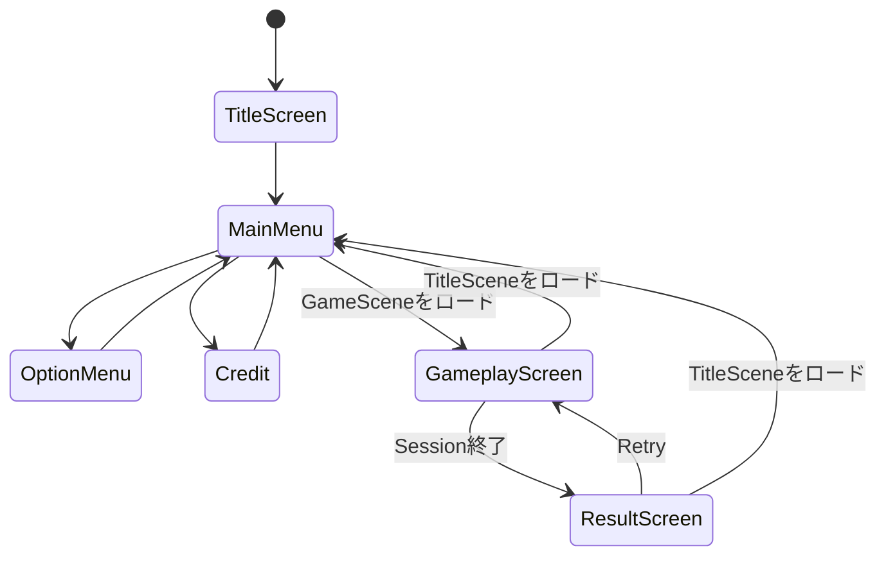
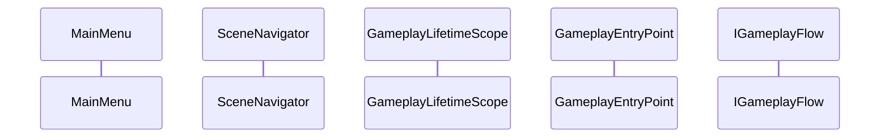
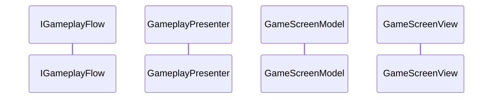

# CCC Unity画面遷移クラス設計

> [ドキュメント一覧](../../README.md) / 区分: クラス設計
>
> 正本: [Cosense「CCC Unity画面遷移クラス設計」](https://scrapbox.io/proto-TeamL/CCC%20Unity%E7%94%BB%E9%9D%A2%E9%81%B7%E7%A7%BB%E3%82%AF%E3%83%A9%E3%82%B9%E8%A8%AD%E8%A8%88)
> 取得時点の原文更新日時: 2026-08-29T22:33:15.000Z

> 対象：TitleScene／GameScene、Scene内Screen切り替え、Gameplay開始、Result、Retry

## 1. 目的

2つのUnity Sceneと各Scene内のScreenを、SceneごとのModelとViewで切り替える。

- Sceneをまたぐ遷移は`SceneNavigator`が担当する。
- Scene内の現在Screenと遷移操作はScene単位のModelが担当する。
- ViewはModelが公開する状態を購読し、対応するScreenへ反映する。
- Gameplayの進行とSession終了判定は`IGameplayFlow`／`GameplayPresenter`へ委譲する。
- Retryは同じGameSceneで新しいSessionを開始する。

## 2. 画面構成と遷移

| Unity Scene | Scene内のScreen |
| --- | --- |
| `TitleScene` | `TitleScreen`、`MainMenu`、`OptionMenu`、`Credit` |
| `GameScene` | `GameplayScreen`、`ResultScreen` |



通常起動では`TitleScreen`から開始する。GameSceneからTitleSceneへ戻る場合は`MainMenu`から開始する。

`MainMenu`の開始操作は、ゲームモードを`LifeEndless`、GameDifficultyを`Normal`とする`GameplayStartRequest`を生成する。
Debug用として、fallbackの`GameplayStartRequest`を生成する

OptionMenuの循環選択UI、設定値の所有、Gameplay開始時のSnapshot化は[UIコンポーネントクラス設計](./ui-components.md)を参照する。

## 3. Assemblyと名前空間

| 型 | assembly／名前空間 | 役割 |
| --- | --- | --- |
| `TitleScreenState`、`GameScreenState` | `Ccc.Presentation.Navigation` | Unity型を含まない画面状態 |
| `OptionMenuViewStateDto`、`OptionSettingsSnapshot` | `Ccc.Presentation.Navigation` | OptionMenu表示状態とGameplay開始時の不変設定値 |
| `IGameplayNavigation` | `Ccc.Presentation` | GameplayPresenterから画面遷移を依頼するポート |
| `SceneNavigator` | `Ccc.Infrastructure.Navigation` | Unity Sceneロードと遷移Requestの受け渡し |
| `TitleScreenModel`、`OptionMenuModel`、`GameScreenModel` | `Ccc.Infrastructure.Navigation` | Scene内の画面状態と操作 |
| `TitleScreenView`、`GameScreenView` | `Ccc.Infrastructure.Navigation` | Scene内Screenの表示と入力通知 |
| `CycleSelectorView` | `Ccc.Infrastructure.UI` | GameplayとOptionMenuで共有する循環選択View |
| `ApplicationLifetimeScope` | `Ccc.Bootstrap` | アプリ共通instanceの登録 |
| `TitleLifetimeScope` | `Ccc.Bootstrap` | TitleSceneの登録 |
| `GameplayLifetimeScope` | `Ccc.Bootstrap` | GameSceneの登録 |

`TitleScreenModel`、`OptionMenuModel`、`GameScreenModel`、`SceneNavigator`は通常classとする。ViewとLifetimeScopeはMonoBehaviourとする。

## 4. 全体のクラス関係


## 5. 画面状態とRequest

配置：

| 型 | assembly／namespace／ファイル |
| --- | --- |
| `TitleScreenState`、`GameScreenState` | `Ccc.Presentation`／`Ccc.Presentation.Navigation`／`Assets/CCC/Scripts/Presentation/Navigation/ScreenState.cs` |
| `GameplayStartRequest`、`TitleStartRequest` | 同上／`SceneStartRequest.cs` |
| `SceneNavigationResult`、`ISceneNavigator` | 同上／`ISceneNavigator.cs` |
| `SceneNavigator` | `Ccc.Infrastructure`／`Ccc.Infrastructure.Navigation`／`Assets/CCC/Scripts/Infrastructure/Navigation/SceneNavigator.cs` |

### 5.1 State enum

```csharp
public enum TitleScreenState
{
   TitleScreen = 0,
   MainMenu,
   OptionMenu,
   Credit
}

public enum GameScreenState
{
   Gameplay = 0,
   Result
}
```

TitleSceneの通常起動はTitleScreen。GameSceneから戻った起動はMainMenu。GameSceneは常にGameplayから開始し、SessionEnded後だけResultへ移る。未定義enum値は各constructor／更新methodで`ArgumentOutOfRangeException`として拒否する。

### 5.2 Scene開始Request

```csharp
public sealed class GameplayStartRequest
{
   public GameMode GameMode { get; }
   public GameDifficulty Difficulty { get; }
   public OptionSettingsSnapshot OptionSettings { get; }

   public GameplayStartRequest(
       GameMode gameMode,
       GameDifficulty difficulty,
       OptionSettingsSnapshot optionSettings);
}

public sealed class TitleStartRequest
{
   public TitleScreenState InitialScreen { get; }
   public TitleStartRequest(TitleScreenState initialScreen);
}
```

`GameplayStartRequest`は未定義enumとnull OptionSettingsを拒否する。TitleStartRequestはTitleScreenまたはMainMenuだけを許可し、OptionMenu／Creditは`ArgumentOutOfRangeException(nameof(initialScreen))`。Requestは生成後に変更できない。

MainMenuの開始操作は`LifeEndless`、`Normal`、`OptionMenuModel.CreateSnapshot()`でGameplayStartRequestを作る。RetryはGameScene Scopeへ渡された同じRequestを再利用する。Titleへ戻る場合は`new TitleStartRequest(TitleScreenState.MainMenu)`。

#### DI

`TitleStartRequest`はApplication RootへTitleScreen開始値をInstance登録する。Titleへ戻る時だけEnqueueしたMainMenu値で子Scope側を上書きする。

```csharp
builder.RegisterInstance(
   new TitleStartRequest(TitleScreenState.TitleScreen));
```

`GameplayStartRequest`はGameSceneロード直前にEnqueue登録する。

```csharp
using (LifetimeScope.Enqueue(
   builder => builder.RegisterInstance(request)))
{
   await SceneManager.LoadSceneAsync(SceneNames.Game);
}
```

### 5.3 Navigation Result

```csharp
public enum SceneNavigationFailureKind
{
   None = 0,
   AlreadyLoading,
   LoadFailed
}

public sealed class SceneNavigationResult
{
   public bool IsSuccess { get; }
   public SceneNavigationFailureKind FailureKind { get; }
   public string ErrorMessage { get; }
   public Exception? Cause { get; }
}

public interface ISceneNavigator
{
   bool IsLoading { get; }
   UniTask<SceneNavigationResult> LoadGameplayAsync(
       GameplayStartRequest request);
   UniTask<SceneNavigationResult> LoadTitleAsync(
       TitleStartRequest request);
}
```

Resultはpublic constructorを持たず、SceneNavigator内部のFactoryで生成する。成功は`FailureKind == None`、空ErrorMessage、null Cause。失敗はNone以外、非空ErrorMessage。AlreadyLoadingのCauseはnull、LoadFailedはcatchしたExceptionをCauseに保持する。

Sceneのロード失敗とロード中の連打は通常制御としてResultで返す。不正RequestはResultへ変換せず引数例外とする。

## 6. SceneNavigator

`SceneNavigator`は通常classで、Project Rootの`ApplicationLifetimeScope`へ`ISceneNavigator`としてSingleton登録する。Unity Scene、VContainerへの依存をこのclassへ集約する。

```csharp
public sealed class SceneNavigator : ISceneNavigator
{
   public bool IsLoading { get; }

   public UniTask<SceneNavigationResult> LoadGameplayAsync(
       GameplayStartRequest request);

   public UniTask<SceneNavigationResult> LoadTitleAsync(
       TitleStartRequest request);
}
```

### DI

`SceneNavigator`はDI登録対象とする。`IsLoading`というApplication内の共有状態を持ち、Scene遷移をUnity APIへ出力する境界だからである。

| 項目 | 指定 |
| --- | --- |
| 登録Scope | `ApplicationLifetimeScope` |
| Lifetime | `Singleton` |
| 登録する実装型 | `SceneNavigator` |
| 解決させる型 | `ISceneNavigator` |
| 生成時期 | Application Root Container構築時。TitleSceneのScopeを生成する前 |
| 注入方法 | 利用する通常classのconstructorへ`ISceneNavigator`を注入 |

登録例：

```csharp
protected override void Configure(IContainerBuilder builder)
{
   builder.Register<ISceneNavigator, SceneNavigator>(
       Lifetime.Singleton);
}
```

利用側は`SceneNavigator`の具象型を要求しない。`TitleScreenModel`と`GameScreenModel`はconstructorで`ISceneNavigator`を受け取る。子Scopeへ再登録せず、Application Rootから同じinstanceを解決する。

このDIブロックは、classの公開API／constructor契約の直後、処理手順より前に記載する。BootstrapページにはScope全体の登録順だけを記載し、Lifetimeや解決型が本ブロックと異なる場合はclass側を正本とする。

### 6.1 Scene名

```csharp
internal static class SceneNames
{
   internal const string Title = "TitleScene";
   internal const string Game = "GameScene";
}
```

文字列をModel、View、EntryPointへ重複記述しない。Build SettingsのScene名もこの2値と一致させる。

### 6.2 共通ロード手順

両methodは同じprivate helperへRequest登録処理とScene名を渡す。

- 1. requestがnullなら`ArgumentNullException(nameof(request))`。
- 2. `IsLoading == true`なら追加処理をせずAlreadyLoading Result。
- 3. `IsLoading = true`。
- 4. `LifetimeScope.Enqueue`で、次に生成されるScene Scopeへrequest instanceを登録する。
- 5. Enqueueのdisposable scope内で`SceneManager.LoadSceneAsync`を生成し、完了までawaitする。
- 6. AsyncOperationがnullなら`InvalidOperationException`としてLoadFailedへ変換する。
- 7. 成功ならSuccess Result。
- 8. 例外時は`Debug.LogException`へ同じExceptionを1回記録し、LoadFailed Result。
- 9. `finally`でEnqueue scopeを破棄し、`IsLoading = false`。

公開APIにCancellationTokenを追加しない。Sceneロード中に呼び出し元画面のdestroy TokenがCancelされても、開始済みロード自体は完了させる。モデル側はResultを受け取った時点で破棄済みならUI状態を更新しない。

RequestをSceneNavigatorのfield、static field、遷移元Scopeへ保存しない。Enqueue登録のcallback以外に保持しない。失敗後の次回ロードへ古いRequestを渡さない。

### 6.3 同時実行と例外

Unity main threadから呼ぶ。IsLoadingの確認とtrue設定の間にawaitを置かず、同じframeの連打でも1件だけLoadSceneAsyncを生成する。

次はLoadFailed：

- `SceneManager.LoadSceneAsync`生成／await中のException。
- Scene名がBuild Settingsにない。
- 次Scopeの構築またはRequest登録中のException。

次はSceneNavigatorの責務外：

- 遷移前Sessionの停止。呼び出し元Model／EntryPointが行う。
- エラー画面の文言。Resultを受けたModelが保持しViewが表示する。
- 自動再試行、fallback Scene、Application終了。

### 6.4 自由裁量と禁止

自由裁量：

- 共通helperの名前。
- ErrorMessageの具体文面。
- IsLoadingをprivate fieldまたはproperty backing fieldで持つ。

禁止：

- `async void`。
- `SceneManager.LoadScene`の同期ロード。
- Requestをstaticへ保存。
- `FindObjectOfType`で次ScopeへRequestを渡す。
- AlreadyLoadingで既存Taskへ相乗りする。
- 失敗時の自動再試行。
- requestの既定値生成。

### 6.5 受け入れ条件

- 1操作につきLoadSceneAsyncが最大1回。
- ロード中の2件目がAlreadyLoadingで即時完了。
- 成功時に次Sceneから渡した同一Request instanceを解決可能。
- 失敗時にIsLoadingがfalseへ戻り、次の操作を受理可能。
- LoadFailedのExceptionがログとResultで同一。
- 失敗後の別Sceneロードへ古いRequestが混入しない。
- SceneNavigatorがGameplay／TitleのScreen状態を保持しない。

## 7. TitleScene

### 7.1 TitleScreenModel API

配置：`Assets/CCC/Scripts/Infrastructure/Navigation/TitleScreenModel.cs`

```csharp
public sealed class TitleScreenModel : IDisposable
{
   public ReadOnlyReactiveProperty<TitleScreenState> CurrentScreen { get; }
   public ReadOnlyReactiveProperty<bool> IsBusy { get; }
   public ReadOnlyReactiveProperty<string> ErrorMessage { get; }

   public TitleScreenModel(
       ISceneNavigator sceneNavigator,
       OptionMenuModel optionMenuModel,
       TitleStartRequest startRequest);

   public void EnterMainMenu();
   public void OpenOptionMenu();
   public void CloseOptionMenu();
   public void OpenCredit();
   public void CloseCredit();
   public UniTask StartGameplayAsync();
   public void Dispose();
}
```

#### DI

Title Scopeの`Scoped`。Application RootまたはEnqueueから`TitleStartRequest`を受ける。

```csharp
builder.Register<TitleScreenModel>(Lifetime.Scoped);
```

startRequestのInitialScreenから開始する。constructor依存のnullを拒否する。

状態ガード：

- `EnterMainMenu`はTitleScreenからだけ。
- `OpenOptionMenu`／`OpenCredit`はMainMenuからだけ。
- `CloseOptionMenu`はOptionMenu、`CloseCredit`はCreditからだけ。
- ガード不一致、IsBusy中、Dispose後の画面操作は何も変更しない。Dispose後のasync開始は`ObjectDisposedException`。

`StartGameplayAsync`はMainMenuかつ非Busyでだけ実行する。

- 1. ErrorMessageを空にし、IsBusyをtrue。
- 2. OptionMenuModel.CreateSnapshotで不変Snapshotを作る。
- 3. `LifeEndless`／`Normal`のRequestを作る。
- 4. SceneNavigator.LoadGameplayAsyncをawait。
- 5. Successなら旧Sceneが破棄されるため追加状態更新しない。
- 6. Failureかつ未DisposeならErrorMessageを画面向け文言へ変換し、IsBusyをfalse。

AlreadyLoadingは「画面を読み込み中です」、LoadFailedは「ゲームを開始できませんでした」とする。Exception詳細を画面に出さない。

### 7.2 TitleScreenView

`CurrentScreen`を購読し、対応するRoot GameObjectだけをactiveにする。ボタン／CycleSelector入力をModelへ1回だけ接続する。`IsBusy`中は開始Buttonを操作不可にし、他画面へ遷移させない。ErrorMessageは空なら非表示。

ViewはRequest、Snapshot、Scene名を生成しない。OptionMenuの値描画と変更は[UIコンポーネントクラス設計](./ui-components.md)に従う。

#### DI

Title ScopeのScene hierarchyから取得する。

```csharp
builder.RegisterComponentInHierarchy<TitleScreenView>();
```

### 7.3 TitleEntryPoint

```csharp
public sealed class TitleEntryPoint :
   IStartable,
   IDisposable
{
   public TitleEntryPoint(
       TitleScreenModel model,
       TitleScreenView view,
       IAudioPlayer audio);

   public void Start();
   public void Dispose();
}
```

#### DI

Title ScopeのEntryPoint。View接続後にBgmTitleを再生する。

```csharp
builder.RegisterEntryPoint<TitleEntryPoint>();
```

`ISceneNavigator`、`IAudioPlayer`、既定`TitleStartRequest`は親Application Scopeから解決する。

## 8. GameScene

### 8.1 GameScreenModel API

配置：`Assets/CCC/Scripts/Infrastructure/Navigation/GameScreenModel.cs`

```csharp
public sealed class GameScreenModel :
   IGameplayNavigation,
   IDisposable
{
   public ReadOnlyReactiveProperty<GameScreenState> CurrentScreen { get; }
   public ReadOnlyReactiveProperty<SessionResult?> Result { get; }
   public ReadOnlyReactiveProperty<bool> IsBusy { get; }
   public ReadOnlyReactiveProperty<string> ErrorMessage { get; }

   public GameScreenModel(
       ISceneNavigator sceneNavigator,
       IGameplayFlow gameplayFlow,
       GameplayStartRequest startRequest);

   public void ShowResult(SessionResult result);
   public UniTask RetryAsync();
   public UniTask NavigateToMainMenuAsync();
   public void Dispose();
}
```

#### DI

Gameplay Scopeの`Scoped`。具象型と`IGameplayNavigation`の同一instanceを解決する。

```csharp
builder.Register<GameScreenModel>(Lifetime.Scoped)
   .AsSelf()
   .As<IGameplayNavigation>();
```

constructor依存はnullを拒否する。初期値はGameplay、Result null、非Busy、ErrorMessage空。startRequestをRetry用にGameScene lifetimeで保持する。

`ShowResult`：

- nullは`ArgumentNullException(nameof(result))`。
- Dispose済み、既にResult、Busy中なら何もしない。
- Resultを先に保持し、その後CurrentScreenをResultへ変更する。

`RetryAsync`はResult画面かつ非Busyでだけ実行する。

- 1. IsBusyをtrue、ErrorMessageを空。
- 2. 旧Sessionの演出停止はPresenter、Timer停止とState初期化はFlowのStartSessionが行う。
- 3. 保持したstartRequestでStartSession。
- 4. 成功時はResultをnull、CurrentScreenをGameplay、IsBusyをfalseの順に更新。
- 5. 失敗時はResultとResult画面を維持し、ErrorMessageを「再挑戦を開始できませんでした」、IsBusyをfalse。
- 6. 失敗後はRetryを無効のままとし、MainMenu操作は有効にする。そのためprivateな`hasRetryFailed`を保持する。

Retry成功時に新しいGameSceneをロードしない。SceneNavigatorを呼ばない。乱数instanceを作り直さない。

`NavigateToMainMenuAsync`はGameplay／Resultのどちらからも呼べる。

- 1. IsBusyをtrue、ErrorMessageを空。
- 2. Presenter購読と演出、Flow Timerを停止する。
- 3. `new TitleStartRequest(MainMenu)`でLoadTitleAsync。
- 4. Failureかつ未Disposeなら現在画面を維持し、ErrorMessageを「メインメニューへ戻れませんでした」、IsBusyをfalse。

### 8.2 GameScreenView

CurrentScreenに応じGameplayScreen／ResultScreenの片方だけを表示する。Resultはnullでない場合だけ描画する。IsBusy中はRetryとMainMenuの両Buttonを無効化する。Retry失敗後はRetryだけ無効、MainMenuを有効にする。

ViewはFlowを直接呼ばず、ResultからScore計算を再実装しない。Button入力はModelのasync methodを`Forget`する場合も例外handlerを必ず付ける。

#### DI

Gameplay ScopeのScene hierarchyから取得する。

```csharp
builder.RegisterComponentInHierarchy<GameScreenView>();
```

### 8.3 GameplayEntryPointとの分担

GameplayEntryPointは同じGameplayStartRequestを受け取り初回Sessionを開始する。GameScreenModelは画面状態、Retry、MainMenu復帰だけを担当する。

初回StartResult失敗：

- GameplayScreenを維持。
- GameScreenModelのErrorMessageへ開始失敗を設定。
- Timer、Presenter演出、Gameplay BGMを開始しない。
- MainMenu操作だけを有効にする。

SessionEndedEventはPresenterが`IGameplayNavigation.ShowResult(result)`へ渡す。GameScreenModelはSession進行Eventを自分で購読しない。

### 8.4 GameScene受け入れ条件

- 初回表示はGameplay、Resultはnull。
- SessionEnded 1件でResultへ1回だけ切り替わる。
- Retry成功で同一SceneのGameplayへ戻り、Resultを消去する。
- Retry失敗でResultを維持し、MainMenuへ戻れる。
- MainMenuロード失敗で現在画面が維持される。
- 古いSessionのTimer／演出完了がRetry後のStateへ反映されない。
- GameScreenModelがMission判定、Timer tick、Audio再生を担当しない。

## 9. Gameplayとの接続

### 9.1 初回開始



    - MainMenu->>Navigator: GameSceneロード要求
    - Navigator->>Scope: GameplayStartRequest登録
    - Scope->>Entry: 起動
    - Entry->>Flow: Session開始

### 9.2 Session終了



    - Flow-->>Presenter: SessionEndedEvent
    - Presenter->>Model: SessionResult表示要求
    - Model-->>View: Result状態

### 9.3 Retry

Retryは次の順序で行う。

- 1. Retry操作を無効化する。
- 2. 旧SessionのTimerと進行中演出を停止する。
- 3. 入力、GameplayState、現在Mission、SessionResult、Presenterの一時状態を初期化する。
- 4. 同じGameplayConfig、MissionCatalog、乱数生成器で新しいSessionを開始する。
- 5. 成功時にSessionResultを消去し、GameplayScreenへ切り替える。

乱数生成器の系列は継続する。旧SessionのTimer通知はMissionIdまたはSession世代番号で除外する。

`RetrySession`失敗時はResultScreenとSessionResultを維持し、Retry操作を無効化して、MainMenu操作を有効にする。画面には再挑戦開始失敗を表示し、詳細をログへ記録する。

### 9.4 MainMenuへ戻る

GameplayScreenまたはResultScreenからMainMenuへ戻る場合は、旧SessionのTimer、Presenter購読、進行中演出を終了してからTitleSceneをロードする。

## 10. 所有関係とlifetime

| 所有者 | 状態／依存 | lifetime |
| --- | --- | --- |
| `ApplicationLifetimeScope` | `SceneNavigator`、Audio共通instance | Application |
| `TitleScreenModel` | `TitleScreenState`、ロード状態、画面エラー | TitleScene |
| `OptionMenuModel` | 設定候補、現在Index、現在設定 | TitleScene |
| `GameScreenModel` | `GameScreenState`、`SessionResult`、Retry状態、画面エラー | GameScene |
| `GameplayController` | `GameplaySessionContext`、`GameplayState` | GameScene内Session |
| `ExpressionInput` | 現在式 | GameScene内Session |
| `ISectionTimer` | MissionId、残り時間、Timer状態 | GameScene内Session |
| `GameplayPresenter` | 購読、演出待機、表示用一時状態 | GameScene |

## 11. DI登録

| Scope | 主な登録 |
| --- | --- |
| `ApplicationLifetimeScope` | `ISceneNavigator`、`IAudioPlayer`、既定`TitleStartRequest` |
| `TitleLifetimeScope` | `OptionMenuModel`、`TitleScreenModel`、`TitleScreenView`、`TitleEntryPoint` |
| `GameplayLifetimeScope` | `GameplayStartRequest`、Gameplay一式、`GameScreenModel`、`GameScreenView`、`GameplayEntryPoint` |

Application Root：

```csharp
protected override void Configure(IContainerBuilder builder)
{
   builder.Register<ISceneNavigator, SceneNavigator>(
       Lifetime.Singleton);
   builder.RegisterComponent(audioPlayer)
       .As<IAudioPlayer>();
   builder.RegisterInstance(
       new TitleStartRequest(TitleScreenState.TitleScreen));
}
```

通常classはconstructor injection、MonoBehaviourはScene hierarchy登録と`[Inject]`を使用する。個別classのDIブロックをLifetimeと解決型の正本とする。

## 12. 手動確認項目

- 起動時にTitleScreenからMainMenuへ進める。
- MainMenuからLifeEndless／NormalでGameSceneを開始できる。
- MainMenu、OptionMenu、Creditを往復できる。
- OptionMenuの数値候補とひらがな候補が末尾から先頭へ循環する。
- OptionMenuで選択したGameplay用設定が`GameplayStartRequest`のSnapshotへ反映される。
- Sceneロード中の連打で追加ロードが発生しない。
- GameplayのLifeが0になるとResultScreenへ切り替わる。
- RetryでSection 1、初期Life、初期式、新しいMissionから開始する。
- Retry後に古いTimer通知と演出完了通知が反映されない。
- Retry失敗時にResultScreenとMainMenu操作が維持される。
- GameplayScreenとResultScreenからMainMenuへ戻れる。
- TitleSceneへ戻った後に古いGameplay通知が反映されない。
- TitleSceneとGameSceneを2往復して同じSceneNavigator instanceが解決される。
- Sceneロード失敗時に遷移元画面が維持され、再操作できる。

## 13. 参照資料

- [画面・UI仕様](../../requirements/presentation/screens-and-ui.md)
- [ゲームモード・難易度](../../requirements/gameplay/game-modes-and-difficulty.md)
- [CCC Unityクラス設計](../unity-class-design.md)
- [プロトスプリントリーグ当日のUnity実装計画](https://scrapbox.io/proto-TeamL/%E3%83%97%E3%83%AD%E3%83%88%E3%82%B9%E3%83%97%E3%83%AA%E3%83%B3%E3%83%88%E3%83%AA%E3%83%BC%E3%82%B0%E5%BD%93%E6%97%A5%E3%81%AEUnity%E5%AE%9F%E8%A3%85%E8%A8%88%E7%94%BB)
- [CCC UnityAudioクラス設計](../infrastructure/audio.md)
- [UIコンポーネントクラス設計](./ui-components.md)
- [VContainer Project root LifetimeScope](https://vcontainer.hadashikick.jp/scoping/project-root-lifetimescope)
- [VContainer Generate child scope via scene or prefab](https://vcontainer.hadashikick.jp/scoping/generate-child-via-scene)
- [Unity SceneManager.LoadSceneAsync](https://docs.unity3d.com/6000.0/Documentation/ScriptReference/SceneManagement.SceneManager.LoadSceneAsync.html)
- [UniTask](https://github.com/Cysharp/UniTask/blob/master/README.md?plain=1)
