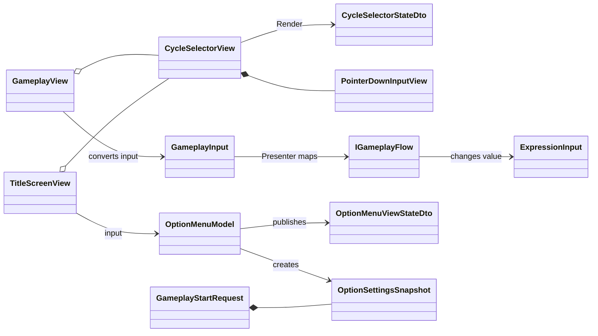

# UI コンポーネントクラス設計

> [ドキュメント一覧](../../README.md) / 区分: クラス設計

> **対象範囲**: Gameplay 画面および OptionMenu 画面で共有する循環選択 UI、PointerDown タップ入力、値表示制御

---

## 1. 目的

Gameplay における数字・演算子の切り替えUIと、OptionMenu における循環設定項目UIに対して、現在値の表示と変更入力を統合した共通の UI コンポーネントを使用すること。

- 本ドキュメントでは `CycleSelectorView` および `PointerDownInputView` の共通契約を定義すること。
- Gameplay と OptionMenu で異なるデータ所有者（`ExpressionInput` / `OptionMenuModel`）および入力変換を定義すること。
- 数値の選択肢とひらがなの選択肢を同一の View コンポーネントで取り扱えるように設計すること。
- マルチタッチ操作を阻害せず、View 側へゲームルールや設定値の判断を持たせない方針を維持すること。

---

## 2. 設計原則

共通化するのは View の「表示・入力境界」のみとすること。

- `CycleSelectorView` は現在値の表示用文字列と操作可否フラグ（DTO）のみを受け取ること。
- `CycleSelectorView` はタップ操作が発生した事実（イベント）のみを外部へ通知すること。
- 現在値、選択肢リスト、現在の選択インデックス、循環計算ルールなどは、各画面の Model が所有すること。
- View 側にゲームルールや設定のビジネスロジックを持たせないこと。

---

## 3. アセンブリと名前空間

| 型名 | 配置アセンブリ / 名前空間 | 役割概要 |
| --- | --- | --- |
| `CycleSelectorStateDto` | `Ccc.Presentation.UI` | 現在値の表示用文字列と操作可否フラグを保持する DTO |
| `OptionMenuViewStateDto` / `OptionSettingsSnapshot` | `Ccc.Presentation.Navigation` | OptionMenu 表示状態および Gameplay 開始時の不変設定値 |
| `CycleSelectorView` / `PointerDownInputView` | `Ccc.Infrastructure.UI` | 共通 Prefab 上での表示描画および PointerDown 入力通知 |
| `GameplayView` | `Ccc.Infrastructure.Gameplay` | Gameplay 固有の各種入力への変換と描画制御 |
| `TitleScreenView` / `OptionMenuModel` | `Ccc.Infrastructure.Navigation` | OptionMenu 入力変換と設定値の管理 |

※ DTO クラスは Unity API 型を含まない。View は `MonoBehaviour`、`OptionMenuModel` は純粋な C# クラスとすること。

---

## 4. 全体のクラス関係図



---

## 5. DTO 定義 (CycleSelectorStateDto)

`CycleSelectorStateDto` は、`CycleSelectorView` へ描画情報を渡すための読み取り専用構造体とする。

```csharp
public readonly struct CycleSelectorStateDto
{
    public string ValueText { get; }
    public bool IsInteractable { get; }

    public CycleSelectorStateDto(string valueText, bool isInteractable)
    {
        ValueText = valueText ?? throw new ArgumentNullException(nameof(valueText));
        IsInteractable = isInteractable;
    }
}
```

- `ValueText` は Presenter または画面 Model が生成した文字列を設定すること（View 側で文字列変換を行わない）。
- `IsInteractable == false` の場合は、操作不可状態の表示（グレーアウト等）に切り替え、PointerDown 通知を行わないこと。

---

## 6. PointerDownInputView

`PointerDownInputView` は、UI の押し下げ（PointerDown）イベントを安全に検知する共通入力コンポーネントとする。

```csharp
public sealed class PointerDownInputView : MonoBehaviour, IPointerDownHandler
{
    public Observable<Unit> Pressed { get; }
    public void SetInteractable(bool isInteractable);
    public void OnPointerDown(PointerEventData eventData);
}
```

- `OnPointerDown` 発生時、操作可能な場合のみ `Unit` イベントを発行すること。
- マウス入力は左クリックのみを受理すること。
- タッチ入力はマルチタッチ対応のため、各ポインターごとに独立して受理すること。

---

## 7. CycleSelectorView

`CycleSelectorView` は表示用テキストと入力検知コンポーネントを Inspector 参照で保持すること。

```csharp
public sealed class CycleSelectorView : MonoBehaviour
{
    public Observable<Unit> ChangeRequested { get; }
    public void Render(CycleSelectorStateDto state);
}
```

- `ChangeRequested` は内部の `PointerDownInputView.Pressed` を公開ストリームとして提供すること。
- `Render` メソッド呼び出しにより、`ValueText` の表示と `IsInteractable` の状態を UI へ即座に反映すること。

---

## 8. OptionMenuModel と循環ルール

`OptionMenuModel` は、タイトル画面における各設定項目の選択肢リスト、現在の選択インデックス、現在の設定値を保持する C# クラスとする。

```csharp
nextIndex = (currentIndex + 1) % candidates.Count;
```

> **循環ロジックのルール**
> - 末尾の要素の次は自動的に先頭（インデックス 0）に戻ること。
> - 選択肢が1つのみの場合はインデックスを変更せず現在の値を維持すること。
> - 数値選択肢・ひらがな選択肢の双方に対して同一の循環ルールを適用すること。

---

## 9. 受け入れ条件（Acceptance Criteria）

- `CycleSelectorView` prefab を Gameplay の数式・演算子変更および OptionMenu の設定項目双方で共通使用できること。
- `PointerDownInputView` が画面固有の入力型に依存せず、純粋なタップイベントのみを通知すること。
- 1回の PointerDown 操作が正確に1回の `ChangeRequested` イベントへ変換されること。
- リクエストされた `Render` 呼び出しにより、テキスト表示と操作可否が常に正しく一致すること。
