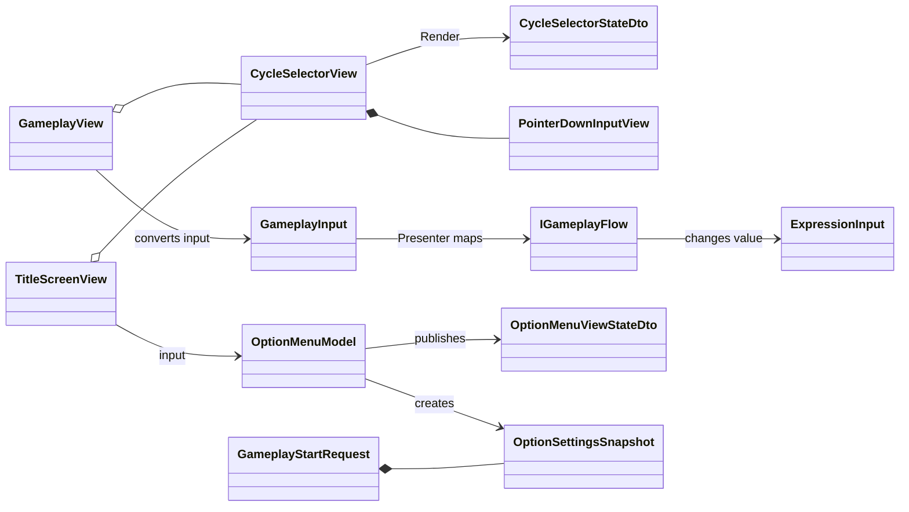
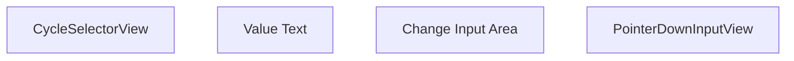

# UIコンポーネントクラス設計

> [ドキュメント一覧](../../README.md) / 区分: クラス設計
>
> 正本: [Cosense「UIコンポーネントクラス設計」](https://scrapbox.io/proto-TeamL/UI%E3%82%B3%E3%83%B3%E3%83%9D%E3%83%BC%E3%83%8D%E3%83%B3%E3%83%88%E3%82%AF%E3%83%A9%E3%82%B9%E8%A8%AD%E8%A8%88)
> 取得時点の原文更新日時: 2026-08-29T04:53:55.000Z

> 対象：Gameplay／OptionMenuで共有する循環選択UI、PointerDown入力、値表示

## 1. 目的

Gameplayの数字・演算子変更とOptionMenuの循環設定に、現在値の表示とChange入力を組み合わせた同じUI componentを使用する。

- 本ページは`CycleSelectorView`と`PointerDownInputView`の共通契約を定義する。
- GameplayとOptionMenuで異なる値所有者と入力変換を定義する。
- 数値候補とひらがな候補を同じViewで扱えるようにする。
- マルチタッチを維持し、Viewへゲームルールや設定値を持たせない。

Gameplayの進行、`ExpressionInput`、Presenter／View接続は[CCC Unityクラス設計](../unity-class-design.md)を参照する。OptionMenu、Scene間Request、DI lifetimeは[CCC Unity画面遷移クラス設計](./scene-navigation.md)を参照する。

## 2. 設計原則

共通化するのはViewの表示・入力境界だけとする。

- `CycleSelectorView`は現在値の表示文字列と操作可否だけを受け取る。
- `CycleSelectorView`は押された事実だけを通知する。
- 現在値、候補列、現在Index、循環規則、設定反映は画面ごとのModelが所有する。
- Gameplayは`ExpressionInput`、OptionMenuは`OptionMenuModel`が型付きの値を所有する。
- `ExpressionInput`をOptionMenuから使用しない。
- GameSceneへmutableな`OptionMenuModel`を渡さない。

## 3. Assemblyと名前空間

| 型 | assembly／名前空間 | 役割 |
| --- | --- | --- |
| `CycleSelectorStateDto` | `Ccc.Presentation.UI` | 現在値の表示文字列と操作可否 |
| `OptionMenuViewStateDto`、`OptionSettingsSnapshot` | `Ccc.Presentation.Navigation` | OptionMenu表示状態とGameplay開始時の不変設定値 |
| `CycleSelectorView`、`PointerDownInputView` | `Ccc.Infrastructure.UI` | 共通Prefabの表示とPointerDown通知 |
| `GameplayView` | `Ccc.Infrastructure.Gameplay` | Gameplay固有入力への変換と描画 |
| `TitleScreenView`、`OptionMenuModel` | `Ccc.Infrastructure.Navigation` | OptionMenu入力変換と設定値の所有 |

DTOはUnity型を含まない。ViewはMonoBehaviour、`OptionMenuModel`は通常classとする。

## 4. 全体のクラス関係



`CycleSelectorView`からModelへ直接依存しない。画面全体のViewが共通Viewの通知を画面固有入力へ変換する。

## 5. CycleSelectorStateDto

`CycleSelectorStateDto`は`CycleSelectorView`へ渡す完成済みの表示状態である。

```csharp
public readonly struct CycleSelectorStateDto
{
   public string ValueText { get; }
   public bool IsInteractable { get; }
}
```

- `ValueText`はPresenterまたは画面Modelが生成する。
- 数値、enum、ひらがなをView側で文字列へ変換しない。
- `IsInteractable == false`ではPointerDownを通知せず、無効状態の見た目を描画する。

## 6. PointerDownInputView

`PointerDownInputView`は画面固有の入力型を生成しない共通入力部品である。

```csharp
public sealed class PointerDownInputView :
   MonoBehaviour,
   IPointerDownHandler
{
   public Observable<Unit> Pressed { get; }
   public void SetInteractable(bool isInteractable);
   public void OnPointerDown(PointerEventData eventData);
}
```

- `OnPointerDown`は操作可能な場合だけ1つの`Unit`を発行する。
- mouseは左buttonだけを受理する。
- touchはpointerごとに独立して受理する。
- 同じ領域への2本指は2件の`Unit`を発行する。
- `GameplayInput`、設定Id、値、Indexを保持しない。
- 破棄時に購読と内部Subjectを終了する。

## 7. CycleSelectorView

`CycleSelectorView`は現在値TextとChange入力領域をInspector参照で持つ。

```csharp
public sealed class CycleSelectorView : MonoBehaviour
{
   public Observable<Unit> ChangeRequested { get; }
   public void Render(CycleSelectorStateDto state);
}
```

`ChangeRequested`は内部の`PointerDownInputView.Pressed`を公開する。`Render`は`ValueText`と`IsInteractable`だけを反映する。

SerializeFieldとして持つもの：

- 現在値を表示するText
- Change入力用`PointerDownInputView`
- 操作可能／不可能の見た目を切り替えるCanvasGroupまたはGraphic参照

SerializeFieldとして持たないもの：

- 数値候補、ひらがな候補、演算子候補
- 現在Index、最小値、最大値
- `PlayerSide`、`GameplayInput`
- `OptionSettingsSnapshot`

## 8. Gameplayへの接続

### 8.1 instanceと表示値

| `CycleSelectorView` instance | 表示値 | Change時の変換先 | 値所有者 |
| --- | --- | --- | --- |
| PLAYER A Number | `GameplayViewStateDto.LeftText` | PLAYER Aの数字変更 | `ExpressionInput` |
| PLAYER A Operator | `GameplayViewStateDto.OperatorText` | 共有演算子変更 | `ExpressionInput` |
| PLAYER B Number | `GameplayViewStateDto.RightText` | PLAYER Bの数字変更 | `ExpressionInput` |
| PLAYER B Operator | `GameplayViewStateDto.OperatorText` | 共有演算子変更 | `ExpressionInput` |

左右のOperator Viewは同じ`OperatorText`を描画する。中央の式表示は既存の`ExpressionView`が担当し、各`CycleSelectorView`の表示と同じDTOから描画する。

### 8.2 入力変換

`GameplayView`は各instanceの`ChangeRequested`を次の`GameplayInput`へ変換する。

- PLAYER A Number：PLAYER Aの数字変更
- PLAYER A Operator：PLAYER A側からの共有演算子変更
- PLAYER B Number：PLAYER Bの数字変更
- PLAYER B Operator：PLAYER B側からの共有演算子変更

Presenterは`GameplayInput`を`IGameplayFlow.ChangeNumber`または`ChangeOperator`へ振り分ける。`GameplayController`のStatus guardと`ExpressionInput`による値変更は既存設計を維持する。

左右Operatorの同時入力では2件のPointerDownが個別に通知され、共有演算子を2段階進める。

## 9. OptionMenuへの接続

### 9.1 OptionMenuModel

`OptionMenuModel`はTitleScene中の設定候補、現在Index、現在設定を所有する通常classである。

- 数値候補とひらがな候補を含む各設定の候補列を持つ。
- 変更後の`OptionMenuViewStateDto`を公開する。
- Gameplayへ影響する現在設定から`OptionSettingsSnapshot`を生成する。
- View、Text、Button、Pointer Eventを参照しない。

設定項目の製品APIには[画面・UI仕様](../../requirements/presentation/screens-and-ui.md)で確定した意味上の名前を使用する。`ChangeNumberOption`や`ChangeHiraganaOption`のような仮名を残さない。

#### DI

Title Scopeの`Scoped`。候補設定を登録した後、`TitleScreenModel`より先に登録する。

```csharp
builder.Register<OptionMenuModel>(Lifetime.Scoped);
```

### 9.2 循環規則

設定項目ごとに次の規則を使用する。

```csharp
nextIndex = (currentIndex + 1) % candidates.Count;
```

- 候補0件はModel生成時の設定不正として拒否する。
- 初期値は候補列に含まれる値だけを受理する。
- 末尾の次は先頭へ戻る。
- 1件だけならChange後も同じ値を維持する。
- 数値候補とひらがな候補に同じ規則を適用する。

循環規則は`CycleSelectorView`へ実装しない。

### 9.3 表示とSnapshot

`OptionMenuModel`は型付きの現在値を保持し、`OptionMenuViewStateDto`には各設定の`CycleSelectorStateDto`を格納する。`TitleScreenView`は各`ChangeRequested`を対応するModel操作へ変換し、公開されたStateを`CycleSelectorView.Render`へ渡す。

Gameplayへ影響する設定は、MainMenuから開始するときに`OptionSettingsSnapshot`として`GameplayStartRequest`へ格納する。Snapshotは不変データとし、GameSceneではSnapshotからGameplay用設定を生成する。

アプリ再起動後の保存は現在のプロトスプリントリーグ要件に含めない。必要になった場合だけ、PlayerPrefsを扱うInfrastructure実装をApplication lifetimeへ追加する。

### 9.4 共通部品の実装パケット

配置：

- `Assets/CCC/Scripts/Presentation/UI/CycleSelectorStateDto.cs`
- `Assets/CCC/Scripts/Infrastructure/UI/PointerDownInputView.cs`
- `Assets/CCC/Scripts/Infrastructure/UI/CycleSelectorView.cs`

```csharp
public readonly struct CycleSelectorStateDto
{
   public string ValueText { get; }
   public bool IsInteractable { get; }

   public CycleSelectorStateDto(
       string valueText,
       bool isInteractable);
}
```

valueTextがnullなら`ArgumentNullException(nameof(valueText))`。空文字は設定側が意図して使えるため許可する。

`PointerDownInputView`：

- AwakeでSubjectを1つ生成し、OnDestroyでOnCompleted後にDisposeする。
- SetInteractableの初期値はtrue。
- false中のPointerDownは通知しない。
- mouseは`eventData.button == PointerEventData.InputButton.Left`だけ通知する。
- touch／penはButton値に依存せず、各OnPointerDownを1件として通知する。
- eventDataがnullなら`ArgumentNullException(nameof(eventData))`。
- OnDestroy後に通知しない。

`CycleSelectorView`：

- AwakeでPointerDownInputView.Pressedを1回だけ購読し、ChangeRequestedへ転送する。
- RenderはText、PointerDownのinteractable、無効見た目を同じ呼び出し内で反映する。
- OnEnableごとに購読を追加しない。
- SerializeField欠落はAwakeで`InvalidOperationException`とし、名前検索や自動追加で補わない。
- OnDestroyでChangeRequestedを完了して購読を解除する。

共通部品は入力のdebounce、長押し、候補循環、値変換を行わない。1回のPointerDownを1回のChangeRequestedへ変換するだけとする。

### 9.5 OptionMenuModel境界

OptionMenuModelの具体的な設定property、変更method、候補値は[画面・UI仕様](../../requirements/presentation/screens-and-ui.md)に記載された確定名をそのまま使用する。本ページ側で別名の汎用Dictionary APIへ置き換えない。

Modelのconstructorは全候補Collectionと初期値を受け取り、null、0件、null要素、重複候補、初期値不在を引数例外で拒否する。候補Collectionは配列へコピーする。Change操作は対応Indexだけを1進め、更新後のOptionMenuViewStateDtoを1回発行する。CreateSnapshotは呼び出し時点の型付き値を新しい不変instanceへコピーする。

Dispose後のChange／CreateSnapshotは`ObjectDisposedException`。二重Disposeは何もしない。GameSceneへModel、Index、候補Collectionを渡さない。

### 9.6 実装受け入れ条件

- 1 PointerDownが1 ChangeRequestedになる。
- 非interactable時は0件。
- 同じ領域の2 PointerDownは2件。
- 左右Operator同時入力はFlowへ2件。
- Renderだけで表示と操作可否が一致する。
- Option候補末尾の次が先頭。
- Snapshot後にTitle側Modelを変更してもSnapshotが変化しない。
- Viewが候補、Index、PlayerSide、Gameplayルールを保持しない。

## 10. 所有関係とlifetime

| 所有者 | 所有する状態 | lifetime |
| --- | --- | --- |
| `PointerDownInputView` | 操作可否、入力通知用Subject | 対応GameObject |
| `CycleSelectorView` | Inspector参照、描画済み表示状態 | 対応GameObject |
| `ExpressionInput` | Gameplayの現在式 | GameScene内Session |
| `OptionMenuModel` | 設定候補、現在Index、現在設定 | TitleScene |
| `OptionSettingsSnapshot` | Gameplay開始時に確定した設定 | GameplayStartRequest／GameScene内Session |

ViewをScene間で持ち回らない。OptionMenuのmutableな選択状態をGameSceneへ渡さない。

## 11. Prefab構成とDI

Prefab構成：



    - Root --> Value
    - Root --> Change
    - Change --> Pointer

`CycleSelectorView`と`PointerDownInputView`はComponent in hierarchyとして使用し、個別にVContainer登録しない。`GameplayView`または`TitleScreenView`がInspector参照で束ねる。

`OptionMenuModel`は`TitleLifetimeScope`へScoped登録する。DTOと`OptionSettingsSnapshot`は値として生成し、Containerへ登録しない。

分担：

- UI担当：Prefab、Text、Graphic、押下表現、無効表現、Inspector接続
- 設計・統合担当：DTO、`OptionMenuModel`、画面固有入力への変換、Snapshot接続
- Gameplay統合担当：`GameplayView`から既存`GameplayInput`への割り当て確認

## 12. 手動確認項目

- Gameplayの4つの`CycleSelectorView`が対応する値を表示する。
- PLAYER A／Bの数字Changeがそれぞれ左／右の数字だけを進める。
- 左右どちらのOperator Changeでも共有演算子が進む。
- 左右Operatorの同時入力で共有演算子が2段階進む。
- 同じ領域への2本指で2件の入力が通知される。
- `IsInteractable == false`では値が変化せず、無効状態が表示される。
- OptionMenuの数値候補が末尾から先頭へ循環する。
- OptionMenuのひらがな候補が末尾から先頭へ循環する。
- OptionMenuの表示値と`OptionMenuModel`の型付き現在値が一致する。
- 選択したGameplay用設定が`GameplayStartRequest`のSnapshotへ反映される。

Gameplayの同時入力と同一領域2本指はAndroid横向き実機で確認する。Viewの自動テストは作成しない。

## 13. 設計受け入れ条件

- 同じ`CycleSelectorView` prefabをGameplayの数字・演算子変更とOptionMenuの循環設定で使用できる。
- `PointerDownInputView`が画面固有の入力型を参照しない。
- `CycleSelectorView`が型付きの値、候補列、現在Indexを保持しない。
- Gameplayの現在値を`ExpressionInput`、OptionMenuの現在値を`OptionMenuModel`が所有する。
- 数値候補とひらがな候補が同じ循環規則で末尾から先頭へ戻る。
- Gameplayの左右同時Operator入力が2件の入力として処理される。
- Gameplayへ影響するOption設定が不変SnapshotとしてScene間を移動する。
- UI担当がPrefabとInspector接続だけで設定項目を配置できる。

## 14. 参照資料

- [CCC Unityクラス設計](../unity-class-design.md)
- [CCC Unity画面遷移クラス設計](./scene-navigation.md)
- [画面・UI仕様](../../requirements/presentation/screens-and-ui.md)
- [入力仕様](../../requirements/gameplay/input.md)
- [CCC実装における設計原則](../design-principles.md)
- [Unity IPointerDownHandler](https://docs.unity3d.com/6000.0/Documentation/ScriptReference/EventSystems.IPointerDownHandler.html)
- [Unity Input System UI Input Module](https://docs.unity3d.com/Packages/com.unity.inputsystem@1.11/manual/UISupport.html)
