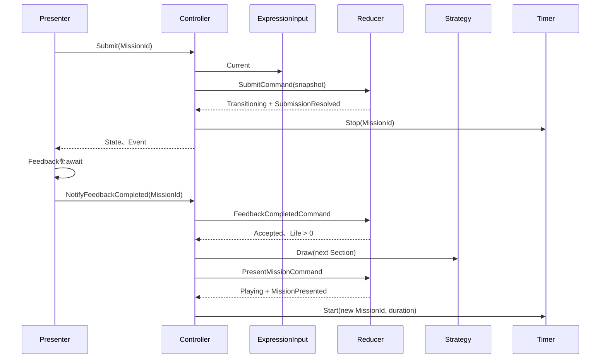
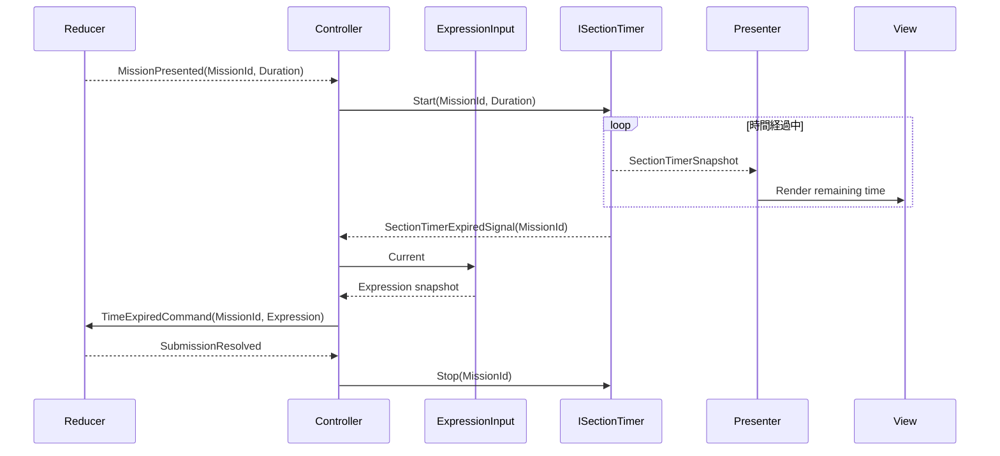

# CCC Unity クラス設計

> [ドキュメント一覧](../README.md) / 区分: クラス設計

> **対象環境・スコープ**: Unity 6 / Normal モード / LifeEndless モード / 簡易版 Mission / Tier 1〜2 優先実装

- [CCC Unity クラス設計](#ccc-unity-クラス設計)
  - [1. 目的](#1-目的)
  - [2. 設計原則](#2-設計原則)
  - [3. アセンブリ定義（Assembly Boundaries）](#3-アセンブリ定義assembly-boundaries)
  - [4. Ccc.Core.Model 設計](#4-ccccoremodel-設計)
    - [4.1 Rational （有理数型）](#41-rational-有理数型)
    - [4.2 CalculationResult （計算結果型）](#42-calculationresult-計算結果型)
    - [4.3 Expression と OperatorType （数式構造と演算子）](#43-expression-と-operatortype-数式構造と演算子)
    - [4.4 MissionCondition （Mission クリア条件）](#44-missioncondition-mission-クリア条件)
    - [4.5 Mission、MissionId、MissionCandidate](#45-missionmissionidmissioncandidate)
    - [4.6 MissionCatalog （出題カタログ）](#46-missioncatalog-出題カタログ)
    - [4.7 GameplayConfig](#47-gameplayconfig)
      - [DI](#di)
    - [4.8 GameplaySessionContext、GameplayState、SubmissionResolution](#48-gameplaysessioncontextgameplaystatesubmissionresolution)
    - [4.9 SessionResult](#49-sessionresult)
    - [4.10 Model受け入れ条件](#410-model受け入れ条件)
  - [5. Ccc.Core.Logic設計](#5-ccccorelogic設計)
    - [5.1 式評価](#51-式評価)
    - [5.2 ExpressionCandidate列挙](#52-expressioncandidate列挙)
    - [5.3 Mission成否判定](#53-mission成否判定)
    - [5.4 Catalog構築](#54-catalog構築)
    - [5.4.1 具体例](#541-具体例)
    - [5.4.2 受け入れ条件](#542-受け入れ条件)
    - [5.5 Index Selector](#55-index-selector)
      - [5.5.1 所属とファイル](#551-所属とファイル)
      - [5.5.2 公開API](#552-公開api)
      - [5.5.3 共通のsample契約](#553-共通のsample契約)
      - [5.5.4 WeightedIndexSelector](#554-weightedindexselector)
      - [5.5.5 UniformIndexSelector](#555-uniformindexselector)
      - [5.5.6 実装上の自由裁量](#556-実装上の自由裁量)
      - [5.5.7 受け入れ条件](#557-受け入れ条件)
  - [6. Ccc.Core.LogicのSession Command、Event、Reducer](#6-ccccorelogicのsession-commandeventreducer)
    - [6.1 Session Command](#61-session-command)
    - [6.2 Presentation Event](#62-presentation-event)
    - [6.3 Reducer API](#63-reducer-api)
    - [6.4 状態遷移表](#64-状態遷移表)
    - [6.5 処理順とEvent順](#65-処理順とevent順)
    - [6.6 Sequence](#66-sequence)
    - [6.7 実装上の自由裁量と禁止](#67-実装上の自由裁量と禁止)
    - [6.8 受け入れ条件](#68-受け入れ条件)
  - [7. Ccc.Core.UseCases設計](#7-ccccoreusecases設計)
    - [7.1 公開ポート](#71-公開ポート)
    - [7.2 ExpressionInput](#72-expressioninput)
    - [7.3 GameplayController](#73-gameplaycontroller)
    - [7.4 Mission抽選Strategy](#74-mission抽選strategy)
      - [DI](#di-1)
    - [7.5 Timerのデータフロー](#75-timerのデータフロー)
    - [7.6 不変データとResult契約](#76-不変データとresult契約)
    - [7.7 ExpressionInputの生成・例外契約](#77-expressioninputの生成例外契約)
      - [DI](#di-2)
    - [7.8 GameplayControllerの公開挙動](#78-gameplaycontrollerの公開挙動)
      - [DI](#di-3)
    - [7.9 SimpleMissionDrawStrategyの厳密な乱数消費](#79-simplemissiondrawstrategyの厳密な乱数消費)
    - [7.10 UseCases受け入れ条件](#710-usecases受け入れ条件)
  - [8. Ccc.PresentationのMVP設計](#8-cccpresentationのmvp設計)
    - [8.1 View契約](#81-view契約)
    - [8.2 GameplayPresenter](#82-gameplaypresenter)
    - [8.3 View DTOとFormatter](#83-view-dtoとformatter)
      - [DI](#di-4)
    - [8.4 GameplayInputとDTOの公開API](#84-gameplayinputとdtoの公開api)
    - [8.5 GameplayPresenterの生成と直列化](#85-gameplaypresenterの生成と直列化)
      - [DI](#di-5)
    - [8.6 Formatterの失敗契約](#86-formatterの失敗契約)
    - [8.7 Presentation受け入れ条件](#87-presentation受け入れ条件)
  - [9. Infrastructure 設計](#9-infrastructure-設計)
    - [9.1 GameplayView](#91-gameplayview)
    - [9.2 マルチタッチと入力処理（Input Handling）](#92-マルチタッチと入力処理input-handling)
    - [9.3 DOTween と UniTask を用いた非同期演出制御](#93-dotween-と-unitask-を用いた非同期演出制御)
    - [9.4 SectionTimer（タイマー具象実装）](#94-sectiontimerタイマー具象実装)
    - [9.5 ScriptableObject によるアセット境界](#95-scriptableobject-によるアセット境界)
  - [10. Bootstrap と DI ライフタイム設計](#10-bootstrap-と-di-ライフタイム設計)
    - [10.1 GameplayLifetimeScope での登録方針](#101-gameplaylifetimescope-での登録方針)
    - [10.2 GameplayEntryPoint のライフサイクル管理](#102-gameplayentrypoint-のライフサイクル管理)
  - [11. 将来の拡張ポイント](#11-将来の拡張ポイント)
  - [12. 設計の最終受け入れ条件（Acceptance Criteria）](#12-設計の最終受け入れ条件acceptance-criteria)
  - [13. 参照資料](#13-参照資料)


---

## 1. 目的

本書は、CCC の Gameplay を Unity 上で構築・実装するためのクラス境界、依存方向、状態遷移、公開 API、MVP 接続構成、および DI（依存注入）仕様を定義する仕様書とする。

設計の中心的な柱は以下の2点とする。

- **Modelの独立性**: Model（モデル）を Unity エンジンやリアクティブライブラリから完全に独立した、不変（Immutable）な純粋データ構造として扱うこと。
- **Functional Core / Imperative Shell の分離**: Model を同期的に計算・処理する `Ccc.Core.Logic` を **Functional Core**（純粋な機能核）とし、`Ccc.Core.UseCases` 以降のタイマー・乱数・演出・画面遷移制御を **Imperative Shell**（副作用を伴う外殻）として明確に分離すること。

主な設計対象は Gameplay 自体、および Title / MainMenu / Result 画面と接続する画面遷移ポートとする。

---

## 2. 設計原則

詳細ルールについては [CCC実装における設計原則](./design-principles.md) を参照すること。

---

## 3. アセンブリ定義（Assembly Boundaries）

アセンブリ境界に関する詳細ルールについては [CCC_asmdef](./assembly-boundaries.md) を参照すること。

---

## 4. Ccc.Core.Model 設計

Model 層のクラス群は Unity API 型（`MonoBehaviour` や `UnityEngine.Object` 等）を一切含まず、通常クラスまたは `readonly struct` として定義し、一度生成された後は内部状態を変更できないものとする。  
配置ルートパスは `Assets/CCC/Scripts/Core/Model/`、所属アセンブリは `Ccc.Core`、名前空間は `Ccc.Core.Model` とする。

> **共通エラーハンドリング規則**
> - 参照型の引数が `null` の場合は `ArgumentNullException` をスローすること。
> - 数値引数が許容範囲外の場合は `ArgumentOutOfRangeException` をスローすること。
> - 複数の引数間の組み合わせ関係が不正な場合は `ArgumentException` をスローすること。
> - 送出する例外の `ParamName` は、公開メソッド/コンストラクタの引数名と完全に一致させること。
> - コレクション引数はコンストラクタ内で配列等へコピーし、外部へは `IReadOnlyList<T>` として公開すること。
> - 自動クランプや空コレクションへの無言補正は行わず、生成に成功したインスタンスは常に不変条件を満たすことを保証すること。

---

### 4.1 Rational （有理数型）

- **配置ファイル**: `Rational.cs` / `RationalMath.cs`

```csharp
public readonly struct Rational :
    IEquatable<Rational>,
    IComparable<Rational>
{
    public long Numerator { get; }
    public long Denominator { get; }
    public bool IsInteger => Denominator == 1;

    public static Rational Create(long numerator, long denominator);
    public int CompareTo(Rational other);
    public bool Equals(Rational other);
    public override bool Equals(object? obj);
    public override int GetHashCode();
    public override string ToString();
    public static bool operator ==(Rational left, Rational right);
    public static bool operator !=(Rational left, Rational right);
}

public static class RationalMath
{
    public static Rational Add(Rational left, Rational right);
    public static Rational Subtract(Rational left, Rational right);
    public static Rational Multiply(Rational left, Rational right);
    public static Rational Divide(Rational left, Rational right);
}
```

- `Rational.Create` は分母を正の数にし、最大公約数で約分した上で、0 を `0/1` として標準形に正規化すること。
- `denominator == 0` の場合は `ArgumentOutOfRangeException(nameof(denominator))` を送出すること。
- 正規化および演算の過程で `long` 型の範囲を超えた場合は `OverflowException` を送出すること。
- `Divide` メソッドで右辺（除数）が 0 の場合は `DivideByZeroException` を送出すること。
- 演算および大小比較の判定において、`float` や `double` へ変換して判定を行わないこと。
- `ToString()` は整数の場合 `"3"`、整除できない場合は `"3/2"` の形式で、カルチャに依存せず文字列化すること。

---

### 4.2 CalculationResult （計算結果型）

- **配置ファイル**: `CalculationResult.cs`

```csharp
public enum CalculationResultKind
{
    Uninitialized = 0,
    Defined,
    DivisionByZero
}

public readonly struct CalculationResult : IEquatable<CalculationResult>
{
    public CalculationResultKind Kind { get; }
    public bool IsDefined => Kind == CalculationResultKind.Defined;
    public Rational Value { get; }

    public static CalculationResult Defined(Rational value);
    public static CalculationResult DivisionByZero();
}
```

- `default(CalculationResult)` は `Uninitialized`（未初期化）状態とする。
- `Kind != Defined` の状態で `Value` プロパティへアクセスした場合は `InvalidOperationException` を送出すること。
- `Defined(0/1)` は正常な計算結果であり、ゼロ除算や未初期化状態と区別すること。

---

### 4.3 Expression と OperatorType （数式構造と演算子）

- **配置ファイル**: `Expression.cs` / `OperatorType.cs`

```csharp
public enum OperatorType
{
    Add = 0,
    Subtract,
    Multiply,
    Divide
}

public readonly struct Expression : IEquatable<Expression>
{
    public int Left { get; }
    public OperatorType Operator { get; }
    public int Right { get; }

    public Expression(int left, OperatorType @operator, int right);
}
```

- 未定義の `OperatorType` 値が渡された場合は `ArgumentOutOfRangeException(nameof(@operator))` を送出すること。
- 演算子の循環切り替え順序は `Add -> Subtract -> Multiply -> Divide -> Add` の順で固定とすること。

---

### 4.4 MissionCondition （Mission クリア条件）

- **配置ファイル**: `MissionKind.cs` / `MissionCondition.cs`

```csharp
public readonly struct MissionCondition : IEquatable<MissionCondition>
{
    public MissionKind Kind { get; }
    public int ParameterA { get; }
    public int ParameterB { get; }
    public bool IsNegated { get; }

    public static MissionCondition Create(MissionKind kind);
    public static MissionCondition Create(MissionKind kind, int parameter);
    public static MissionCondition Between(int lowerBound, int width);
    public static MissionCondition Modulo(int divisor, int remainder);
}
```

- **Between条件**: `ParameterA = lowerBound`、`ParameterB = width`（width は 1 以上）。
- **Modulo条件**: `ParameterA = divisor`（2 以上）、`ParameterB = remainder`（0 以上 divisor 未満）。
- プロトスプリントリーグ版での `IsNegated` は常に `false` とすること。

---

### 4.5 Mission、MissionId、MissionCandidate

- **配置ファイル**: `MissionId.cs` / `Mission.cs` / `MissionCandidate.cs`

```csharp
public readonly struct MissionId : IEquatable<MissionId>
{
    public int Value { get; }
    public MissionId(int value);
}

public sealed class Mission
{
    public MissionId Id { get; }
    public MissionCondition Condition { get; }
    public int Tier { get; }
    public Mission(MissionId id, MissionCondition condition, int tier);
}

public sealed class MissionCandidate
{
    public MissionCondition Condition { get; }
    public int Tier { get; }
    public int ExpressionMatchCount { get; }
    public int EvaluatedExpressionCount { get; }
    public float ExpressionMatchRatio { get; }
    public ExpressionCandidate AnswerExample { get; }

    public MissionCandidate(
        MissionCondition condition,
        int tier,
        int expressionMatchCount,
        int evaluatedExpressionCount,
        ExpressionCandidate answerExample);
}
```

- `MissionId.Value <= 0` および `tier <= 0` の場合は、対応する引数名で `ArgumentOutOfRangeException` を送出すること。
- `MissionCandidate` は `evaluatedExpressionCount > 0` および `1 <= expressionMatchCount <= evaluatedExpressionCount` であることを要求すること。
- `MissionId` はセッション内で 1 から開始し、提示されるごとに 1 ずつ増加すること。

---

### 4.6 MissionCatalog （出題カタログ）

- **配置ファイル**: `MissionCatalog.cs`

```csharp
public sealed class MissionCatalog
{
    public IReadOnlyList<MissionCandidate> Candidates { get; }
    public MissionCatalog(IReadOnlyList<MissionCandidate> candidates);
}
```

- `null`、要素数 0、要素内の `null`、および同一 `Condition`・`Tier` の重複を拒否すること。
- カタログが空になるような失敗ケースは Builder の `MissionCatalogBuildResult` で表現し、空の `MissionCatalog` インスタンスは作成しないこと。


### 4.7 GameplayConfig

ファイル：`GameplayConfig.cs`、`TimerConfig.cs`、`TierProgression.cs`

```csharp
public sealed class TimerConfig
{
   public TimeSpan InitialDuration { get; }
   public TimeSpan ReductionPerSection { get; }
   public TimeSpan MinimumDuration { get; }
   public TimeSpan GetDuration(int section);
}

public sealed class TierProgression
{
   public int GetTier(int section);
}

public sealed class GameplayConfig
{
   public int MinimumNumber { get; }
   public int MaximumNumber { get; }
   public Expression InitialExpression { get; }
   public int InitialLife { get; }
   public TimerConfig Timer { get; }
   public TierProgression TierProgression { get; }
   public bool ShowCurrentAnswer { get; }
   public float MinimumExpressionMatchRatio { get; }
   public float MaximumExpressionMatchRatio { get; }
   public int MinimumExpressionMatchCount { get; }
   public int ZeroAndPrimeMinimumExpressionMatchCount { get; }
   public float CurrentTierDrawWeight { get; }
   public float LowerTierDrawWeight { get; }
   public float TargetExpressionMatchRatio { get; }
   public float NegatedMissionSelectionWeight { get; }
   public int MissionParameterSelectionPoolSize { get; }

   public int GetMinimumExpressionMatchCount(MissionKind kind);
}
```

constructorは全propertyと同名の引数を受ける。`MinimumNumber <= MaximumNumber`、初期式の左右が範囲内、`InitialLife > 0`、割合と重みが有限、割合が0〜1、各重みが0以上、Current／Lower重みの合計が正、各最小件数とMissionパラメータ抽選プール数が1以上であることを生成時に検証すること。

`TimerConfig`は初期時間と最低時間が正、短縮量が0以上であることを要求し、最低時間より短くしないこと。`GetDuration(section <= 0)`と`GetTier(section <= 0)`は`ArgumentOutOfRangeException(nameof(section))`とすること。

型の使い分け：

- 式の結果とMission成否：`Rational`
- 個数、Section、Life：`int`
- 割合、確率、抽選重み：`float`
- Coreの時間：`TimeSpan`。Inspectorの秒数floatからの変換はInfrastructureで行うこと。

Normal初期値：

| 項目 | 値 |
| --- | --- |
| 数字範囲 | 1〜5 |
| 初期式 | 1 + 1 |
| 初期Life | 3 |
| 初期時間 | 10秒 |
| Sectionごとの短縮 | 0.5秒 |
| 最低時間 | 3秒 |
| Tier 1 | Section 1〜3 |
| Tier 2 | Section 4〜7 |
| Tier 3 | Section 8〜11 |
| Tier 4 | Section 12以降 |
| Current／Lower Tier重み | 0.60／0.40 |
| 式適合割合 | 0.10〜0.50 |
| 最小適合式数 | 通常2、Zero／Prime 1 |
| ShowCurrentAnswer | false |

#### DI

`GameplayConfig`はGameplay Scopeの`Scoped`とする。Scope構築中、`ExpressionInput`を解決する前に1回生成すること。

```csharp
builder.Register<GameplayConfig>(_ =>
{
   var result = configAsset.CreateRuntimeConfig();
   if (!result.IsSuccess)
       throw new GameplayConfigurationException(result.Errors);
   return result.Value;
}, Lifetime.Scoped);
```

`MissionCatalog`、`GameplaySessionContext`、`GameplayState`はDI登録せず、Session開始後に`GameplayController`が所有すること。

### 4.8 GameplaySessionContext、GameplayState、SubmissionResolution

ファイル：`GameplaySessionContext.cs`、`GameplayState.cs`、`SubmissionResolution.cs`

```csharp
public sealed class GameplaySessionContext
{
   public GameplayConfig Config { get; }
   public MissionCatalog MissionCatalog { get; }
   public GameplaySessionContext(GameplayConfig config, MissionCatalog missionCatalog);
}

public enum GameplayStatus { Playing, Transitioning, GameOver }
public enum SubmissionTrigger { ManualSubmit, TimeExpired }

public sealed class GameplayState
{
   public GameplayStatus Status { get; }
   public int Section { get; }
   public int Life { get; }
   public Mission CurrentMission { get; }
   public SubmissionResolution? LastResolution { get; }
   public int CorrectAnswerCount => Math.Max(0, Section - 1);
   public bool IsAcceptingSubmit => Status == GameplayStatus.Playing;
   public bool IsTransitioning => Status == GameplayStatus.Transitioning;

   public GameplayState(
       GameplayStatus status,
       int section,
       int life,
       Mission currentMission,
       SubmissionResolution? lastResolution);
}

public sealed class SubmissionResolution
{
   public MissionId MissionId { get; }
   public SubmissionTrigger Trigger { get; }
   public Expression SubmittedExpression { get; }
   public bool IsSuccess { get; }
   public CalculationResult CalculationResult { get; }

   public SubmissionResolution(
       MissionId missionId,
       SubmissionTrigger trigger,
       Expression submittedExpression,
       bool isSuccess,
       CalculationResult calculationResult);
}
```

Contextはnullを拒否すること。Stateは`section > 0`、`life >= 0`を要求すること。`Playing`ではlifeが正。`Transitioning`／`GameOver`ではLastResolutionが必須かつCurrentMissionとMissionIdが一致すること。`GameOver`では`life == 0`とすること。未定義enumを拒否すること。

`CalculationResult.Kind != Defined`なら`SubmissionResolution.IsSuccess`はfalseだけを許可すること。Session固定値はContext、進行はState、編集中の式は§7.2、残り時間は`SectionTimerSnapshot`が所有すること。

### 4.9 SessionResult

ファイル：`SessionResult.cs`

```csharp
public sealed class SessionResult
{
   public int FinalSection { get; }
   public Mission LastMission { get; }
   public SubmissionResolution LastResolution { get; }
   public Expression FinalExpression => LastResolution.SubmittedExpression;
   public int CorrectAnswerCount => Math.Max(0, FinalSection - 1);

   public SessionResult(
       int finalSection,
       Mission lastMission,
       SubmissionResolution lastResolution);
}
```

`finalSection <= 0`、null、LastMissionとLastResolutionのMissionId不一致を拒否すること。Life 0後の`FeedbackCompletedCommand`が受理された時だけ生成すること。

### 4.10 Model受け入れ条件

- 公開constructor／Factoryだけで正常instanceを生成できること。
- 不正値の例外型とParamNameが本章と一致すること。
- 生成後にCollectionやpropertyを外部から変更できないこと。
- Rationalの正規化、等値性、Hash、比較が一致すること。
- `default(CalculationResult)`を正常値として扱わないこと。
- MissionIdとMission提示回数が1対1に対応すること。
- UnityEngine、R3、VContainer、時刻取得、乱数取得を参照しないこと。

## 5. Ccc.Core.Logic設計

配置Rootは`Assets/CCC/Scripts/Core/Logic/`、assemblyは`Ccc.Core`、名前空間は`Ccc.Core.Logic`とする。全処理を同期・決定的にし、Unity型、乱数生成、時刻取得、R3を参照しないこと。

### 5.1 式評価

ファイル：`ExpressionCalculator.cs`

```csharp
public static class ExpressionCalculator
{
   public static CalculationResult Evaluate(Expression expression);
}
```

Operatorとの対応はAdd＝`RationalMath.Add`、Subtract＝Subtract、Multiply＝Multiply、Divide＝Divideとする。左右のintは分母1のRationalへ変換すること。Divideで`expression.Right == 0`のときだけ`CalculationResult.DivisionByZero()`を返すこと。未定義Operatorは`ArgumentOutOfRangeException(nameof(expression))`。表現不能な結果の`OverflowException`は握り潰さず呼び出し元へ送出すること。

例：

- `1 + 2 -> Defined(3/1)`
- `1 / 2 -> Defined(1/2)`
- `1 / 0 -> DivisionByZero`
- `0 / 3 -> Defined(0/1)`

### 5.2 ExpressionCandidate列挙

`ExpressionCandidate`はLogicの出力として使う不変データだが、`MissionCandidate`が保持するため`Ccc.Core.Model`へ置くこと。

```csharp
public readonly struct ExpressionCandidate : IEquatable<ExpressionCandidate>
{
   public Expression Expression { get; }
   public CalculationResult Result { get; }

   public ExpressionCandidate(
       Expression expression,
       CalculationResult result);
}

public static class ExpressionCandidateGenerator
{
   public static IReadOnlyList<ExpressionCandidate> Generate(
       int minimumNumber,
       int maximumNumber);
}
```

`minimumNumber > maximumNumber`は`ArgumentException`（`ParamName == nameof(minimumNumber)`）。全組合せ数がint範囲を超える場合は`ArgumentOutOfRangeException(nameof(maximumNumber))`とすること。

列挙順をLeft昇順、Right昇順、Operatorのenum順に固定すること。左右の全組合せと4演算子を評価し、DivisionByZeroだけを除外すること。同じ結果でも式が異なれば別Candidateとすること。戻り値は配列へ確定し、呼び出し側から変更できないこと。

### 5.3 Mission成否判定

ファイル：`MissionConditionMatcher.cs`

```csharp
public static class MissionConditionMatcher
{
   public static bool IsMatch(
       MissionCondition condition,
       CalculationResult result);
}
```

`result.Kind != Defined`はfalse。`Defined`では[生成するMission](../requirements/missions/mission-types.md)の成立条件をそのまま実装し、パラメータ候補とTierは[Missionパラメータ候補プリセット](../requirements/missions/candidate-presets.md)を参照すること。少なくとも完成範囲のTier 1〜2は全Kindを実装すること。

判定上の固定規則：

- Even／Odd／Prime／Square／Multipleなど「整数のみ」の条件は`result.Value.IsInteger`を先に確認すること。
- Evenは0を含む。Oddは絶対値を2で割った余りが1とする。
- Primeは2以上の正整数。試し割りは平方根以下までとすること。
- Decimalは`!IsInteger`とする。
- Betweenは下限と`下限 + 幅`の両端を含むこと。
- Moduloは負数にもユークリッド剰余を使い、結果を0以上divisor未満に正規化すること。
- `condition.IsNegated`がtrueなら、通常条件の結果を最後に1回だけ反転すること。
- Rationalの比較・整数性を使い、float／doubleへ変換しないこと。

KindごとのswitchをMatcherへ集約し、ReducerとCatalogBuilderに同じ判定を重複実装しないこと。境界例は[CCCテスト仕様](../requirements/testing/acceptance-specification.md)を参照すること。

用語：

| 工程 | コード |
| --- | --- |
| 条件と結果の一致判定 | `MissionConditionMatcher.IsMatch` |
| 候補の統計取得 | `MissionCatalogBuilder`内部の`Analyze` |
| Catalogへ含める判断 | `ShouldInclude` |
| Catalog構築 | `MissionCatalogBuilder.Build` |
| Catalogからの実行時抽選 | `IMissionDrawStrategy.Draw` |
| Reducerによる提示確定 | `PresentMissionCommand` |
| 提示完了Event | `MissionPresentedEvent` |

### 5.4 Catalog構築

ファイル：`MissionParameterCandidate.cs`、`MissionCatalogBuildResult.cs`、`MissionCatalogBuilder.cs`

```csharp
public readonly struct MissionParameterCandidate
{
   public MissionCondition Condition { get; }
   public int Tier { get; }

   public MissionParameterCandidate(
       MissionCondition condition,
       int tier);
}

public enum MissionCatalogBuildFailureKind
{
   None = 0,
   NoExpressions,
   NoParameters,
   EmptyCatalog
}

public sealed class MissionCatalogBuildResult
{
   public bool IsSuccess { get; }
   public MissionCatalog Catalog { get; }
   public MissionCatalogBuildFailureKind FailureKind { get; }
   public string FailureMessage { get; }
}

public static class MissionCatalogBuilder
{
   public static MissionCatalogBuildResult Build(
       IReadOnlyList<ExpressionCandidate> expressions,
       IReadOnlyList<MissionParameterCandidate> parameters,
       GameplayConfig config);
}
```

null引数は`ArgumentNullException`。Collection内の不正要素や同じCondition・Tierの重複は`ArgumentException`を該当Collectionの引数名で送出すること。0件は例外にせず、対応するFailureKindを返すこと。

Result契約：

- 成功時は`IsSuccess == true`、`FailureKind == None`、`Catalog`へアクセス可能、`FailureMessage == string.Empty`。
- 失敗時は`IsSuccess == false`、Catalogアクセスで`InvalidOperationException`、FailureKindはNone以外、FailureMessageはログへ出せる非空文字列。
- 公開constructorを持たせず、Builder内部またはinternal Factoryだけが生成すること。

Builderは入力順に各Parameterを処理し、全Defined ExpressionCandidateへMatcherを適用すること。DivisionByZero CandidateはGeneratorで除外済みだが、外部入力に含まれても分母へ数えないこと。

選出条件：

- 正常な適合式が1件以上。
- 正常な非適合式が1件以上。
- 適合割合がConfigの最小以上、最大以下。
- `config.GetMinimumExpressionMatchCount(condition.Kind)`以上の適合式。
- 正常なAnswerExampleが1件以上。
- Kind固有パラメータ制約を満たす。

AnswerExampleは列挙順で最初に一致したCandidateとすること。Catalog順は`Tier -> MissionKind -> ParameterA -> ParameterB -> IsNegated`の昇順へ固定し、抽選結果の再現性を保つこと。候補分析と選出判定はprivate static methodとし、public APIを増やさないこと。

### 5.4.1 具体例

数字1〜2ではExpressionをLeft、Right、Operator順に列挙する。ConditionがEvenなら、Defined候補だけを分母とし、結果が偶数整数のCandidateを数える。割合と最小件数を満たせば、最初に一致した式をAnswerExampleとしてMissionCandidateを生成すること。

パラメータ0件なら`NoParameters`、Defined式0件なら`NoExpressions`、分析後に選出0件なら`EmptyCatalog`。いずれも空Catalogを成功値として返さないこと。

### 5.4.2 受け入れ条件

- 同じ入力からCandidate内容・順序・AnswerExampleが一致すること。
- BuilderとReducerの一致判定がMatcherへ一本化されていること。
- DivisionByZeroを分析分母に含めないこと。
- Failure時にCatalogへアクセスできないこと。
- Unity、乱数Source、時刻、表示文言を参照しないこと。

### 5.5 Index Selector

Selectorは、呼び出し側から渡された0以上1未満のsampleをIndexへ変換する同期・決定的な純粋関数とする。乱数の取得、候補の抽出、Tier／Kindの選択手順は§7.4のMission抽選Strategyが担当し、Selectorは乱数Source、Catalog、Mission型を参照しないこと。

#### 5.5.1 所属とファイル

| 型 | assembly／名前空間 | 配置 |
| --- | --- | --- |
| `WeightedIndexSelector` | `Ccc.Core`／`Ccc.Core.Logic` | `Assets/CCC/Scripts/Core/Logic/WeightedIndexSelector.cs` |
| `UniformIndexSelector` | `Ccc.Core`／`Ccc.Core.Logic` | `Assets/CCC/Scripts/Core/Logic/UniformIndexSelector.cs` |

両方とも状態を持たない`static class`とする。UnityEngine、R3、乱数APIを参照しないこと。

#### 5.5.2 公開API

```csharp
namespace Ccc.Core.Logic;

public static class WeightedIndexSelector
{
   public static int SelectIndex(
       IReadOnlyList<float> weights,
       float sample);
}

public static class UniformIndexSelector
{
   public static int SelectIndex(
       int count,
       float sample);
}
```

戻り値は常に0以上、選択肢数未満のIndexとする。不正入力は戻り値や独自Result型で表現せず、引数例外を同期的に送出すること。`-1`、clamp、入力の自動補正、`TrySelectIndex`は使用しないこと。

#### 5.5.3 共通のsample契約

`sample`は0以上1未満の有限な`float`とする。

- `0f`は有効。
- `1f`は無効。
- 負数、`NaN`、正負の無限大は無効。
- 無効なsampleは`ArgumentOutOfRangeException`を`nameof(sample)`で送出すること。
- 同じ有効入力には必ず同じIndexを返すこと。

Selector内で乱数を生成しないこと。§7.4のStrategyが`IRandomSource.NextFloat01()`からsampleを取得し、選択肢が2件以上ある段階だけSelectorを呼ぶこと。Selector自体は選択肢1件でも使用可能であり、有効なsampleに対してIndex 0を返すこと。

#### 5.5.4 WeightedIndexSelector

入力契約：

- `weights == null`は`ArgumentNullException`を`nameof(weights)`で送出すること。
- `weights.Count == 0`は`ArgumentException`を`nameof(weights)`で送出すること。
- 各重みは0以上の有限な`float`とする。
- 負数、`NaN`、正負の無限大を含む場合は`ArgumentOutOfRangeException`を`nameof(weights)`で送出すること。
- 重み0は許可するが、そのIndexは選択されないこと。
- 全重みが0の場合は`ArgumentException`を`nameof(weights)`で送出すること。

処理手順：

- 1. weightsとsampleをすべて検証すること。
- 2. 誤差を抑えるため、合計重みと累積重みは`double`で計算すること。
- 3. `scaledSample = (double)sample * totalWeight`を求めること。
- 4. Index 0から重みを累積し、`scaledSample < cumulativeWeight`を最初に満たしたIndexを返すこと。
- 5. 重み0のIndexは幅0の区間となるため選択しないこと。
- 6. 有効入力に対して浮動小数点の累積誤差で末尾まで到達した場合は、最後の正の重みを持つIndexを返すこと。

各Indexの区間は左閉右開とする。重み`[0.6f, 0.4f]`では、正規化後の区間は次となる。

| sample | 結果 |
| --- | --- |
| `0.0f` | Index 0 |
| `0.5999f` | Index 0 |
| `0.6f` | Index 1 |
| `0.9999f` | Index 1 |

重み`[0f, 3f, 0f, 1f]`では、`sample == 0f`はIndex 1、`sample == 0.75f`はIndex 3を返すこと。Index 0とIndex 2は選択しないこと。

計算量はO(n)、追加領域はO(1)とする。入力Collectionの順序を変更せず、新しいCollectionを生成しないこと。

#### 5.5.5 UniformIndexSelector

入力契約：

- `count <= 0`は`ArgumentOutOfRangeException`を`nameof(count)`で送出すること。
- sampleの検証は§5.5.3と同じとする。

Indexは次で求めること。

```csharp
var index = (int)Math.Floor((double)sample * count);
```

有効なsampleは1未満のため、結果は必ず`0..count-1`に収まること。clampは行わない。

| count | sample | 結果 |
| --- | --- | --- |
| 1 | `0.0f` | Index 0 |
| 1 | `0.9999f` | Index 0 |
| 3 | `0.0f` | Index 0 |
| 3 | `0.4f` | Index 1 |
| 3 | `0.9999f` | Index 2 |

計算量はO(1)、追加領域はO(1)とする。

#### 5.5.6 実装上の自由裁量

次は公開挙動へ影響しない限り実装側が決めてよい。

- 引数検証をprivate methodへ分けるか。
- 最後の正の重みを走査中に記録するか、必要時に逆順探索するか。
- 例外messageの文面。
- XML documentation commentの文面。

次は禁止する。

- UnityEngine.Random、System.Random、時刻、staticなmutable状態への依存。
- 確率分布を確認するための多数回試行。
- 不正入力に対する既定Indexの返却。
- weightsの並べ替え、正規化結果の外部保存。
- floatの等値比較だけで区間境界を決める実装。

#### 5.5.7 受け入れ条件

- 公開APIが§5.5.2と一致すること。
- 有効入力では範囲内のIndexを返すこと。
- 不正入力では§5.5.3〜§5.5.5の例外型とparamNameが一致すること。
- 重み付き選択が左閉右開の区間規則に従うこと。
- 重み0のIndexを選択しないこと。
- 全重み0を拒否すること。
- 一様選択が`floor(sample * count)`と一致すること。
- 同じ入力から常に同じIndexを返すこと。
- Unity、乱数Source、Mission型を参照しないこと。
- §7.4の固定sample例から期待するCandidateを再現できること。

## 6. Ccc.Core.LogicのSession Command、Event、Reducer

配置Rootは`Assets/CCC/Scripts/Core/Logic/Gameplay/`、namespaceは`Ccc.Core.Logic`とする。Command、Event、Transitionは不変データ、Reducerは状態を持たない`static class`とする。

### 6.1 Session Command

```csharp
public abstract class GameplayCommand { }

public sealed class SubmitCommand : GameplayCommand
{
   public MissionId MissionId { get; }
   public Expression SubmittedExpression { get; }
   public SubmitCommand(
       MissionId missionId,
       Expression submittedExpression);
}

public sealed class TimeExpiredCommand : GameplayCommand
{
   public MissionId MissionId { get; }
   public Expression SubmittedExpression { get; }
   public TimeExpiredCommand(
       MissionId missionId,
       Expression submittedExpression);
}

public sealed class FeedbackCompletedCommand : GameplayCommand
{
   public MissionId MissionId { get; }
   public FeedbackCompletedCommand(MissionId missionId);
}

public sealed class PresentMissionCommand : GameplayCommand
{
   public MissionId PreviousMissionId { get; }
   public MissionCandidate Candidate { get; }
   public PresentMissionCommand(
       MissionId previousMissionId,
       MissionCandidate candidate);
}
```

各constructorは参照引数のnullを拒否すること。数字・演算子変更はCommandにせず、Controllerから`ExpressionInput`へ渡すこと。Submit／TimeExpiredの式は入力時点のsnapshotであり、Reducer内で`ExpressionInput`を参照しないこと。

### 6.2 Presentation Event

```csharp
public abstract class GameplayEvent { }

public sealed class MissionPresentedEvent : GameplayEvent
{
   public Mission Mission { get; }
   public TimeSpan Duration { get; }
}

public sealed class SubmissionResolvedEvent : GameplayEvent
{
   public SubmissionResolution Resolution { get; }
   public ExpressionCandidate AnswerExample { get; }
   public int RemainingLife { get; }
}

public sealed class SessionEndedEvent : GameplayEvent
{
   public SessionResult Result { get; }
}
```

constructorは全propertyと同名の引数を受け、null、負のRemainingLife、正でないDurationを拒否すること。Eventは発生済みの論理事実だけを表し、色、Animation名、日本語文言、AudioKeyを持たないこと。

### 6.3 Reducer API

```csharp
public static class GameplayReducer
{
   public static GameplayTransition Reduce(
       GameplaySessionContext context,
       GameplayState currentState,
       GameplayCommand command);
}
```

nullは`ArgumentNullException`を各引数名で送出すること。未対応のCommand派生型は`ArgumentOutOfRangeException(nameof(command))`とすること。状態上受理できない既知Commandは例外にせずIgnoredを返すこと。

Ignored契約：

- `IsAccepted == false`
- `ReferenceEquals(NextState, currentState) == true`
- `Events.Count == 0`
- State、Life、Section、MissionIdを変更しない。

Accepted契約：

- `IsAccepted == true`
- Eventは発生順の配列として固定し、呼び出し側から変更できない。
- Transition生成後にNextStateとEvent内容を変更できない。

ReducerはSession遷移、受理判定、式評価、Mission一致判定、Life／Section更新だけを担当すること。State配信、Timer、抽選、演出待機、Audioは担当しない。

### 6.4 状態遷移表

| 現在Status | Command | ガード | 次Status | 更新／Event |
| --- | --- | --- | --- | --- |
| Playing | Submit | MissionId一致 | Transitioning | 式を判定。成功ならSection+1、失敗ならLife-1。SubmissionResolved |
| Playing | TimeExpired | MissionId一致 | Transitioning | TriggerだけTimeExpiredとし、同じ判定経路 |
| Transitioning | FeedbackCompleted | MissionId一致、Life>0 | Transitioning | 受理するがEventなし。Controllerが直ちに抽選 |
| Transitioning | FeedbackCompleted | MissionId一致、Life=0 | GameOver | SessionEnded |
| Transitioning | PresentMission | PreviousMissionId一致、Life>0 | Playing | MissionId+1、LastResolution維持、MissionPresented |

次はIgnoredとする。

- Playing以外のSubmit／TimeExpired。
- 現在MissionIdと一致しないSubmit／TimeExpired／FeedbackCompleted。
- Transitioning中の2回目のSubmit／TimeExpired。
- PlayingまたはGameOverでのFeedbackCompleted／PresentMission。
- PreviousMissionId不一致。
- GameOver後の全Command。

成功時はSubmissionResolvedの`IsSuccess == true`、Life維持、Sectionを1増やす。失敗時はSection維持、Lifeを1減らす。Lifeは0未満にしないこと。DivisionByZeroは失敗扱いとする。

`PresentMissionCommand`のMissionId採番でint上限を超える場合は`OverflowException`とする。これは状態ガードによるIgnoredではなく、Sessionを続行不能な内部限界として扱うこと。

### 6.5 処理順とEvent順

Submit／TimeExpired受理時：

- 1. Command内の式を`ExpressionCalculator.Evaluate`。
- 2. Definedなら`MissionConditionMatcher.IsMatch`。それ以外は失敗。
- 3. SubmissionResolutionを生成。
- 4. LifeまたはSectionを更新したTransitioning Stateを生成。
- 5. `SubmissionResolvedEvent`を1件だけ生成。

Life 0のFeedbackCompleted受理時：

- 1. StatusをGameOverへ変更。
- 2. 現在State、CurrentMission、LastResolutionからSessionResultを生成。
- 3. `SessionEndedEvent`を1件だけ生成。

Lifeが残るFeedbackCompleted受理後は、Controllerが同じ同期呼び出し内でStrategyを呼び、`PresentMissionCommand`をReducerへ渡すこと。Reducerは抽選しない。

PresentMission受理時：

- 1. `PreviousMissionId.Value + 1`で新しいIdを作る。
- 2. CandidateからMissionを作る。
- 3. Playing Stateを作る。
- 4. Config.Timerから新SectionのDurationを求める。
- 5. `MissionPresentedEvent`を1件だけ生成。

### 6.6 Sequence



ControllerがTransitionを適用する順は、`NextState公開 -> Timer停止／開始 -> Eventsを配列順に公開`で固定すること。

### 6.7 実装上の自由裁量と禁止

自由裁量：

- Command／Eventを1ファイルまたは型別ファイルへ分ける。
- Accepted／Ignored Factoryのprivate helper構成。
- switch文または型patternの書き方。

禁止：

- Reducer内でSubjectへ通知する。
- Timer、乱数、Unity API、Audio、非同期処理を呼ぶ。
- Ignored時に新しい同値Stateを生成する。
- Eventの順序をCollection実装へ依存させる。
- 不正な既知状態を例外で通常制御する。

### 6.8 受け入れ条件

- 同じContext、State、Commandから同じTransitionを返すこと。
- SubmittedExpressionが入力後の変更から影響を受けないこと。
- SubmitとTimeExpiredが同じ判定経路を使うこと。
- 古いMissionIdと二重SubmitをIgnoredにすること。
- Life 0はFeedback完了後にだけGameOverとSessionEndedへ進むこと。
- Mission提示のたびにMissionIdが1増えること。
- Ignoredの参照同一性、空Event、IsAcceptedが契約と一致すること。
- Core外の型を参照しないこと。

## 7. Ccc.Core.UseCases設計

### 7.1 公開ポート

```csharp
public enum SectionTimerStatus
{
   Running,
   Stopped,
   Expired
}

public readonly struct SectionTimerSnapshot
{
   public MissionId MissionId { get; }
   public SectionTimerStatus Status { get; }
   public TimeSpan RemainingTime { get; }
}

public readonly struct SectionTimerExpiredSignal
{
   public MissionId MissionId { get; }
}

public interface IGameplayFlow
{
   Observable<GameplayState> States { get; }
   Observable<Expression> Expressions { get; }
   Observable<GameplayEvent> Events { get; }
   Observable<GameplayFlowFailure> Failures { get; }
   Observable<SectionTimerSnapshot> TimerSnapshots { get; }

   GameplayStartResult StartSession(GameplayStartRequest request);
   void ChangeNumber(PlayerSide side);
   void ChangeOperator();
   void Submit(MissionId missionId);
   void NotifyFeedbackCompleted(MissionId missionId);
}

public interface ISectionTimer : IDisposable
{
   Observable<SectionTimerSnapshot> Snapshots { get; }
   Observable<SectionTimerExpiredSignal> ExpiredSignals { get; }
   void Start(MissionId missionId, TimeSpan duration);
   void Stop(MissionId missionId);
   void StopAll();
}

public interface IRandomSource
{
   float NextFloat01();
}

public interface IMissionDrawStrategy
{
   MissionDrawResult Draw(MissionDrawContext context);
}
```

`SectionTimerSnapshot`はTimer専用の読み取りモデルであり、Presenterの表示更新ストリームへ流すこと。Controllerは`SectionTimerExpiredSignal`を同じMissionIdと現在式を持つ`TimeExpiredCommand`へ変換すること。

`IRandomSource.NextFloat01()`の契約は`0.0f <= value < 1.0f`とする。`UnityRandomSource`はUnity APIから1.0fが返り得る場合、1未満の最大値へclampしてから返すこと。`NaN`、無限大、範囲外はCoreのSelectorが拒否すること。

### 7.2 ExpressionInput

`ExpressionInput`は提出式を作る1つの入力装置として扱う小さなmutable classとする。

```csharp
public sealed class ExpressionInput : IDisposable
{
   public Expression Current { get; }
   public Observable<Expression> Expressions { get; }

   public void ChangeNumber(PlayerSide side);
   public void ChangeOperator();
   public void Reset(Expression expression);
}
```

- 数字範囲と演算子順を使って、現在式をその場で更新すること。
- 変更後のExpressionを表示用に配信すること。
- 変更APIの呼び出し元は`GameplayController`とすること。
- Controllerは`GameplayState.Status == Playing`の入力を変更APIへ渡すこと。
- Mission提示時は同じCurrentを保持すること。

入力領域と現在値表示の共通化は[UIコンポーネントクラス設計](./presentation/ui-components.md)を参照すること。`ExpressionInput`はGameplayの値所有者であり、OptionMenuから使用しないこと。

### 7.3 GameplayController

`GameplayController`は現在の`GameplayState`、`ExpressionInput`、Context、R3の配信SubjectをScopedで保持し、Gameplayの進行を調停すること。

- Session開始時にAsset境界からConfigとMission候補を受け取り、ExpressionCandidateとMissionCatalogを1回だけ構築してContextとして保持すること。
- 初回Candidateを抽選し、Section 1、初期Life、MissionId 1のStateを直接生成すること。Stateと初期Expressionを公開し、Timer開始後に`MissionPresentedEvent`を公開すること。
- 数字・演算子入力はStatusを確認して`ExpressionInput`へ渡すこと。
- SubmitとExpired Signalでは現在式をsnapshotし、対応するSession CommandをReducerへ渡すこと。
- ReducerのTransitionを受けたらNextStateを先に公開し、Timer開始・停止を行ってからPresentation Eventを公開すること。
- Lifeが残るFeedback完了は、Reducer受理後にStrategyで抽選し、その場で`PresentMissionCommand`をReducerへ渡すこと。
- Timer Snapshotは`IGameplayFlow.TimerSnapshots`へ転送すること。
- 設定不正、正常ExpressionCandidate 0件、Catalog 0件、抽選失敗は理由付き`GameplayFlowFailure`として扱い、Timerを停止すること。

Controllerの各公開操作は、対応する内部処理とState／Event公開を同期的に完了させること。演出完了は`await`後に`NotifyFeedbackCompleted`として入力すること。

### 7.4 Mission抽選Strategy

`MissionDrawContext`は次を保持すること。

- `GameplaySessionContext`（ConfigとSession固定Catalog）
- 次Missionが使うSection
- 2問目以降では`CurrentExpression`と直前の`Mission`

初回用の`CreateForInitialMission`と2問目以降用の`CreateForNextMission`を分け、現在式と直前Missionが片方だけ存在するContextを作れないようにすること。

Strategyは`MissionCandidate`を1件抽選して返すこと。`PresentMissionCommand`を受けたReducerがMissionIdを採番すること。

Candidateの順序はCatalog構築時に`Tier -> MissionKind -> ParameterA -> ParameterB -> IsNegated`で固定すること。同じCatalog、Context、Fake乱数列なら必ず同じCandidateが選ばれること。簡易版はCatalogとSection、本実装版はそれらに加えて初回／次回の区分、現在式、直前Missionを抽選入力とする。

| 抽選タイミング | 呼び出し元 | Strategyへ渡す情報 | 抽選後 |
| --- | --- | --- | --- |
| Session初回 | `GameplayController.StartSession` | 構築済みContext、Section 1、履歴なし | CandidateからMissionId 1の初期Stateを直接生成 |
| 2回目以降 | `GameplayController.NotifyFeedbackCompleted` | Session Context、更新後Section、現在式、直前Mission | `PresentMissionCommand`をReducerへ直接渡し、MissionIdを+1 |

`FixedMissionDrawStrategy`：

- 開発確認用。
- Evenの固定Candidateを返すこと。
- 開発確認用のStrategyとして登録できる。製品設定では`FullMissionDrawStrategy`を登録すること。

`SimpleMissionDrawStrategy`：

- `TierResolver`でSectionのCurrent Tierを求め、CatalogをCurrent Tierと解放済みLower TierのBucketへ分けること。
- 実際に候補があるBucketだけを抽選対象にすること。CurrentまたはLowerが空なら、残った側を乱数なしで選ぶこと。Currentが空の場合は既存の乱数消費順を維持するため、候補が存在する全Lower Tierを1つの候補群として扱うこと。
- 次の順序で抽選すること。
- 1. 候補がある範囲だけでCurrent 0.60／Lower 0.40を正規化して選ぶ。
- 2. Lowerを選んだ場合は、候補のある下位Tierから一様に選ぶ。
- 3. 選ばれたTierで候補のあるKindから一様に選ぶ。
- 4. 選ばれたKindのCandidateから一様に選ぶ。
- 選択肢が2件以上ある「Current／Lower」、「Lower内Tier」、「Kind」、「同Kind内Candidate」の各段階でだけ`IRandomSource.NextFloat01()`を各1回呼ぶこと。
- 得た`float`をCoreの`WeightedIndexSelector`または`UniformIndexSelector`へ渡すこと。
- 簡易版抽選の回帰確認および段階的な検証で使用すること。

内部例：Section 5でCurrent Tier 2、LowerはTier 1だけ、Current／Lowerの両方に候補がある場合。

| 段階 | 選択肢 | Fake乱数 | 結果 |
| --- | --- | --- | --- |
| Current／Lower | Current 0.60、Lower 0.40 | 0.72 | Lower |
| Lower内Tier | Tier 1のみ | 消費しない | Tier 1 |
| Kind | Even、Odd、Integer | 0.40 | `floor(0.40 * 3) = 1`でOdd |
| Odd Candidate | `Odd(A)`、`Odd(B)` | 0.90 | `floor(0.90 * 2) = 1`で`Odd(B)` |

この例で`IRandomSource`が返す列を`0.72, 0.40, 0.90`に固定すると、常に同じCandidateが抽選される。Strategyは選択肢が2件以上ある分岐で乱数を順に取得すること。本番は`UnityRandomSource`、テストは`SequenceRandomSource`をDIすること。

抽選が候補0件や不正重みで失敗した場合、Controllerは`IGameplayFlow.Failures`へ理由付きの`GameplayFlowFailure`を公開してTimerを停止すること。この失敗はCatalog／Configの内部不整合を表す。

`FullMissionDrawStrategy`は同じinterfaceを実装し、本番設定で使用すること。初回は現在式による除外を行わず、2問目以降はControllerが`ExpressionInput.Current`と直前MissionをContextへ渡すこと。現在式で未達成の候補を優先し、0件の場合だけ未達成条件を緩和する。その後、Tier、肯定／Negated、直前Mission、Kind、目標適合率上位候補の順に選定すること。共通のTier・Kind・乱数選定は`MissionDrawSelectionModule`へ集約し、Simple版と共有すること。

#### DI

`UnityRandomSource`と製品用StrategyはGameplay Scopeの`Scoped`とする。Strategyより先にRandomを登録すること。

```csharp
builder.Register<IRandomSource, UnityRandomSource>(
   Lifetime.Scoped);
builder.Register<IMissionDrawStrategy, FullMissionDrawStrategy>(
   Lifetime.Scoped);
```

開発確認時だけ2行目を`FixedMissionDrawStrategy`へ差し替えること。同時に複数Strategyを登録しないこと。

### 7.5 Timerのデータフロー



- Timer SnapshotはPresenterの表示更新ストリームへ配信すること。
- SubmitとExpired Signalが競合しても、Reducerの`GameplayStatus`とMissionIdガードにより最初のCommandだけを受理すること。
- 古いMissionIdのSnapshotはPresenterが表示から除外し、古いExpired SignalはReducerが棄却すること。

### 7.6 不変データとResult契約

配置Rootは`Assets/CCC/Scripts/Core/UseCases/`、namespaceは`Ccc.Core.UseCases`とする。

```csharp
public enum GameplayFlowFailureKind
{
   None = 0,
   SessionAlreadyRunning,
   InvalidConfiguration,
   CatalogBuildFailed,
   MissionDrawFailed
}

public sealed class GameplayFlowFailure
{
   public GameplayFlowFailureKind Kind { get; }
   public string Message { get; }
}

public sealed class GameplayStartResult
{
   public bool IsSuccess { get; }
   public GameplaySessionContext Context { get; }
   public GameplayState InitialState { get; }
   public GameplayFlowFailure Failure { get; }
}

public sealed class MissionDrawContext
{
   public GameplaySessionContext SessionContext { get; }
   public int Section { get; }
   public bool IsInitialDraw { get; }
   public Expression? CurrentExpression { get; }
   public Mission? PreviousMission { get; }

   public static MissionDrawContext CreateForInitialMission(
      GameplaySessionContext sessionContext,
      int section);
   public static MissionDrawContext CreateForNextMission(
      GameplaySessionContext sessionContext,
      int section,
      Expression currentExpression,
      Mission previousMission);
}

public sealed class MissionDrawResult
{
   public bool IsSuccess { get; }
   public MissionCandidate Candidate { get; }
   public string FailureMessage { get; }
}
```

Result型はpublic constructorを持たず、同じnamespaceのinternal Factoryで生成すること。成功時だけ成功値へ、失敗時だけFailure／FailureMessageへアクセスでき、それ以外は`InvalidOperationException`とすること。`FailureKind.None`は成功Resultでだけ使用すること。失敗messageは非空とし、画面文言ではなくログ用の技術情報とすること。

`MissionDrawContext`はnullと`section <= 0`を拒否し、次回Mission用Contextでは直前Missionを必須とすること。Draw失敗は候補0件、不正Catalog／Configなど、通常プレイでは発生しない内部不整合を表す。Strategyは例外を画面制御に使わず`MissionDrawResult`を返すこと。

### 7.7 ExpressionInputの生成・例外契約

```csharp
public sealed class ExpressionInput : IDisposable
{
   public Expression Current { get; }
   public Observable<Expression> Expressions { get; }

   public ExpressionInput(GameplayConfig config);
   public void ChangeNumber(PlayerSide side);
   public void ChangeOperator();
   public void Reset(Expression expression);
   public void Dispose();
}
```

constructorはConfigの初期式をCurrentとし、初期値をObservableへ自動発行しないこと。ControllerがSession開始成功時に初期Expressionを公開すること。

`PlayerSide`はLeft／Rightだけを定義すること。未定義値は`ArgumentOutOfRangeException(nameof(side))`。ChangeNumberは対象数字を最大値の次で最小値へ戻すこと。ChangeOperatorは§4.3の順に1段階進めること。Resetは左右がConfig範囲外なら`ArgumentOutOfRangeException(nameof(expression))`。値が変わった公開操作は更新後のExpressionを1回だけ同期発行すること。

Dispose後の公開操作とCurrentアクセスは`ObjectDisposedException`とすること。Expressionsは完了し、二重Disposeは何もしないこと。

#### DI

Gameplay Scopeの`Scoped`とする。GameplayConfig登録後に生成すること。

```csharp
builder.Register<ExpressionInput>(Lifetime.Scoped);
```

### 7.8 GameplayControllerの公開挙動

```csharp
public sealed class GameplayController :
   IGameplayFlow,
   IDisposable
{
   public GameplayController(
       GameplayConfig config,
       ExpressionInput expressionInput,
       ISectionTimer sectionTimer,
       IMissionDrawStrategy missionDrawStrategy);
}
```

#### DI

Gameplay Scopeの`Scoped`とする。`IGameplayFlow`として解決すること。

```csharp
builder.Register<IGameplayFlow, GameplayController>(
   Lifetime.Scoped);
```

constructor引数はnullを拒否すること。Controllerは入力ストリームとTimerを購読するが、Presentation型、Unity型、Asset型を参照しないこと。

`StartSession`：

- 1. Dispose済みなら`ObjectDisposedException`。
- 2. Playing／Transitioning中なら`SessionAlreadyRunning`の失敗Resultを返し、現在Sessionを変更しない。
- 3. constructorで注入したConfigとRequestからParameter候補を取得する。
- 4. ExpressionCandidate列挙、Catalog構築、Section 1のDrawを順に実行する。
- 5. 途中失敗ならTimerを`StopAll()`し、Failuresへ1件発行して同じFailureをStartResultへ返す。
- 6. 成功ならExpressionInputを初期式へResetし、Context、MissionId 1、Section 1、初期LifeのPlaying Stateを保持する。
- 7. States、Expressionsの順に初期値を各1件発行する。
- 8. TimerをStartする。
- 9. `MissionPresentedEvent`を1件発行し、成功Resultを返す。

ChangeNumber／ChangeOperatorはPlayingのときだけExpressionInputへ渡し、それ以外は何もしないこと。Submitは現在StateのMissionIdと一致し、Playingのときだけ現在式をsnapshotしてReducerへ渡すこと。NotifyFeedbackCompletedもMissionIdとStatusを確認してReducerへ渡すこと。これらの状態不一致はFailureへ流さないこと。

Transition適用順は`State保持 -> States発行 -> Timer操作 -> Events発行`とすること。SubmissionResolved受理時はTimerをStopし、PresentMission受理時はTimerをStartすること。

Expired Signalは現在MissionIdと一致し、PlayingのときだけTimeExpiredCommandへ変換すること。古いSignalは無視すること。Timer Snapshotは内容を変更せずTimerSnapshotsへ転送すること。

GameOver後のStartSessionはRetryとして許可し、前SessionのTimer、Context、State、Subject内の一時値を初期化すること。IRandomSourceのinstanceはStrategy側で維持するため乱数系列は継続すること。

DisposeはTimer購読を解除し`StopAll()`して全Subjectを完了すること。二重Disposeは何もしないこと。

### 7.9 SimpleMissionDrawStrategyの厳密な乱数消費

constructorで`IRandomSource`を受け取りnullを拒否すること。各段階で候補0件なら失敗、1件なら乱数を消費せずIndex 0、2件以上なら1回だけ`NextFloat01()`を呼ぶこと。

候補Collectionは次の順に生成すること。

- Current／Lower：Current、Lowerの順。
- Lower Tier：Tier昇順。
- Kind：MissionKind enum昇順。
- Candidate：Catalog順。

Current／Lowerの一方が空なら他方を無条件選択すること。両方ある場合だけ`[CurrentTierDrawWeight, LowerTierDrawWeight]`をWeighted Selectorへ渡すこと。下位Tier、Kind、CandidateはUniform Selectorを使うこと。

Simple版でCurrent Tierが空の場合は、従来の決定性を維持するためLower内Tier抽選を追加せず、全Lower Tierの候補群からKind、Candidateの順に抽選すること。本実装版は候補が存在するLower TierからTier昇順の母集団で一様抽選すること。

`FixedMissionDrawStrategy`はconstructorで固定Candidateを受け取り、DrawのSectionに関係なく成功で返すこと。null Candidateを受けないこと。「Evenを内部で検索する」責務を持たせないこと。

### 7.10 UseCases受け入れ条件

- Session開始失敗で部分的なContext、State、Timerを残さないこと。
- 初期公開順とTransition公開順が本章どおりであること。
- Playing以外の入力でExpressionを変更しないこと。
- SubmitとExpiredの競合はReducerが最初の1件だけ受理すること。
- 古いTimer通知を現在Missionへ適用しないこと。
- RetryでStateは初期化し、乱数系列だけ継続すること。
- 選択肢1件の段階で乱数を消費しないこと。
- Dispose後にTimer、State、Eventを発行しないこと。
- ControllerにUnity、UniTask、Audio、Viewの判断を入れないこと。

## 8. Ccc.PresentationのMVP設計

### 8.1 View契約

```csharp
public interface IGameplayView
{
   Observable<GameplayInput> Inputs { get; }

   void Render(GameplayViewStateDto state);
   UniTask PlayFeedbackAsync(
       FeedbackViewDataDto feedback,
       CancellationToken cancellationToken);
   void ShowConfigurationError(IReadOnlyList<string> errors);
   void ShowFatalError(string message);
}

public interface IGameplayNavigation
{
   void ShowResult(SessionResult result);
   UniTask NavigateToMainMenuAsync();
}
```

`IGameplayView`はGameplay画面全体の受動的なView契約とする。Unity側の`GameplayView : MonoBehaviour`が子Viewを束ねて実装し、入力事実の通知、完成済みDTOの描画、成否演出を担当すること。State遷移とMission成否はCore、画面遷移は`IGameplayNavigation`が担当すること。

`IGameplayNavigation`はGameplay画面から外へ出るためのポートとする。Infrastructure実装がScene遷移、Panel切り替え、画面スタックの方式を担当すること。

`GameplayInput`は次を表す。

- PLAYER Aの数字変更
- PLAYER Aの演算子変更
- PLAYER Bの数字変更
- PLAYER Bの演算子変更
- Submit
- MainMenuへ戻る

### 8.2 GameplayPresenter

```csharp
public sealed class GameplayPresenter : IDisposable
{
   public void Start(CancellationToken cancellationToken);
}
```

責務：

- View Inputsを`IGameplayFlow.ChangeNumber`、`ChangeOperator`、`Submit`へ振り分けること。
- Gameplay State、Expression、同じMissionIdを持つ最新の`SectionTimerSnapshot`をprivateな`CreateViewStateDto`で結合し、ViewへRenderすること。
- Timer Snapshot更新時は最新StateとExpressionを使ってDTOを再生成すること。
- `SubmissionResolvedEvent`を`FeedbackViewDataDto`へ変換し、Viewの演出完了を待つこと。
- 演出完了後、元Eventと同じMissionIdで`NotifyFeedbackCompleted`を呼ぶこと。
- `SessionEndedEvent`を`IGameplayNavigation.ShowResult`へ渡すこと。
- MainMenu復帰入力で`IGameplayNavigation.NavigateToMainMenuAsync`を呼ぶこと。遷移開始時にGameplay scopeをCancelすること。
- `GameplayFlowFailure`を受けたら`IGameplayView.ShowFatalError`でプレイ続行不可を表示すること。
- 自身のCancellationToken終了時に購読と進行中演出を破棄すること。

式計算、Mission判定、Life更新、Tier抽選はCoreの結果をPresenterが表示へ変換すること。

### 8.3 View DTOとFormatter

`GameplayViewStateDto`は表示に必要な完成済みデータを持つPresentation DTOとする。DTOの型名は末尾を`Dto`で統一すること。変換は`GameplayPresenter.CreateViewStateDto`で行い、現在Tierなどの導出にはCoreの`GameplayStateQueries`を利用すること。

```csharp
private GameplayViewStateDto CreateViewStateDto(
   GameplaySessionContext context,
   GameplayState gameplayState,
   Expression expression,
   SectionTimerSnapshot? timerSnapshot);
```

このmethodはTimer Snapshotが存在し、`gameplayState.CurrentMission.Id == timerSnapshot.MissionId`の場合だけ残り時間を使用すること。不一致なら古いTimer表示を捨て、現在Missionの最初のSnapshotが届くまでは`HasRemainingTime = false`とすること。

```csharp
public sealed class GameplayViewStateDto
{
   public int Section { get; }
   public int Tier { get; }
   public int Life { get; }
   public string MissionText { get; }
   public string LeftText { get; }
   public string OperatorText { get; }
   public string RightText { get; }
   public string AnswerText { get; }
   public bool HasRemainingTime { get; }
   public float RemainingSeconds { get; }
   public bool IsTimeWarning { get; }
   public bool CanSubmit { get; }
}
```

ViewはDTOをText、Gauge、interactable表現へ反映すること。`Rational`、`MissionCondition`、`GameplayStatus`の表示変換はPresenterが担当すること。

`RationalDecimalFormatter`は次を実装すること。

- 小数点以下2桁。
- 第3位以降が続く場合は丸めず切り捨て、`……`を付与。
- 整数と有限小数は0で補う。
- 0除算は`？`。

`MissionTextFormatter`は`MissionCondition`と`IMissionTextSource`を受け取って日本語文言を生成するPresentation classとする。

```csharp
public interface IMissionTextSource
{
   string GetTemplate(MissionKind kind, bool isNegated);
}
```

`MissionTextAsset`がこのinterfaceを実装し、Presentation境界へ文言を提供すること。

#### DI

両FormatterはGameplay Scopeの`Scoped`とする。`MissionTextFormatter`は`IMissionTextSource`をconstructorで受けること。

```csharp
builder.Register<RationalDecimalFormatter>(Lifetime.Scoped);
builder.Register<MissionTextFormatter>(Lifetime.Scoped);
```

GameplayとOptionMenuで共有する循環選択View、PointerDown入力、値所有者の分離は[UIコンポーネントクラス設計](./presentation/ui-components.md)を参照すること。

### 8.4 GameplayInputとDTOの公開API

配置Rootは`Assets/CCC/Scripts/Presentation/Gameplay/`、namespaceは`Ccc.Presentation`とする。

```csharp
public enum GameplayInputKind
{
   ChangeLeftNumber = 0,
   ChangeLeftOperator,
   ChangeRightNumber,
   ChangeRightOperator,
   Submit,
   ReturnToMainMenu
}

public readonly struct GameplayInput
{
   public GameplayInputKind Kind { get; }
   public GameplayInput(GameplayInputKind kind);
}

public sealed class FeedbackViewDataDto
{
   public MissionId MissionId { get; }
   public bool IsSuccess { get; }
   public string AnswerText { get; }
   public int RemainingLife { get; }
}
```

未定義InputKindは`ArgumentOutOfRangeException(nameof(kind))`とすること。GameplayInputはPointerId、GameObject、Button、PlayerSideを持たないこと。左右Operator入力はどちらもPresenterが`IGameplayFlow.ChangeOperator()`へ変換すること。

`GameplayViewStateDto`と`FeedbackViewDataDto`は全propertyと同名のconstructor引数を持つこと。`string`はnullを拒否し、`RemainingSeconds`は有限かつ0以上、`RemainingLife`は0以上を要求すること。`HasRemainingTime == false`ではRemainingSecondsを0に固定すること。

### 8.5 GameplayPresenterの生成と直列化

```csharp
public sealed class GameplayPresenter : IDisposable
{
   public GameplayPresenter(
       IGameplayFlow flow,
       IGameplayView view,
       IGameplayNavigation navigation,
       IAudioPlayer audio,
       RationalDecimalFormatter rationalFormatter,
       MissionTextFormatter missionTextFormatter);

   public void Start(CancellationToken cancellationToken);
   public void Dispose();
}
```

#### DI

Gameplay Scopeの`Scoped`とする。EntryPointへ具象型で注入すること。

```csharp
builder.Register<GameplayPresenter>(Lifetime.Scoped);
```

全依存はconstructorでnullを拒否すること。Startの二重呼び出しは`InvalidOperationException`、Dispose後のStartは`ObjectDisposedException`とすること。Startは購読を設定するだけでSessionを開始しないこと。Session開始はGameplayEntryPointが行うこと。

最新のContext、State、Expression、Timer SnapshotはPresenter内に個別保持すること。Renderに必要な3値が揃ったときだけDTOを生成すること。新MissionIdのStateを受けた時点で古いTimer Snapshotを破棄し、最初の同Id Snapshotまでは`HasRemainingTime == false`とすること。

SubmissionResolvedEventの処理：

- 1. 同じMissionIdの演出処理中なら重複Eventを無視すること。
- 2. Feedback DTOを生成すること。
- 3. Eventに対応するAudioKeyを1回指定すること。
- 4. `PlayFeedbackAsync`をawaitすること。
- 5. 正常完了かつToken未Cancelなら同じMissionIdで`NotifyFeedbackCompleted`すること。
- 6. Cancel／例外時はNotifyしないこと。例外はログへ渡し、FatalErrorを表示すること。

演出は同時に複数走らせないこと。新しいSubmissionResolvedで古い演出を上書きしないこと。SessionEndedEventではResult表示を先に依頼し、その後Result BGMへ切り替えること。

入力の振り分け：

| GameplayInputKind | 呼び出し |
| --- | --- |
| ChangeLeftNumber | `ChangeNumber(PlayerSide.Left)` |
| ChangeRightNumber | `ChangeNumber(PlayerSide.Right)` |
| ChangeLeftOperator／ChangeRightOperator | `ChangeOperator()` |
| Submit | 最新StateのCurrentMission.Idで`Submit` |
| ReturnToMainMenu | 入力購読を止めて`NavigateToMainMenuAsync()` |

入力音はControllerへ渡す直前に鳴らすこと。ただし最新StateがPlayingでない入力はControllerへ渡さず、入力音も鳴らさないこと。Audio詳細は[CCC UnityAudioクラス設計](./infrastructure/audio.md)に従うこと。

Disposeは購読、進行中演出、MainMenu遷移待機をCancelすること。二重Disposeは何もしないこと。

### 8.6 Formatterの失敗契約

`RationalDecimalFormatter`は正常なRationalだけを入力とすること。0除算表示`？`は`CalculationResult`を受け取る別overloadで処理し、Rationalへ不正値を作らないこと。

`IMissionTextSource.GetTemplate`がnull／空文字、不正placeholderを返した場合、`MissionTextFormatter`は`InvalidOperationException`、通常はLogErrorを出しFallback文章が返るようにすること。Asset検証済みの通常経路では発生しないこと。Betweenの第2表示値は`ParameterA + ParameterB`、ModuloはParameterA、ParameterBの順に適用すること。

### 8.7 Presentation受け入れ条件

- ViewはCore Modelを加工せず完成済みDTOだけを描画すること。
- 同じMissionIdのFeedbackを1回だけ再生すること。
- Cancelされた演出からFeedbackCompletedを通知しないこと。
---

## 9. Infrastructure 設計

### 9.1 GameplayView

`GameplayView` は複数のコンポーネント（`MonoBehaviour`）を統括し、`IGameplayView` インターフェースを具象実装すること。

> **構成する子Viewコンポーネント**
> - `ExpressionView`（数式表示）
> - `MissionView`（Mission情報表示）
> - `TimerView`（残り時間表示）
> - `LifeView`（ライフ残数表示）
> - `SubmitView`（提出ボタン表示）
> - `DotweenFeedbackView`（正誤アニメーション演出）
> - 4つの `CycleSelectorView`（プレイヤーA/Bの数字・演算子変更UI）
> - `PointerDownInputView`（タッチ・タップ入力検知）

※ 子Viewの責務は表示状態の更新描画と入力イベントの通知のみとする。共通部品の仕様と Gameplay への割り当ては [UIコンポーネントクラス設計](./presentation/ui-components.md) を参照すること。

---

### 9.2 マルチタッチと入力処理（Input Handling）

- `PointerDownInputView` は `IPointerDownHandler.OnPointerDown` ごとに 1つの `Unit` イベントを発行すること。
- `GameplayView` は入力元のインスタンスに応じてイベントを `GameplayInput` に変換して外部へ伝達すること。
- 入力モジュールには Unity の Input System UI Input Module を使用すること。
- タッチ入力はマルチタッチ（複数指同時操作）に対応するため、各ポインターごとに独立して受理すること。
- 左右の演算子変更UIが同時に操作された場合、共有演算子を2段階分進める処理を行うこと。

---

### 9.3 DOTween と UniTask を用いた非同期演出制御

- 演出描画には `DotweenFeedbackView` などの Unity View が DOTween を使用すること。
- View が提供する演出再生 API は非同期完了を表す `UniTask` を返却すること。
- Presenter から渡された `CancellationToken` を Tween の再生待機処理へ正しく伝播させること。
- キャンセル（`Cancel`）発生時は再生中の Tween を即座に破棄（`Kill`）し、非同期待機を安全に終了させること。
- 成功演出は約0.8秒、失敗演出は約3.0秒を基準とし、設定ファイルまたは View 設定で管理すること。

---

### 9.4 SectionTimer（タイマー具象実装）

`UniTaskSectionTimer` は GameplayState の外側に位置し、MissionId と開始時刻を保持してカウントダウンを行うタイマーの実体クラスとする。

- `Start` 呼び出し時は、それまで実行中だったタイマー処理を安全にキャンセルすること。
- スナップショット（`SectionTimerSnapshot`）は UI 表示用のストリームへ定期的に非同期配信すること。
- タイマーが 0 秒に到達した瞬間、`SectionTimerExpiredSignal` を一度だけ発行し、期限切れ通知を行うこと。
- セッション終了、シーン破棄、メインメニュー復帰などのイベント発生時にタイマー処理を停止・破棄すること。

---

### 9.5 ScriptableObject によるアセット境界

`GameplayConfigAsset`、`MissionPresetAsset`、`MissionTextAsset` は Unity Editor 上で編集を行う設定データであり、それぞれ純粋 C# 型への変換インターフェースを実装すること。

- `GameplayConfigAsset.CreateRuntimeConfig()` は、検証済みの純粋 C# `GameplayConfig` インスタンスを生成すること。
- `MissionPresetAsset.CreateCandidates()` は、検証済みの純粋 C# `MissionParameterCandidate` リストを生成すること。
- `MissionTextAsset` は Presentation層の `IMissionTextSource` インターフェースを具象実装し、表示テキストテンプレートを提供すること。

---

## 10. Bootstrap と DI ライフタイム設計

### 10.1 GameplayLifetimeScope での登録方針

| 登録対象の型 | 登録ライフタイム (Lifetime) |
| --- | --- |
| `GameplayConfigAsset` / `MissionPresetAsset` / `MissionTextAsset` | `Instance`（事前割り当て済みアセット） |
| `GameplayConfig` | `Scoped`（アセットからファクトリ生成） |
| `UnityRandomSource` / `UniTaskSectionTimer` | `Scoped` |
| `FullMissionDrawStrategy` | `Scoped`（`IMissionDrawStrategy` として登録） |
| `ExpressionInput` / `GameplayController` | `Scoped` |
| `GameplayPresenter` / `GameScreenModel` | `Scoped` |
| `GameplayView` / `GameScreenView` | `ComponentInHierarchy` |
| `GameplayEntryPoint` | `EntryPoint` (`IStartable`, `IDisposable`) |

---

### 10.2 GameplayEntryPoint のライフサイクル管理

```csharp
public sealed class GameplayEntryPoint :
    IStartable,
    IDisposable
{
    public GameplayEntryPoint(
        GameplayStartRequest request,
        GameplayConfigAsset configAsset,
        MissionPresetAsset missionPresetAsset,
        MissionTextAsset missionTextAsset,
        IGameplayFlow flow,
        GameplayPresenter presenter,
        IGameplayView view,
        IAudioPlayer audio);

    public void Start();
    public void Dispose();
}
```

- VContainer のライフサイクルインターフェース（`IStartable`）を実装すること。
- `Start` 実行時、設定アセット群の最終バリデーションを行い、エラーが検出された場合はエラー内容を画面に表示してゲーム進行を安全に停止させること。
- 検証が成功した場合は Presenter を初期化し、`IGameplayFlow.StartSession` を呼び出して Gameplay セッションを開始し、BGM（`AudioKey.BgmGameplay`）の再生を開始すること。
- `Dispose` 実行時は、Presenter、Controller、タイマー処理の順で安全に破棄（Dispose）を行うこと。

---

## 11. 将来の拡張ポイント

- **Tier 3〜4 の追加**: `MissionKind`、ファクトリ、Matcher 判定処理、およびプリセット設定を追加拡張すること。
- **Mission候補生成の本実装化**: 到達可能な計算結果からMission候補を自動生成し、Negated候補をカタログへ供給すること。
- **NegatedMission（否定条件 Mission）**: Negated候補をカタログへ供給し、否定用文言テンプレート（`negatedTemplate`）を有効化すること。

---

## 12. 設計の最終受け入れ条件（Acceptance Criteria）

- プロダクション用のアセンブリ（asmdef）が `Ccc.Core`、`Ccc.Presentation`、`Ccc.Infrastructure`、`Ccc.Bootstrap` の4つに正しく分割・整理されていること。
- すべてのクラスおよびインターフェースの所属アセンブリおよび名前空間が一意かつ明確に決定できること。
- Core 層のコードが Unity API、R3、VContainer、外部副作用（時間・乱数等）に直接依存していないこと。
- `Ccc.Core`の外部package参照がR3であること。
- R3の使用箇所が`Ccc.Core.UseCases`であること。
- ReducerのSession遷移が提出、時間切れ、Feedback完了、Mission提示であること。
- 式編集が`ExpressionInput`で完結し、Mission提示後も現在式を保持すること。
- Submitと時間切れの競合、古い通知をReducerの表から実装でき、演出中入力はControllerのStatusガードで無視できること。
- Timer SnapshotとGameplayStateが別ストリームで配信され、Expired SignalがTimeExpiredCommandへ変換されること。
- Presenter／Viewは`IGameplayFlow`を介してMission提示結果を受け取ること。
- ConfigとMission候補をScriptableObjectから純C#型へ生成する境界が各Assetのmethodとして定義されていること。
- MissionTextAssetの日本語templateをEditorから確認・修正でき、`IMissionTextSource`としてPresentationから利用できること。
- Title／MainMenu／Resultとの接続は`IGameplayNavigation`が担当すること。

---

## 13. 参照資料

- [Unity 6 C#コンパイラ](https://docs.unity3d.com/6000.0/Documentation/Manual/csharp-compiler.html)
- [Unity Input System](https://docs.unity3d.com/ja/current/Manual/com.unity.inputsystem.html)
- [VContainer](https://github.com/hadashiA/VContainer#basic-usage)
- [UniTask](https://github.com/Cysharp/UniTask/blob/master/README.md?plain=1)
- [UIコンポーネントクラス設計](./presentation/ui-components.md)
