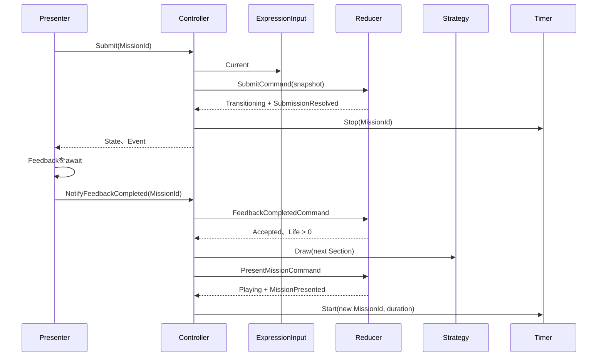
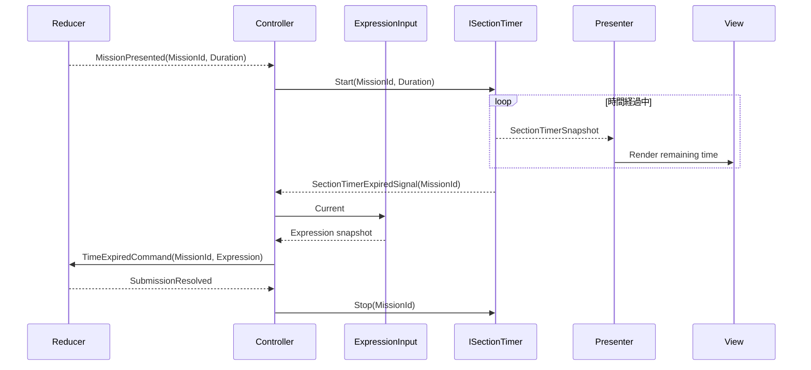

# CCC Unityクラス設計

> [ドキュメント一覧](../README.md) / 区分: クラス設計
>
> 正本: [Cosense「CCC Unityクラス設計」](https://scrapbox.io/proto-TeamL/CCC%20Unity%E3%82%AF%E3%83%A9%E3%82%B9%E8%A8%AD%E8%A8%88)
> 取得時点の原文更新日時: 2026-08-29T22:02:58.000Z


> 対象：Unity 6 / Normal / LifeEndless / 簡易版Mission / Tier 1〜2優先

## 1. 目的

本書は、CCCのGameplayをUnityで実装するためのクラス境界、依存方向、状態遷移、公開API、MVP接続、DI構成を定義する。

設計の中心は次の2点である。

- ModelをUnityやリアクティブライブラリから独立した不変データとして扱う。
- Modelを処理する`Ccc.Core.Logic`をFunctional Core、`Ccc.Core.UseCases`以降のタイマー・乱数・演出・画面遷移をImperative Shellとして分離する。

設計対象はGameplayと、Title／MainMenu／Resultへ接続する画面遷移ポートである。

実装順、担当分け、受け入れ条件は[プロトスプリントリーグ当日のUnity実装計画](https://scrapbox.io/proto-TeamL/%E3%83%97%E3%83%AD%E3%83%88%E3%82%B9%E3%83%97%E3%83%AA%E3%83%B3%E3%83%88%E3%83%AA%E3%83%BC%E3%82%B0%E5%BD%93%E6%97%A5%E3%81%AEUnity%E5%AE%9F%E8%A3%85%E8%A8%88%E7%94%BB)を参照する。

中核ロジックの全体フロー、詳細なクラス関係、所有関係は[CCC Unity中核ロジック関係図](./core/core-logic-overview.md)を参照する。

AudioKey、再生責務、ScriptableObjectによるClip設定、DI lifetimeは[CCC UnityAudioクラス設計](./infrastructure/audio.md)を参照する。
TitleScene／GameScene、Scene内Screen、Result／Retryの接続は[CCC Unity画面遷移クラス設計](./presentation/scene-navigation.md)を参照する。

## 2. 設計原則

[CCC実装における設計原則](./design-principles.md)を参照

## 3. Assembly定義

[CCC_asmdef](./assembly-boundaries.md)を参照

## 4. Ccc.Core.Model設計

ModelはUnity型を含まない通常classまたは`readonly struct`とし、生成後に変更できない。配置Rootは`Assets/CCC/Scripts/Core/Model/`、assemblyは`Ccc.Core`、名前空間は`Ccc.Core.Model`とする。

共通契約：

- nullの参照引数は`ArgumentNullException`、範囲外の数値は`ArgumentOutOfRangeException`、引数間の関係が不正なら`ArgumentException`で拒否する。例外の`ParamName`は公開引数名と一致させる。
- Collectionはconstructorで配列へコピーし、`IReadOnlyList<T>`として公開する。
- clamp、既定値、空Collectionへの自動補正をしない。公開constructor／Factoryから生成できたinstanceは常に不変条件を満たす。

### 4.1 Rational ✅

ファイル：`Rational.cs`、`RationalMath.cs`

```csharp
public readonly struct Rational :
   IEquatable<Rational>,
   IComparable<Rational>
{
   public long Numerator { get; }
   public long Denominator { get; }
   public bool IsInteger => Denominator == 1;

   public static Rational Create(long numerator, long denominator);
   public int CompareTo(Rational other);
   public bool Equals(Rational other);
   public override bool Equals(object? obj);
   public override int GetHashCode();
   public override string ToString();
   public static bool operator ==(Rational left, Rational right);
   public static bool operator !=(Rational left, Rational right);
}

public static class RationalMath
{
   public static Rational Add(Rational left, Rational right);
   public static Rational Subtract(Rational left, Rational right);
   public static Rational Multiply(Rational left, Rational right);
   public static Rational Divide(Rational left, Rational right);
}
```

`Create`は分母を正数にし、最大公約数で約分し、0を`0/1`へ正規化する。`denominator == 0`は`ArgumentOutOfRangeException(nameof(denominator))`。正規化または演算結果が`long`へ収まらなければ`OverflowException`。`Divide`の右辺0は`DivideByZeroException`とする。演算と比較をfloat／doubleへ変換しない。

`ToString()`は整数なら`"3"`、それ以外は`"3/2"`形式でCultureに依存しない。`Create(2, 4) == Create(1, 2)`、`Create(1, -2)`は`-1/2`となる。途中で交差約分するかは公開挙動を守る限り自由とする。

### 4.2 CalculationResult ✅

ファイル：`CalculationResult.cs`

```csharp
public enum CalculationResultKind
{
   Uninitialized = 0,
   Defined,
   DivisionByZero
}

public readonly struct CalculationResult : IEquatable<CalculationResult>
{
   public CalculationResultKind Kind { get; }
   public bool IsDefined => Kind == CalculationResultKind.Defined;
   public Rational Value { get; }

   public static CalculationResult Defined(Rational value);
   public static CalculationResult DivisionByZero();
}
```

`default(CalculationResult)`は`Uninitialized`。`Kind != Defined`で`Value`へアクセスすると`InvalidOperationException`。`Defined(0/1)`は正常値であり、0除算や未初期化と混同しない。

### 4.3 ExpressionとOperatorType ✅

ファイル：`Expression.cs`、`OperatorType.cs`

```csharp
public enum OperatorType
{
   Add = 0,
   Subtract,
   Multiply,
   Divide
}

public readonly struct Expression : IEquatable<Expression>
{
   public int Left { get; }
   public OperatorType Operator { get; }
   public int Right { get; }

   public Expression(int left, OperatorType @operator, int right);
}
```

未定義の`OperatorType`は`ArgumentOutOfRangeException(nameof(@operator))`。数字範囲はConfig依存のためExpressionでは制限せず、`ExpressionInput`が検証する。循環順は`Add -> Subtract -> Multiply -> Divide -> Add`で固定する。

### 4.4 MissionCondition ✅

ファイル：`MissionKind.cs`、`MissionCondition.cs`

```csharp
public readonly struct MissionCondition : IEquatable<MissionCondition>
{
   public MissionKind Kind { get; }
   public int ParameterA { get; }
   public int ParameterB { get; }
   public bool IsNegated { get; }

   public static MissionCondition Create(MissionKind kind);
   public static MissionCondition Create(MissionKind kind, int parameter);
   public static MissionCondition Between(int lowerBound, int width);
   public static MissionCondition Modulo(int divisor, int remainder);
}
```

`Create(kind)`はパラメータなしKind、`Create(kind, parameter)`は1パラメータKindだけを受理する。対応しないKindは`ArgumentException`（`ParamName == nameof(kind)`）、未定義Kindは`ArgumentOutOfRangeException(nameof(kind))`。

- Betweenは`ParameterA = lowerBound`、`ParameterB = width`。widthは1以上。`lowerBound + width`がint範囲外なら`OverflowException`。
- Moduloは`ParameterA = divisor`、`ParameterB = remainder`。divisorは2以上、remainderは0以上divisor未満。
- Multipleは2以上、Absoluteは1以上、OnesDigitとDecimalFirstDigitは0〜9。
- AtLeast／AtMost／Exactはint全域。
- プロトスプリント版の`IsNegated`は常にfalse。

Kind分類：

- パラメータなし：Even、Odd、Integer、Decimal、Positive、Negative、Prime、Zero、Square、Composite
- 1パラメータ：AtLeast、AtMost、Exact、Multiple、Absolute、OnesDigit、DecimalFirstDigit
- 2パラメータ：Between、Modulo

### 4.5 Mission、MissionId、MissionCandidate ✅

ファイル：`MissionId.cs`、`Mission.cs`、`MissionCandidate.cs`

```csharp
public readonly struct MissionId : IEquatable<MissionId>
{
   public int Value { get; }
   public MissionId(int value);
}

public sealed class Mission
{
   public MissionId Id { get; }
   public MissionCondition Condition { get; }
   public int Tier { get; }
   public Mission(MissionId id, MissionCondition condition, int tier);
}

public sealed class MissionCandidate
{
   public MissionCondition Condition { get; }
   public int Tier { get; }
   public int ExpressionMatchCount { get; }
   public int EvaluatedExpressionCount { get; }
   public float ExpressionMatchRatio { get; }
   public ExpressionCandidate AnswerExample { get; }

   public MissionCandidate(
       MissionCondition condition,
       int tier,
       int expressionMatchCount,
       int evaluatedExpressionCount,
       ExpressionCandidate answerExample);
}
```

`MissionId.Value <= 0`と`tier <= 0`は対応する引数の`ArgumentOutOfRangeException`。`MissionCandidate`は`evaluatedExpressionCount > 0`、`1 <= expressionMatchCount <= evaluatedExpressionCount`を要求し、割合をconstructor内で算出する。BuilderはAnswerExampleがDefinedかつConditionへ一致することを保証してから渡す。

MissionIdはSession内で1から始まり、提示ごとに1増える。CandidateはIdを持たず、提示時にMissionへ変換する。

### 4.6 MissionCatalog ✅

ファイル：`MissionCatalog.cs`

```csharp
public sealed class MissionCatalog
{
   public IReadOnlyList<MissionCandidate> Candidates { get; }
   public MissionCatalog(IReadOnlyList<MissionCandidate> candidates);
}
```

null、0件、null要素、同じCondition・Tierの重複を拒否する。入力順を保持してコピーする。Catalogが空の失敗はBuilderのResultで表し、空Catalog instanceを作らない。

### 4.7 GameplayConfig

ファイル：`GameplayConfig.cs`、`TimerConfig.cs`、`TierProgression.cs`

```csharp
public sealed class TimerConfig
{
   public TimeSpan InitialDuration { get; }
   public TimeSpan ReductionPerSection { get; }
   public TimeSpan MinimumDuration { get; }
   public TimeSpan GetDuration(int section);
}

public sealed class TierProgression
{
   public int GetTier(int section);
}

public sealed class GameplayConfig
{
   public int MinimumNumber { get; }
   public int MaximumNumber { get; }
   public Expression InitialExpression { get; }
   public int InitialLife { get; }
   public TimerConfig Timer { get; }
   public TierProgression TierProgression { get; }
   public bool ShowCurrentAnswer { get; }
   public float MinimumExpressionMatchRatio { get; }
   public float MaximumExpressionMatchRatio { get; }
   public int MinimumExpressionMatchCount { get; }
   public int ZeroAndPrimeMinimumExpressionMatchCount { get; }
   public float CurrentTierDrawWeight { get; }
   public float LowerTierDrawWeight { get; }

   public int GetMinimumExpressionMatchCount(MissionKind kind);
}
```

constructorは全propertyと同名の引数を受ける。`MinimumNumber <= MaximumNumber`、初期式の左右が範囲内、`InitialLife > 0`、割合と重みが有限、割合が0〜1、最小割合以下最大割合、各重みが0以上かつ合計が正、最小件数が1以上であることを生成時に検証する。

`TimerConfig`は初期時間と最低時間が正、短縮量が0以上であることを要求し、最低時間より短くしない。`GetDuration(section <= 0)`と`GetTier(section <= 0)`は`ArgumentOutOfRangeException(nameof(section))`。

型の使い分け：

- 式の結果とMission成否：`Rational`
- 個数、Section、Life：`int`
- 割合、確率、抽選重み：`float`
- Coreの時間：`TimeSpan`。Inspectorの秒数floatからの変換はInfrastructure。

Normal初期値：

| 項目 | 値 |
| --- | --- |
| 数字範囲 | 1〜5 |
| 初期式 | 1 + 1 |
| 初期Life | 3 |
| 初期時間 | 10秒 |
| Sectionごとの短縮 | 0.5秒 |
| 最低時間 | 3秒 |
| Tier 1 | Section 1〜3 |
| Tier 2 | Section 4〜7 |
| Tier 3 | Section 8〜11 |
| Tier 4 | Section 12以降 |
| Current／Lower Tier重み | 0.60／0.40 |
| 式適合割合 | 0.10〜0.50 |
| 最小適合式数 | 通常2、Zero／Prime 1 |
| ShowCurrentAnswer | false |

#### DI

`GameplayConfig`はGameplay Scopeの`Scoped`。Scope構築中、`ExpressionInput`を解決する前に1回生成する。

```csharp
builder.Register<GameplayConfig>(_ =>
{
   var result = configAsset.CreateRuntimeConfig();
   if (!result.IsSuccess)
       throw new GameplayConfigurationException(result.Errors);
   return result.Value;
}, Lifetime.Scoped);
```

`MissionCatalog`、`GameplaySessionContext`、`GameplayState`はDI登録せず、Session開始後に`GameplayController`が所有する。

### 4.8 GameplaySessionContext、GameplayState、SubmissionResolution

ファイル：`GameplaySessionContext.cs`、`GameplayState.cs`、`SubmissionResolution.cs`

```csharp
public sealed class GameplaySessionContext
{
   public GameplayConfig Config { get; }
   public MissionCatalog MissionCatalog { get; }
   public GameplaySessionContext(GameplayConfig config, MissionCatalog missionCatalog);
}

public enum GameplayStatus { Playing, Transitioning, GameOver }
public enum SubmissionTrigger { ManualSubmit, TimeExpired }

public sealed class GameplayState
{
   public GameplayStatus Status { get; }
   public int Section { get; }
   public int Life { get; }
   public Mission CurrentMission { get; }
   public SubmissionResolution? LastResolution { get; }
   public int CorrectAnswerCount => Math.Max(0, Section - 1);
   public bool IsAcceptingSubmit => Status == GameplayStatus.Playing;
   public bool IsTransitioning => Status == GameplayStatus.Transitioning;

   public GameplayState(
       GameplayStatus status,
       int section,
       int life,
       Mission currentMission,
       SubmissionResolution? lastResolution);
}

public sealed class SubmissionResolution
{
   public MissionId MissionId { get; }
   public SubmissionTrigger Trigger { get; }
   public Expression SubmittedExpression { get; }
   public bool IsSuccess { get; }
   public CalculationResult CalculationResult { get; }

   public SubmissionResolution(
       MissionId missionId,
       SubmissionTrigger trigger,
       Expression submittedExpression,
       bool isSuccess,
       CalculationResult calculationResult);
}
```

Contextはnullを拒否する。Stateは`section > 0`、`life >= 0`を要求する。`Playing`ではlifeが正。`Transitioning`／`GameOver`ではLastResolutionが必須かつCurrentMissionとMissionIdが一致する。`GameOver`では`life == 0`。未定義enumを拒否する。

`CalculationResult.Kind != Defined`なら`SubmissionResolution.IsSuccess`はfalseだけを許可する。Session固定値はContext、進行はState、編集中の式は§7.2、残り時間は`SectionTimerSnapshot`が所有する。

### 4.9 SessionResult

ファイル：`SessionResult.cs`

```csharp
public sealed class SessionResult
{
   public int FinalSection { get; }
   public Mission LastMission { get; }
   public SubmissionResolution LastResolution { get; }
   public Expression FinalExpression => LastResolution.SubmittedExpression;
   public int CorrectAnswerCount => Math.Max(0, FinalSection - 1);

   public SessionResult(
       int finalSection,
       Mission lastMission,
       SubmissionResolution lastResolution);
}
```

`finalSection <= 0`、null、LastMissionとLastResolutionのMissionId不一致を拒否する。Life 0後の`FeedbackCompletedCommand`が受理された時だけ生成する。

### 4.10 Model受け入れ条件

- 公開constructor／Factoryだけで正常instanceを生成できる。
- 不正値の例外型とParamNameが本章と一致する。
- 生成後にCollectionやpropertyを外部から変更できない。
- Rationalの正規化、等値性、Hash、比較が一致する。
- `default(CalculationResult)`を正常値として扱わない。
- MissionIdとMission提示回数が1対1に対応する。
- UnityEngine、R3、VContainer、時刻取得、乱数取得を参照しない。

## 5. Ccc.Core.Logic設計

配置Rootは`Assets/CCC/Scripts/Core/Logic/`、assemblyは`Ccc.Core`、名前空間は`Ccc.Core.Logic`とする。全処理を同期・決定的にし、Unity型、乱数生成、時刻取得、R3を参照しない。

### 5.1 式評価

ファイル：`ExpressionCalculator.cs`

```csharp
public static class ExpressionCalculator
{
   public static CalculationResult Evaluate(Expression expression);
}
```

Operatorとの対応はAdd＝`RationalMath.Add`、Subtract＝Subtract、Multiply＝Multiply、Divide＝Divideとする。左右のintは分母1のRationalへ変換する。Divideで`expression.Right == 0`のときだけ`CalculationResult.DivisionByZero()`を返す。未定義Operatorは`ArgumentOutOfRangeException(nameof(expression))`。表現不能な結果の`OverflowException`は握り潰さず呼び出し元へ送出する。

例：

- `1 + 2 -> Defined(3/1)`
- `1 / 2 -> Defined(1/2)`
- `1 / 0 -> DivisionByZero`
- `0 / 3 -> Defined(0/1)`

### 5.2 ExpressionCandidate列挙

`ExpressionCandidate`はLogicの出力として使う不変データだが、`MissionCandidate`が保持するため`Ccc.Core.Model`へ置く。

```csharp
public readonly struct ExpressionCandidate : IEquatable<ExpressionCandidate>
{
   public Expression Expression { get; }
   public CalculationResult Result { get; }

   public ExpressionCandidate(
       Expression expression,
       CalculationResult result);
}

public static class ExpressionCandidateGenerator
{
   public static IReadOnlyList<ExpressionCandidate> Generate(
       int minimumNumber,
       int maximumNumber);
}
```

`minimumNumber > maximumNumber`は`ArgumentException`（`ParamName == nameof(minimumNumber)`）。全組合せ数がint範囲を超える場合は`ArgumentOutOfRangeException(nameof(maximumNumber))`。

列挙順をLeft昇順、Right昇順、Operatorのenum順に固定する。左右の全組合せと4演算子を評価し、DivisionByZeroだけを除外する。同じ結果でも式が異なれば別Candidateとする。戻り値は配列へ確定し、呼び出し側から変更できない。

### 5.3 Mission成否判定

ファイル：`MissionConditionMatcher.cs`

```csharp
public static class MissionConditionMatcher
{
   public static bool IsMatch(
       MissionCondition condition,
       CalculationResult result);
}
```

`result.Kind != Defined`はfalse。`Defined`では[生成するMission](../requirements/missions/mission-types.md)の成立条件をそのまま実装し、パラメータ候補とTierは[Missionパラメータ候補プリセット](../requirements/missions/candidate-presets.md)を参照する。少なくとも完成範囲のTier 1〜2は全Kindを実装する。

判定上の固定規則：

- Even／Odd／Prime／Square／Multipleなど「整数のみ」の条件は`result.Value.IsInteger`を先に確認する。
- Evenは0を含む。Oddは絶対値を2で割った余りが1。
- Primeは2以上の正整数。試し割りは平方根以下までとする。
- Decimalは`!IsInteger`。
- Betweenは下限と`下限 + 幅`の両端を含む。
- Moduloは負数にもユークリッド剰余を使い、結果を0以上divisor未満に正規化する。
- `condition.IsNegated`がtrueなら、通常条件の結果を最後に1回だけ反転する。
- Rationalの比較・整数性を使い、float／doubleへ変換しない。

KindごとのswitchをMatcherへ集約し、ReducerとCatalogBuilderに同じ判定を重複実装しない。境界例は[CCCテスト仕様](../requirements/testing/acceptance-specification.md)を参照する。

用語：

| 工程 | コード |
| --- | --- |
| 条件と結果の一致判定 | `MissionConditionMatcher.IsMatch` |
| 候補の統計取得 | `MissionCatalogBuilder`内部の`Analyze` |
| Catalogへ含める判断 | `ShouldInclude` |
| Catalog構築 | `MissionCatalogBuilder.Build` |
| Catalogからの実行時抽選 | `IMissionDrawStrategy.Draw` |
| Reducerによる提示確定 | `PresentMissionCommand` |
| 提示完了Event | `MissionPresentedEvent` |

### 5.4 Catalog構築

ファイル：`MissionParameterCandidate.cs`、`MissionCatalogBuildResult.cs`、`MissionCatalogBuilder.cs`

```csharp
public readonly struct MissionParameterCandidate
{
   public MissionCondition Condition { get; }
   public int Tier { get; }

   public MissionParameterCandidate(
       MissionCondition condition,
       int tier);
}

public enum MissionCatalogBuildFailureKind
{
   None = 0,
   NoExpressions,
   NoParameters,
   EmptyCatalog
}

public sealed class MissionCatalogBuildResult
{
   public bool IsSuccess { get; }
   public MissionCatalog Catalog { get; }
   public MissionCatalogBuildFailureKind FailureKind { get; }
   public string FailureMessage { get; }
}

public static class MissionCatalogBuilder
{
   public static MissionCatalogBuildResult Build(
       IReadOnlyList<ExpressionCandidate> expressions,
       IReadOnlyList<MissionParameterCandidate> parameters,
       GameplayConfig config);
}
```

null引数は`ArgumentNullException`。Collection内の不正要素や同じCondition・Tierの重複は`ArgumentException`を該当Collectionの引数名で送出する。0件は例外にせず、対応するFailureKindを返す。

Result契約：

- 成功時は`IsSuccess == true`、`FailureKind == None`、`Catalog`へアクセス可能、`FailureMessage == string.Empty`。
- 失敗時は`IsSuccess == false`、Catalogアクセスで`InvalidOperationException`、FailureKindはNone以外、FailureMessageはログへ出せる非空文字列。
- 公開constructorを持たせず、Builder内部またはinternal Factoryだけが生成する。

Builderは入力順に各Parameterを処理し、全Defined ExpressionCandidateへMatcherを適用する。DivisionByZero CandidateはGeneratorで除外済みだが、外部入力に含まれても分母へ数えない。

選出条件：

- 正常な適合式が1件以上。
- 正常な非適合式が1件以上。
- 適合割合がConfigの最小以上、最大以下。
- `config.GetMinimumExpressionMatchCount(condition.Kind)`以上の適合式。
- 正常なAnswerExampleが1件以上。
- Kind固有パラメータ制約を満たす。

AnswerExampleは列挙順で最初に一致したCandidateとする。Catalog順は`Tier -> MissionKind -> ParameterA -> ParameterB -> IsNegated`の昇順へ固定し、抽選結果の再現性を保つ。候補分析と選出判定はprivate static methodとし、public APIを増やさない。

### 5.4.1 具体例

数字1〜2ではExpressionをLeft、Right、Operator順に列挙する。ConditionがEvenなら、Defined候補だけを分母とし、結果が偶数整数のCandidateを数える。割合と最小件数を満たせば、最初に一致した式をAnswerExampleとしてMissionCandidateを生成する。

パラメータ0件なら`NoParameters`、Defined式0件なら`NoExpressions`、分析後に選出0件なら`EmptyCatalog`。いずれも空Catalogを成功値として返さない。

### 5.4.2 受け入れ条件

- 同じ入力からCandidate内容・順序・AnswerExampleが一致する。
- BuilderとReducerの一致判定がMatcherへ一本化されている。
- DivisionByZeroを分析分母に含めない。
- Failure時にCatalogへアクセスできない。
- Unity、乱数Source、時刻、表示文言を参照しない。

### 5.5 Index Selector

Selectorは、呼び出し側から渡された0以上1未満のsampleをIndexへ変換する同期・決定的な純粋関数である。乱数の取得、候補の抽出、Tier／Kindの選択手順は§7.4のMission抽選Strategyが担当し、Selectorは乱数Source、Catalog、Mission型を参照しない。

#### 5.5.1 所属とファイル

| 型 | assembly／名前空間 | 配置 |
| --- | --- | --- |
| `WeightedIndexSelector` | `Ccc.Core`／`Ccc.Core.Logic` | `Assets/CCC/Scripts/Core/Logic/WeightedIndexSelector.cs` |
| `UniformIndexSelector` | `Ccc.Core`／`Ccc.Core.Logic` | `Assets/CCC/Scripts/Core/Logic/UniformIndexSelector.cs` |

両方とも状態を持たない`static class`とする。UnityEngine、R3、乱数APIを参照しない。

#### 5.5.2 公開API

```csharp
namespace Ccc.Core.Logic;

public static class WeightedIndexSelector
{
   public static int SelectIndex(
       IReadOnlyList<float> weights,
       float sample);
}

public static class UniformIndexSelector
{
   public static int SelectIndex(
       int count,
       float sample);
}
```

戻り値は常に0以上、選択肢数未満のIndexである。不正入力は戻り値や独自Result型で表現せず、引数例外を同期的に送出する。`-1`、clamp、入力の自動補正、`TrySelectIndex`は使用しない。

#### 5.5.3 共通のsample契約

`sample`は0以上1未満の有限な`float`とする。

- `0f`は有効。
- `1f`は無効。
- 負数、`NaN`、正負の無限大は無効。
- 無効なsampleは`ArgumentOutOfRangeException`を`nameof(sample)`で送出する。
- 同じ有効入力には必ず同じIndexを返す。

Selector内で乱数を生成しない。§7.4のStrategyが`IRandomSource.NextFloat01()`からsampleを取得し、選択肢が2件以上ある段階だけSelectorを呼ぶ。Selector自体は選択肢1件でも使用可能であり、有効なsampleに対してIndex 0を返す。

#### 5.5.4 WeightedIndexSelector

入力契約：

- `weights == null`は`ArgumentNullException`を`nameof(weights)`で送出する。
- `weights.Count == 0`は`ArgumentException`を`nameof(weights)`で送出する。
- 各重みは0以上の有限な`float`とする。
- 負数、`NaN`、正負の無限大を含む場合は`ArgumentOutOfRangeException`を`nameof(weights)`で送出する。
- 重み0は許可するが、そのIndexは選択されない。
- 全重みが0の場合は`ArgumentException`を`nameof(weights)`で送出する。

処理手順：

- 1. weightsとsampleをすべて検証する。
- 2. 誤差を抑えるため、合計重みと累積重みは`double`で計算する。
- 3. `scaledSample = (double)sample * totalWeight`を求める。
- 4. Index 0から重みを累積し、`scaledSample < cumulativeWeight`を最初に満たしたIndexを返す。
- 5. 重み0のIndexは幅0の区間となるため選択しない。
- 6. 有効入力に対して浮動小数点の累積誤差で末尾まで到達した場合は、最後の正の重みを持つIndexを返す。

各Indexの区間は左閉右開とする。重み`[0.6f, 0.4f]`では、正規化後の区間は次となる。

| sample | 結果 |
| --- | --- |
| `0.0f` | Index 0 |
| `0.5999f` | Index 0 |
| `0.6f` | Index 1 |
| `0.9999f` | Index 1 |

重み`[0f, 3f, 0f, 1f]`では、`sample == 0f`はIndex 1、`sample == 0.75f`はIndex 3を返す。Index 0とIndex 2は選択しない。

計算量はO(n)、追加領域はO(1)とする。入力Collectionの順序を変更せず、新しいCollectionを生成しない。

#### 5.5.5 UniformIndexSelector

入力契約：

- `count <= 0`は`ArgumentOutOfRangeException`を`nameof(count)`で送出する。
- sampleの検証は§5.5.3と同じとする。

Indexは次で求める。

```csharp
var index = (int)Math.Floor((double)sample * count);
```

有効なsampleは1未満のため、結果は必ず`0..count-1`に収まる。clampは行わない。

| count | sample | 結果 |
| --- | --- | --- |
| 1 | `0.0f` | Index 0 |
| 1 | `0.9999f` | Index 0 |
| 3 | `0.0f` | Index 0 |
| 3 | `0.4f` | Index 1 |
| 3 | `0.9999f` | Index 2 |

計算量はO(1)、追加領域はO(1)とする。

#### 5.5.6 実装上の自由裁量

次は公開挙動へ影響しない限り実装側が決めてよい。

- 引数検証をprivate methodへ分けるか。
- 最後の正の重みを走査中に記録するか、必要時に逆順探索するか。
- 例外messageの文面。
- XML documentation commentの文面。

次は禁止する。

- UnityEngine.Random、System.Random、時刻、staticなmutable状態への依存。
- 確率分布を確認するための多数回試行。
- 不正入力に対する既定Indexの返却。
- weightsの並べ替え、正規化結果の外部保存。
- floatの等値比較だけで区間境界を決める実装。

#### 5.5.7 受け入れ条件

- 公開APIが§5.5.2と一致する。
- 有効入力では範囲内のIndexを返す。
- 不正入力では§5.5.3〜§5.5.5の例外型とparamNameが一致する。
- 重み付き選択が左閉右開の区間規則に従う。
- 重み0のIndexを選択しない。
- 全重み0を拒否する。
- 一様選択が`floor(sample * count)`と一致する。
- 同じ入力から常に同じIndexを返す。
- Unity、乱数Source、Mission型を参照しない。
- §7.4の固定sample例から期待するCandidateを再現できる。

## 6. Ccc.Core.LogicのSession Command、Event、Reducer ✅

配置Rootは`Assets/CCC/Scripts/Core/Logic/Gameplay/`、namespaceは`Ccc.Core.Logic`とする。Command、Event、Transitionは不変データ、Reducerは状態を持たない`static class`とする。

### 6.1 Session Command

```csharp
public abstract class GameplayCommand { }

public sealed class SubmitCommand : GameplayCommand
{
   public MissionId MissionId { get; }
   public Expression SubmittedExpression { get; }
   public SubmitCommand(
       MissionId missionId,
       Expression submittedExpression);
}

public sealed class TimeExpiredCommand : GameplayCommand
{
   public MissionId MissionId { get; }
   public Expression SubmittedExpression { get; }
   public TimeExpiredCommand(
       MissionId missionId,
       Expression submittedExpression);
}

public sealed class FeedbackCompletedCommand : GameplayCommand
{
   public MissionId MissionId { get; }
   public FeedbackCompletedCommand(MissionId missionId);
}

public sealed class PresentMissionCommand : GameplayCommand
{
   public MissionId PreviousMissionId { get; }
   public MissionCandidate Candidate { get; }
   public PresentMissionCommand(
       MissionId previousMissionId,
       MissionCandidate candidate);
}
```

各constructorは参照引数のnullを拒否する。数字・演算子変更はCommandにせず、Controllerから`ExpressionInput`へ渡す。Submit／TimeExpiredの式は入力時点のsnapshotであり、Reducer内で`ExpressionInput`を参照しない。

### 6.2 Presentation Event

```csharp
public abstract class GameplayEvent { }

public sealed class MissionPresentedEvent : GameplayEvent
{
   public Mission Mission { get; }
   public TimeSpan Duration { get; }
}

public sealed class SubmissionResolvedEvent : GameplayEvent
{
   public SubmissionResolution Resolution { get; }
   public ExpressionCandidate AnswerExample { get; }
   public int RemainingLife { get; }
}

public sealed class SessionEndedEvent : GameplayEvent
{
   public SessionResult Result { get; }
}
```

constructorは全propertyと同名の引数を受け、null、負のRemainingLife、正でないDurationを拒否する。Eventは発生済みの論理事実だけを表し、色、Animation名、日本語文言、AudioKeyを持たない。

### 6.3 Reducer API

```csharp
public sealed class GameplayTransition
{
   public GameplayState NextState { get; }
   public IReadOnlyList<GameplayEvent> Events { get; }
   public bool IsAccepted { get; }

   internal static GameplayTransition Accepted(
       GameplayState nextState,
       params GameplayEvent[] events);

   internal static GameplayTransition Ignored(
       GameplayState currentState);
}

public static class GameplayReducer
{
   public static GameplayTransition Reduce(
       GameplaySessionContext context,
       GameplayState currentState,
       GameplayCommand command);
}
```

nullは`ArgumentNullException`を各引数名で送出する。未対応のCommand派生型は`ArgumentOutOfRangeException(nameof(command))`。状態上受理できない既知Commandは例外にせずIgnoredを返す。

Ignored契約：

- `IsAccepted == false`
- `ReferenceEquals(NextState, currentState) == true`
- `Events.Count == 0`
- State、Life、Section、MissionIdを変更しない。

Accepted契約：

- `IsAccepted == true`
- Eventは発生順の配列として固定し、呼び出し側から変更できない。
- Transition生成後にNextStateとEvent内容を変更できない。

ReducerはSession遷移、受理判定、式評価、Mission一致判定、Life／Section更新だけを担当する。State配信、Timer、抽選、演出待機、Audioは担当しない。

### 6.4 状態遷移表

| 現在Status | Command | ガード | 次Status | 更新／Event |
| --- | --- | --- | --- | --- |
| Playing | Submit | MissionId一致 | Transitioning | 式を判定。成功ならSection+1、失敗ならLife-1。SubmissionResolved |
| Playing | TimeExpired | MissionId一致 | Transitioning | TriggerだけTimeExpiredとし、同じ判定経路 |
| Transitioning | FeedbackCompleted | MissionId一致、Life>0 | Transitioning | 受理するがEventなし。Controllerが直ちに抽選 |
| Transitioning | FeedbackCompleted | MissionId一致、Life=0 | GameOver | SessionEnded |
| Transitioning | PresentMission | PreviousMissionId一致、Life>0 | Playing | MissionId+1、LastResolution維持、MissionPresented |

次はIgnoredとする。

- Playing以外のSubmit／TimeExpired。
- 現在MissionIdと一致しないSubmit／TimeExpired／FeedbackCompleted。
- Transitioning中の2回目のSubmit／TimeExpired。
- PlayingまたはGameOverでのFeedbackCompleted／PresentMission。
- PreviousMissionId不一致。
- GameOver後の全Command。

成功時はSubmissionResolvedの`IsSuccess == true`、Life維持、Sectionを1増やす。失敗時はSection維持、Lifeを1減らす。Lifeは0未満にしない。DivisionByZeroは失敗扱い。

`PresentMissionCommand`のMissionId採番でint上限を超える場合は`OverflowException`。これは状態ガードによるIgnoredではなく、Sessionを続行不能な内部限界として扱う。

### 6.5 処理順とEvent順

Submit／TimeExpired受理時：

- 1. Command内の式を`ExpressionCalculator.Evaluate`。
- 2. Definedなら`MissionConditionMatcher.IsMatch`。それ以外は失敗。
- 3. SubmissionResolutionを生成。
- 4. LifeまたはSectionを更新したTransitioning Stateを生成。
- 5. `SubmissionResolvedEvent`を1件だけ生成。

Life 0のFeedbackCompleted受理時：

- 1. StatusをGameOverへ変更。
- 2. 現在State、CurrentMission、LastResolutionからSessionResultを生成。
- 3. `SessionEndedEvent`を1件だけ生成。

Lifeが残るFeedbackCompleted受理後は、Controllerが同じ同期呼び出し内でStrategyを呼び、`PresentMissionCommand`をReducerへ渡す。Reducerは抽選しない。

PresentMission受理時：

- 1. `PreviousMissionId.Value + 1`で新しいIdを作る。
- 2. CandidateからMissionを作る。
- 3. Playing Stateを作る。
- 4. Config.Timerから新SectionのDurationを求める。
- 5. `MissionPresentedEvent`を1件だけ生成。

### 6.6 Sequence



ControllerがTransitionを適用する順は、`NextState公開 -> Timer停止／開始 -> Eventsを配列順に公開`で固定する。

### 6.7 実装上の自由裁量と禁止

自由裁量：

- Command／Eventを1ファイルまたは型別ファイルへ分ける。
- Accepted／Ignored Factoryのprivate helper構成。
- switch文または型patternの書き方。

禁止：

- Reducer内でSubjectへ通知する。
- Timer、乱数、Unity API、Audio、非同期処理を呼ぶ。
- Ignored時に新しい同値Stateを生成する。
- Eventの順序をCollection実装へ依存させる。
- 不正な既知状態を例外で通常制御する。

### 6.8 受け入れ条件

- 同じContext、State、Commandから同じTransitionを返す。
- SubmittedExpressionが入力後の変更から影響を受けない。
- SubmitとTimeExpiredが同じ判定経路を使う。
- 古いMissionIdと二重SubmitをIgnoredにする。
- Life 0はFeedback完了後にだけGameOverとSessionEndedへ進む。
- Mission提示のたびにMissionIdが1増える。
- Ignoredの参照同一性、空Event、IsAcceptedが契約と一致する。
- Core外の型を参照しない。

## 7. Ccc.Core.UseCases設計

### 7.1 公開ポート

```csharp
public enum SectionTimerStatus
{
   Running,
   Stopped,
   Expired
}

public readonly struct SectionTimerSnapshot
{
   public MissionId MissionId { get; }
   public SectionTimerStatus Status { get; }
   public TimeSpan RemainingTime { get; }
}

public readonly struct SectionTimerExpiredSignal
{
   public MissionId MissionId { get; }
}

public interface IGameplayFlow
{
   Observable<GameplayState> States { get; }
   Observable<Expression> Expressions { get; }
   Observable<GameplayEvent> Events { get; }
   Observable<GameplayFlowFailure> Failures { get; }
   Observable<SectionTimerSnapshot> TimerSnapshots { get; }

   GameplayStartResult StartSession(GameplayStartRequest request);
   void ChangeNumber(PlayerSide side);
   void ChangeOperator();
   void Submit(MissionId missionId);
   void NotifyFeedbackCompleted(MissionId missionId);
}

public interface ISectionTimer : IDisposable
{
   Observable<SectionTimerSnapshot> Snapshots { get; }
   Observable<SectionTimerExpiredSignal> ExpiredSignals { get; }
   void Start(MissionId missionId, TimeSpan duration);
   void Stop(MissionId missionId);
   void StopAll();
}

public interface IRandomSource
{
   float NextFloat01();
}

public interface IMissionDrawStrategy
{
   MissionDrawResult Draw(MissionDrawContext context);
}
```

`SectionTimerSnapshot`はTimer専用の読み取りモデルであり、Presenterの表示更新ストリームへ流す。Controllerは`SectionTimerExpiredSignal`を同じMissionIdと現在式を持つ`TimeExpiredCommand`へ変換する。

`IRandomSource.NextFloat01()`の契約は`0.0f <= value < 1.0f`とする。`UnityRandomSource`はUnity APIから1.0fが返り得る場合、1未満の最大値へclampしてから返す。`NaN`、無限大、範囲外はCoreのSelectorが拒否する。

### 7.2 ExpressionInput

`ExpressionInput`は提出式を作る1つの入力装置として扱う小さなmutable classである。

```csharp
public sealed class ExpressionInput : IDisposable
{
   public Expression Current { get; }
   public Observable<Expression> Expressions { get; }

   public void ChangeNumber(PlayerSide side);
   public void ChangeOperator();
   public void Reset(Expression expression);
}
```

- 数字範囲と演算子順を使って、現在式をその場で更新する。
- 変更後のExpressionを表示用に配信する。
- 変更APIの呼び出し元は`GameplayController`である。
- Controllerは`GameplayState.Status == Playing`の入力を変更APIへ渡す。
- Mission提示時は同じCurrentを保持する。

入力領域と現在値表示の共通化は[UIコンポーネントクラス設計](./presentation/ui-components.md)を参照する。`ExpressionInput`はGameplayの値所有者であり、OptionMenuから使用しない。

### 7.3 GameplayController

`GameplayController`は現在の`GameplayState`、`ExpressionInput`、Context、R3の配信SubjectをScopedで保持し、Gameplayの進行を調停する。

- Session開始時にAsset境界からConfigとMission候補を受け取り、ExpressionCandidateとMissionCatalogを1回だけ構築してContextとして保持する。
- 初回Candidateを抽選し、Section 1、初期Life、MissionId 1のStateを直接生成する。Stateと初期Expressionを公開し、Timer開始後に`MissionPresentedEvent`を公開する。
- 数字・演算子入力はStatusを確認して`ExpressionInput`へ渡す。
- SubmitとExpired Signalでは現在式をsnapshotし、対応するSession CommandをReducerへ渡す。
- ReducerのTransitionを受けたらNextStateを先に公開し、Timer開始・停止を行ってからPresentation Eventを公開する。
- Lifeが残るFeedback完了は、Reducer受理後にStrategyで抽選し、その場で`PresentMissionCommand`をReducerへ渡す。
- Timer Snapshotは`IGameplayFlow.TimerSnapshots`へ転送する。
- 設定不正、正常ExpressionCandidate 0件、Catalog 0件、抽選失敗は理由付き`GameplayFlowFailure`として扱い、Timerを停止する。

Controllerの各公開操作は、対応する内部処理とState／Event公開を同期的に完了させる。演出完了は`await`後に`NotifyFeedbackCompleted`として入力される。

### 7.4 Mission抽選Strategy

プロトスプリントリーグ版の`MissionDrawContext`は次を保持する。

- `GameplaySessionContext`（ConfigとSession固定Catalog）
- 次Missionが使うSection

Strategyは`MissionCandidate`を1件抽選して返す。`PresentMissionCommand`を受けたReducerがMissionIdを採番する。

Candidateの順序はCatalog構築時に`Tier -> MissionKind -> ParameterA -> ParameterB -> IsNegated`で固定する。同じCatalog、Section、Fake乱数列なら必ず同じCandidateが選ばれる。プロトスプリントリーグ版の抽選入力はCatalogとSectionである。

| 抽選タイミング | 呼び出し元 | Strategyへ渡す情報 | 抽選後 |
| --- | --- | --- | --- |
| Session初回 | `GameplayController.StartSession` | 構築済みContext、Section 1 | CandidateからMissionId 1の初期Stateを直接生成 |
| 2回目以降 | `GameplayController.NotifyFeedbackCompleted` | Session Context、更新後Section | `PresentMissionCommand`をReducerへ直接渡し、MissionIdを+1 |

`FixedMissionDrawStrategy`：

- 開発確認用。
- Evenの固定Candidateを返す。
- 開発確認用のStrategyとして登録できる。製品設定では`SimpleMissionDrawStrategy`を登録する。

`SimpleMissionDrawStrategy`：

- `TierResolver`でSectionのCurrent Tierを求め、CatalogをCurrent Tierと解放済みLower TierのBucketへ分ける。
- 実際に候補があるBucketだけを抽選対象にする。CurrentまたはLowerが空なら、残った側を乱数なしで選ぶ。
- 次の順序で抽選する。
- 1. 候補がある範囲だけでCurrent 0.60／Lower 0.40を正規化して選ぶ。
- 2. Lowerを選んだ場合は、候補のある下位Tierから一様に選ぶ。
- 3. 選ばれたTierで候補のあるKindから一様に選ぶ。
- 4. 選ばれたKindのCandidateから一様に選ぶ。
- 選択肢が2件以上ある「Current／Lower」、「Lower内Tier」、「Kind」、「同Kind内Candidate」の各段階でだけ`IRandomSource.NextFloat01()`を各1回呼ぶ。
- 得た`float`をCoreの`WeightedIndexSelector`または`UniformIndexSelector`へ渡す。
- Normal・簡易版の製品設定で使用する。

内部例：Section 5でCurrent Tier 2、LowerはTier 1だけ、Current／Lowerの両方に候補がある場合。

| 段階 | 選択肢 | Fake乱数 | 結果 |
| --- | --- | --- | --- |
| Current／Lower | Current 0.60、Lower 0.40 | 0.72 | Lower |
| Lower内Tier | Tier 1のみ | 消費しない | Tier 1 |
| Kind | Even、Odd、Integer | 0.40 | `floor(0.40 * 3) = 1`でOdd |
| Odd Candidate | `Odd(A)`、`Odd(B)` | 0.90 | `floor(0.90 * 2) = 1`で`Odd(B)` |

この例で`IRandomSource`が返す列を`0.72, 0.40, 0.90`に固定すると、常に同じCandidateが抽選される。Strategyは選択肢が2件以上ある分岐で乱数を順に取得する。本番は`UnityRandomSource`、テストは`SequenceRandomSource`をDIする。

抽選が候補0件や不正重みで失敗した場合、Controllerは`IGameplayFlow.Failures`へ理由付きの`GameplayFlowFailure`を公開してTimerを停止する。この失敗はCatalog／Configの内部不整合を表す。

`FullMissionDrawStrategy`は同じinterfaceを実装し、現在式と直前Missionを含む拡張DrawContextを使用する。Controllerが現在式を`ExpressionInput.Current`から渡す。

#### DI

`UnityRandomSource`と製品用StrategyはGameplay Scopeの`Scoped`。Strategyより先にRandomを登録する。

```csharp
builder.Register<IRandomSource, UnityRandomSource>(
   Lifetime.Scoped);
builder.Register<IMissionDrawStrategy, SimpleMissionDrawStrategy>(
   Lifetime.Scoped);
```

開発確認時だけ2行目を`FixedMissionDrawStrategy`へ差し替える。同時に複数Strategyを登録しない。

### 7.5 Timerのデータフロー



- Timer SnapshotはPresenterの表示更新ストリームへ配信する。
- SubmitとExpired Signalが競合しても、Reducerの`GameplayStatus`とMissionIdガードにより最初のCommandだけを受理する。
- 古いMissionIdのSnapshotはPresenterが表示から除外し、古いExpired SignalはReducerが棄却する。

### 7.6 不変データとResult契約

配置Rootは`Assets/CCC/Scripts/Core/UseCases/`、namespaceは`Ccc.Core.UseCases`とする。

```csharp
public enum GameplayFlowFailureKind
{
   None = 0,
   SessionAlreadyRunning,
   InvalidConfiguration,
   CatalogBuildFailed,
   MissionDrawFailed
}

public sealed class GameplayFlowFailure
{
   public GameplayFlowFailureKind Kind { get; }
   public string Message { get; }
}

public sealed class GameplayStartResult
{
   public bool IsSuccess { get; }
   public GameplaySessionContext Context { get; }
   public GameplayState InitialState { get; }
   public GameplayFlowFailure Failure { get; }
}

public sealed class MissionDrawContext
{
   public GameplaySessionContext SessionContext { get; }
   public int Section { get; }
}

public sealed class MissionDrawResult
{
   public bool IsSuccess { get; }
   public MissionCandidate Candidate { get; }
   public string FailureMessage { get; }
}
```

Result型はpublic constructorを持たず、同じnamespaceのinternal Factoryで生成する。成功時だけ成功値へ、失敗時だけFailure／FailureMessageへアクセスでき、それ以外は`InvalidOperationException`。`FailureKind.None`は成功Resultでだけ使用する。失敗messageは非空とし、画面文言ではなくログ用の技術情報とする。

`MissionDrawContext`はnullと`section <= 0`を拒否する。Draw失敗は候補0件、不正Catalog／Configなど、通常プレイでは発生しない内部不整合を表す。Strategyは例外を画面制御に使わず`MissionDrawResult`を返す。

### 7.7 ExpressionInputの生成・例外契約 ✅

```csharp
public sealed class ExpressionInput : IDisposable
{
   public Expression Current { get; }
   public Observable<Expression> Expressions { get; }

   public ExpressionInput(GameplayConfig config);
   public void ChangeNumber(PlayerSide side);
   public void ChangeOperator();
   public void Reset(Expression expression);
   public void Dispose();
}
```

constructorはConfigの初期式をCurrentとし、初期値をObservableへ自動発行しない。ControllerがSession開始成功時に初期Expressionを公開する。

`PlayerSide`はLeft／Rightだけを定義する。未定義値は`ArgumentOutOfRangeException(nameof(side))`。ChangeNumberは対象数字を最大値の次で最小値へ戻す。ChangeOperatorは§4.3の順に1段階進める。Resetは左右がConfig範囲外なら`ArgumentOutOfRangeException(nameof(expression))`。値が変わった公開操作は更新後のExpressionを1回だけ同期発行する。

Dispose後の公開操作とCurrentアクセスは`ObjectDisposedException`。Expressionsは完了し、二重Disposeは何もしない。

#### DI

Gameplay Scopeの`Scoped`。GameplayConfig登録後に生成する。

```csharp
builder.Register<ExpressionInput>(Lifetime.Scoped);
```

### 7.8 GameplayControllerの公開挙動

```csharp
public sealed class GameplayController :
   IGameplayFlow,
   IDisposable
{
   public GameplayController(
       GameplayConfig config,
       ExpressionInput expressionInput,
       ISectionTimer sectionTimer,
       IMissionDrawStrategy missionDrawStrategy);
}
```

#### DI

Gameplay Scopeの`Scoped`。`IGameplayFlow`として解決する。

```csharp
builder.Register<IGameplayFlow, GameplayController>(
   Lifetime.Scoped);
```

constructor引数はnullを拒否する。Controllerは入力ストリームとTimerを購読するが、Presentation型、Unity型、Asset型を参照しない。

`StartSession`：

- 1. Dispose済みなら`ObjectDisposedException`。
- 2. Playing／Transitioning中なら`SessionAlreadyRunning`の失敗Resultを返し、現在Sessionを変更しない。
- 3. constructorで注入したConfigとRequestからParameter候補を取得する。
- 4. ExpressionCandidate列挙、Catalog構築、Section 1のDrawを順に実行する。
- 5. 途中失敗ならTimerを`StopAll()`し、Failuresへ1件発行して同じFailureをStartResultへ返す。
- 6. 成功ならExpressionInputを初期式へResetし、Context、MissionId 1、Section 1、初期LifeのPlaying Stateを保持する。
- 7. States、Expressionsの順に初期値を各1件発行する。
- 8. TimerをStartする。
- 9. `MissionPresentedEvent`を1件発行し、成功Resultを返す。

ChangeNumber／ChangeOperatorはPlayingのときだけExpressionInputへ渡し、それ以外は何もしない。Submitは現在StateのMissionIdと一致し、Playingのときだけ現在式をsnapshotしてReducerへ渡す。NotifyFeedbackCompletedもMissionIdとStatusを確認してReducerへ渡す。これらの状態不一致はFailureへ流さない。

Transition適用順は`State保持 -> States発行 -> Timer操作 -> Events発行`。SubmissionResolved受理時はTimerをStopし、PresentMission受理時はTimerをStartする。

Expired Signalは現在MissionIdと一致し、PlayingのときだけTimeExpiredCommandへ変換する。古いSignalは無視する。Timer Snapshotは内容を変更せずTimerSnapshotsへ転送する。

GameOver後のStartSessionはRetryとして許可し、前SessionのTimer、Context、State、Subject内の一時値を初期化する。IRandomSourceのinstanceはStrategy側で維持するため乱数系列は継続する。

DisposeはTimer購読を解除し`StopAll()`して全Subjectを完了する。二重Disposeは何もしない。

### 7.9 SimpleMissionDrawStrategyの厳密な乱数消費

constructorで`IRandomSource`を受け取りnullを拒否する。各段階で候補0件なら失敗、1件なら乱数を消費せずIndex 0、2件以上なら1回だけ`NextFloat01()`を呼ぶ。

候補Collectionは次の順に生成する。

- Current／Lower：Current、Lowerの順。
- Lower Tier：Tier昇順。
- Kind：MissionKind enum昇順。
- Candidate：Catalog順。

Current／Lowerの一方が空なら他方を無条件選択する。両方ある場合だけ`[CurrentTierDrawWeight, LowerTierDrawWeight]`をWeighted Selectorへ渡す。下位Tier、Kind、CandidateはUniform Selectorを使う。

`FixedMissionDrawStrategy`はconstructorで固定Candidateを受け取り、DrawのSectionに関係なく成功で返す。null Candidateを受けない。「Evenを内部で検索する」責務は持たせない。

### 7.10 UseCases受け入れ条件

- Session開始失敗で部分的なContext、State、Timerを残さない。
- 初期公開順とTransition公開順が本章どおり。
- Playing以外の入力でExpressionを変更しない。
- SubmitとExpiredの競合はReducerが最初の1件だけ受理する。
- 古いTimer通知を現在Missionへ適用しない。
- RetryでStateは初期化し、乱数系列だけ継続する。
- 選択肢1件の段階で乱数を消費しない。
- Dispose後にTimer、State、Eventを発行しない。
- ControllerにUnity、UniTask、Audio、Viewの判断を入れない。

## 8. Ccc.PresentationのMVP設計

### 8.1 View契約

```csharp
public interface IGameplayView
{
   Observable<GameplayInput> Inputs { get; }

   void Render(GameplayViewStateDto state);
   UniTask PlayFeedbackAsync(
       FeedbackViewDataDto feedback,
       CancellationToken cancellationToken);
   void ShowConfigurationError(IReadOnlyList<string> errors);
   void ShowFatalError(string message);
}

public interface IGameplayNavigation
{
   void ShowResult(SessionResult result);
   UniTask NavigateToMainMenuAsync();
}
```

`IGameplayView`はGameplay画面全体の受動的なView契約である。Unity側の`GameplayView : MonoBehaviour`が子Viewを束ねて実装し、入力事実の通知、完成済みDTOの描画、成否演出を担当する。State遷移とMission成否はCore、画面遷移は`IGameplayNavigation`が担当する。

`IGameplayNavigation`はGameplay画面から外へ出るためのポートである。Infrastructure実装がScene遷移、Panel切り替え、画面スタックの方式を担当する。

`GameplayInput`は次を表す。

- PLAYER Aの数字変更
- PLAYER Aの演算子変更
- PLAYER Bの数字変更
- PLAYER Bの演算子変更
- Submit
- MainMenuへ戻る

### 8.2 GameplayPresenter

```csharp
public sealed class GameplayPresenter : IDisposable
{
   public void Start(CancellationToken cancellationToken);
}
```

責務：

- View Inputsを`IGameplayFlow.ChangeNumber`、`ChangeOperator`、`Submit`へ振り分ける。
- Gameplay State、Expression、同じMissionIdを持つ最新の`SectionTimerSnapshot`をprivateな`CreateViewStateDto`で結合し、ViewへRenderする。
- Timer Snapshot更新時は最新StateとExpressionを使ってDTOを再生成する。
- `SubmissionResolvedEvent`を`FeedbackViewDataDto`へ変換し、Viewの演出完了を待つ。
- 演出完了後、元Eventと同じMissionIdで`NotifyFeedbackCompleted`を呼ぶ。
- `SessionEndedEvent`を`IGameplayNavigation.ShowResult`へ渡す。
- MainMenu復帰入力で`IGameplayNavigation.NavigateToMainMenuAsync`を呼ぶ。遷移開始時にGameplay scopeをCancelする。
- `GameplayFlowFailure`を受けたら`IGameplayView.ShowFatalError`でプレイ続行不可を表示する。
- 自身のCancellationToken終了時に購読と進行中演出を破棄する。

式計算、Mission判定、Life更新、Tier抽選はCoreの結果をPresenterが表示へ変換する。

### 8.3 View DTOとFormatter

`GameplayViewStateDto`は表示に必要な完成済みデータを持つPresentation DTOである。DTOの型名は末尾を`Dto`で統一する。変換は`GameplayPresenter.CreateViewStateDto`で行い、現在Tierなどの導出にはCoreの`GameplayStateQueries`を利用する。

```csharp
private GameplayViewStateDto CreateViewStateDto(
   GameplaySessionContext context,
   GameplayState gameplayState,
   Expression expression,
   SectionTimerSnapshot? timerSnapshot);
```

このmethodはTimer Snapshotが存在し、`gameplayState.CurrentMission.Id == timerSnapshot.MissionId`の場合だけ残り時間を使用する。不一致なら古いTimer表示を捨て、現在Missionの最初のSnapshotが届くまでは`HasRemainingTime = false`とする。

```csharp
public sealed class GameplayViewStateDto
{
   public int Section { get; }
   public int Tier { get; }
   public int Life { get; }
   public string MissionText { get; }
   public string LeftText { get; }
   public string OperatorText { get; }
   public string RightText { get; }
   public string AnswerText { get; }
   public bool HasRemainingTime { get; }
   public float RemainingSeconds { get; }
   public bool IsTimeWarning { get; }
   public bool CanSubmit { get; }
}
```

ViewはDTOをText、Gauge、interactable表現へ反映する。`Rational`、`MissionCondition`、`GameplayStatus`の表示変換はPresenterが担当する。

`RationalDecimalFormatter`は次を実装する。

- 小数点以下2桁。
- 第3位以降が続く場合は丸めず切り捨て、`……`を付与。
- 整数と有限小数は0で補う。
- 0除算は`？`。

`MissionTextFormatter`は`MissionCondition`と`IMissionTextSource`を受け取って日本語文言を生成するPresentation classである。

```csharp
public interface IMissionTextSource
{
   string GetTemplate(MissionKind kind, bool isNegated);
}
```

`MissionTextAsset`がこのinterfaceを実装し、Presentation境界へ文言を提供する。

#### DI

両FormatterはGameplay Scopeの`Scoped`。`MissionTextFormatter`は`IMissionTextSource`をconstructorで受ける。

```csharp
builder.Register<RationalDecimalFormatter>(Lifetime.Scoped);
builder.Register<MissionTextFormatter>(Lifetime.Scoped);
```

GameplayとOptionMenuで共有する循環選択View、PointerDown入力、値所有者の分離は[UIコンポーネントクラス設計](./presentation/ui-components.md)を参照する。

### 8.4 GameplayInputとDTOの公開API

配置Rootは`Assets/CCC/Scripts/Presentation/Gameplay/`、namespaceは`Ccc.Presentation`とする。

```csharp
public enum GameplayInputKind
{
   ChangeLeftNumber = 0,
   ChangeLeftOperator,
   ChangeRightNumber,
   ChangeRightOperator,
   Submit,
   ReturnToMainMenu
}

public readonly struct GameplayInput
{
   public GameplayInputKind Kind { get; }
   public GameplayInput(GameplayInputKind kind);
}

public sealed class FeedbackViewDataDto
{
   public MissionId MissionId { get; }
   public bool IsSuccess { get; }
   public string AnswerText { get; }
   public int RemainingLife { get; }
}
```

未定義InputKindは`ArgumentOutOfRangeException(nameof(kind))`。GameplayInputはPointerId、GameObject、Button、PlayerSideを持たない。左右Operator入力はどちらもPresenterが`IGameplayFlow.ChangeOperator()`へ変換する。

`GameplayViewStateDto`と`FeedbackViewDataDto`は全propertyと同名のconstructor引数を持つ。`string`はnullを拒否し、`RemainingSeconds`は有限かつ0以上、`RemainingLife`は0以上を要求する。`HasRemainingTime == false`ではRemainingSecondsを0に固定する。

### 8.5 GameplayPresenterの生成と直列化

```csharp
public sealed class GameplayPresenter : IDisposable
{
   public GameplayPresenter(
       IGameplayFlow flow,
       IGameplayView view,
       IGameplayNavigation navigation,
       IAudioPlayer audio,
       RationalDecimalFormatter rationalFormatter,
       MissionTextFormatter missionTextFormatter);

   public void Start(CancellationToken cancellationToken);
   public void Dispose();
}
```

#### DI

Gameplay Scopeの`Scoped`。EntryPointへ具象型で注入する。

```csharp
builder.Register<GameplayPresenter>(Lifetime.Scoped);
```

全依存はconstructorでnullを拒否する。Startの二重呼び出しは`InvalidOperationException`、Dispose後のStartは`ObjectDisposedException`。Startは購読を設定するだけでSessionを開始しない。Session開始はGameplayEntryPointが行う。

最新のContext、State、Expression、Timer SnapshotはPresenter内に個別保持する。Renderに必要な3値が揃ったときだけDTOを生成する。新MissionIdのStateを受けた時点で古いTimer Snapshotを破棄し、最初の同Id Snapshotまでは`HasRemainingTime == false`。

SubmissionResolvedEventの処理：

- 1. 同じMissionIdの演出処理中なら重複Eventを無視する。
- 2. Feedback DTOを生成。
- 3. Eventに対応するAudioKeyを1回指定。
- 4. `PlayFeedbackAsync`をawait。
- 5. 正常完了かつToken未Cancelなら同じMissionIdで`NotifyFeedbackCompleted`。
- 6. Cancel／例外時はNotifyしない。例外はログへ渡し、FatalErrorを表示する。

演出は同時に複数走らせない。新しいSubmissionResolvedで古い演出を上書きしない。SessionEndedEventではResult表示を先に依頼し、その後Result BGMへ切り替える。

入力の振り分け：

| GameplayInputKind | 呼び出し |
| --- | --- |
| ChangeLeftNumber | `ChangeNumber(PlayerSide.Left)` |
| ChangeRightNumber | `ChangeNumber(PlayerSide.Right)` |
| ChangeLeftOperator／ChangeRightOperator | `ChangeOperator()` |
| Submit | 最新StateのCurrentMission.Idで`Submit` |
| ReturnToMainMenu | 入力購読を止めて`NavigateToMainMenuAsync()` |

入力音はControllerへ渡す直前に鳴らす。ただし最新StateがPlayingでない入力はControllerへ渡さず、入力音も鳴らさない。Audio詳細は[CCC UnityAudioクラス設計](./infrastructure/audio.md)に従う。

Disposeは購読、進行中演出、MainMenu遷移待機をCancelする。二重Disposeは何もしない。

### 8.6 Formatterの失敗契約

`RationalDecimalFormatter`は正常なRationalだけを入力とする。0除算表示`？`は`CalculationResult`を受け取る別overloadで処理し、Rationalへ不正値を作らない。

`IMissionTextSource.GetTemplate`がnull／空文字、不正placeholderを返した場合、`MissionTextFormatter`は`InvalidOperationException`、通常はLogErrorを出しFallback文章が返るようにする。Asset検証済みの通常経路では発生しない。Betweenの第2表示値は`ParameterA + ParameterB`、ModuloはParameterA、ParameterBの順に適用する。

### 8.7 Presentation受け入れ条件

- ViewはCore Modelを加工せず完成済みDTOだけを描画する。
- 同じMissionIdのFeedbackを1回だけ再生する。
- Cancelされた演出からFeedbackCompletedを通知しない。
- 古いTimer Snapshotを新Missionへ表示しない。
- Transitioning中の入力音とFlow入力を発生させない。
- PresenterがMission判定、Life更新、抽選を再実装しない。
- View契約にAudio再生methodを追加しない。

## 9. Infrastructure設計

### 9.1 GameplayView

`GameplayView`は複数の小さなMonoBehaviourを束ねて`IGameplayView`を実装する。

- `ExpressionView`
- `MissionView`
- `TimerView`
- `LifeView`
- `SubmitView`
- `DotweenFeedbackView`
- 4つのGameplay変更操作用`CycleSelectorView`
- Submit用`PointerDownInputView`

子Viewの責務は表示値の設定と入力通知である。共通部品の責務とGameplayへの割り当ては[UIコンポーネントクラス設計](./presentation/ui-components.md)を参照する。

#### DI

Gameplay ScopeのScene hierarchyから取得し、`IGameplayView`として解決する。

```csharp
builder.RegisterComponentInHierarchy<GameplayView>()
   .As<IGameplayView>();
```

### 9.2 マルチタッチ

`PointerDownInputView`は`IPointerDownHandler.OnPointerDown`ごとに1つの`Unit`を発行する。`GameplayView`が入力元のinstanceに応じて`GameplayInput`へ変換する。

- Input System UI Input Moduleを使用する。
- タッチは独立ポインタとして扱う設定にする。
- 入力はPointerDown時に通知する。
- 同じ領域への2本指は2回通知する。
- 左右OPERATORの同時入力は共有演算子を2段階進める。
- Gameplay操作の通知元は`IPointerDownHandler`に統一する。
- `GameplayController`が入力を受理し、ViewはStateに応じたinteractable表現を描画する。

### 9.3 DOTweenとUniTask

- `DotweenFeedbackView`などのUnity ViewがDOTweenを使用する。
- Viewの演出APIは`UniTask`を返す。
- Presenterから受け取ったCancellationTokenをTween待機へ伝播する。
- `UNITASK_DOTWEEN_SUPPORT`または導入したUniTask版のasmdef Version Definesを確認する。
- Cancel時はTweenをKillし、演出待機をCancellationとして完了する。
- 成功演出は約0.8秒、失敗演出は約3秒をScriptableObjectまたはView設定で共通管理する。

### 9.4 SectionTimer

`UniTaskSectionTimer`はGameplayStateの外でMissionIdと開始時刻を保持するTimer実体である。残り時間のSnapshotと、0到達を表すExpired Signalを別ストリームで通知する。

- Start時に実行中のTimer処理をCancelする。
- SnapshotはMissionId、Running／Stopped／Expired、0以上のRemainingTimeを持つ。
- Tickは表示用Snapshotを生成し、0到達時はExpired Signalを生成する。
- 0到達時にExpired Snapshotを公開した後、`SectionTimerExpiredSignal`を1回だけ通知する。
- Stopは指定MissionIdと現在Idが一致する場合だけ停止する。
- Scene破棄、MainMenu復帰、Session終了でCancelする。

TimerはMissionId、開始時刻、残り時間、Expired Signalを管理する。ControllerがExpired Signal受信時に現在式をsnapshotし、`TimeExpiredCommand`へ変換する。

### 9.5 ScriptableObject境界

`GameplayConfigAsset`、`MissionPresetAsset`、`MissionTextAsset`はUnity編集用データであり、各Assetが境界用methodまたは表示用interfaceを実装する。

- `GameplayConfigAsset.CreateRuntimeConfig()`はGameplay Scopeで検証済みの純C# `GameplayConfig`を1回生成する。
- `MissionPresetAsset.CreateCandidates()`は検証済みの純C# `MissionParameterCandidate`列を生成する。
- `MissionTextAsset`はPresentationの`IMissionTextSource`を実装し、表示文言を直接提供する。

ゲームルールへ渡すConfigとMission候補は純C#型とする。表示文言は`IMissionTextSource`から取得する。

`MissionTextAsset`は日本語文言をUnity Editorから確認・修正するためのAssetである。

```csharp
[CreateAssetMenu(menuName = "CCC/Mission Text")]
public sealed class MissionTextAsset : ScriptableObject, IMissionTextSource
{
   [SerializeField] private List<MissionTextEntry> entries;

   public string GetTemplate(MissionKind kind, bool isNegated);
}

[Serializable]
public sealed class MissionTextEntry
{
   [SerializeField] private MissionKind kind;
   [SerializeField] private string positiveTemplate;
   [SerializeField] private string negatedTemplate;
}
```

- `positiveTemplate`は必須、`negatedTemplate`は任意とする。
- パラメータは`{0}`、`{1}`で埋め込む。例：AtLeastは`答えを{0}以上にしよう`、Betweenは`答えを{0}以上{1}以下にしよう`。
- `MissionTextAsset`自身が重複Kind、対象Kindの欠落、空文字列、必要placeholderの欠落、不正なplaceholder番号を開始時に検証する。
- `MissionTextFormatter`はConditionのParameterをtemplateへ適用する。Betweenの第2表示値は`ParameterA + ParameterB`から導出する。
- Asset不正はConfig不正と同様にGameplay開始を拒否し、エラー一覧をViewに表示する。

検証項目：

- 最小数字 <= 最大数字。
- 初期式の数字が範囲内。
- 初期Life > 0。
- 初期時間 > 0、短縮量 >= 0、最低時間 > 0。
- Tier境界がSection 1から昇順。
- 抽選重みが非負で、CurrentとLowerの両方が0ではない。
- 0 <= 最小式適合割合 <= 最大式適合割合 <= 1。
- `float`の抽選重みと式適合割合が`NaN`または無限大でない。
- 最小適合式数 > 0。
- Betweenの幅W >= 1。
- Moduloの法N > 1、0 <= M < N。
- 未決定文字列や欠損パラメータを実行用候補として受け入れない。

エラーは一覧で返し、Gameplayを開始せずViewへ表示する。

### 9.6 配置と公開class一覧

| 配置 | 型 |
| --- | --- |
| `Assets/CCC/Scripts/Infrastructure/Gameplay/` | `GameplayView`、子View、`DotweenFeedbackView` |
| `Assets/CCC/Scripts/Infrastructure/UI/` | `CycleSelectorView`、`PointerDownInputView` |
| `Assets/CCC/Scripts/Infrastructure/Time/` | `UniTaskSectionTimer` |
| `Assets/CCC/Scripts/Infrastructure/Random/` | `UnityRandomSource` |
| `Assets/CCC/Scripts/Infrastructure/Assets/` | `GameplayConfigAsset`、`MissionPresetAsset`、`MissionTextAsset` |

assemblyは`Ccc.Infrastructure`。名前空間は配置に対応して`Ccc.Infrastructure.Gameplay`、`UI`、`Time`、`Random`、`Assets`とする。MonoBehaviourはInspector参照をSerializeField、通常依存を`[Inject]` methodで受け取る。Core／Presentationの通常classを`new`しない。

### 9.7 UniTaskSectionTimerの厳密な契約

```csharp
public sealed class UniTaskSectionTimer :
   ISectionTimer
{
   public Observable<SectionTimerSnapshot> Snapshots { get; }
   public Observable<SectionTimerExpiredSignal> ExpiredSignals { get; }

   public void Start(MissionId missionId, TimeSpan duration);
   public void Stop(MissionId missionId);
   public void StopAll();
   public void Dispose();
}
```

#### DI

Gameplay Scopeの`Scoped`。`ISectionTimer`として解決する。

```csharp
builder.Register<ISectionTimer, UniTaskSectionTimer>(
   Lifetime.Scoped);
```

`duration <= TimeSpan.Zero`は`ArgumentOutOfRangeException(nameof(duration))`。Dispose後のStart／Stop／StopAllは`ObjectDisposedException`、二重Disposeは何もしない。

Start：

- 1. 既存loopをCancelし、旧Missionへ追加通知しない。
- 2. MissionId、duration、Time.realtimeSinceStartupAsDouble相当の単調時刻を保持する。
- 3. RemainingTime＝durationのRunning Snapshotを同期的に1件発行する。
- 4. destroy CancellationTokenとStart世代Tokenを連結し、PlayerLoop Updateで残り時間を更新する。

各Tickは`max(TimeSpan.Zero, duration - elapsed)`。0より大きい間だけRunning Snapshotを発行する。0到達時はRemainingTime 0のExpired Snapshot、その直後にExpired Signalを各1件発行してloopを終了する。

Stopはcurrent MissionId一致かつRunningの場合だけ、現在RemainingTimeのStopped Snapshotを1件発行して停止する。不一致、既にStopped／Expiredは何もしない。StopAllは現在loopを停止するが、Session終了時の不要な表示更新を避けるためSnapshotを発行しない。

Start世代番号をloop内で確認し、Cancel完了の競合で旧MissionのSnapshot／Expired Signalを発行しない。Cancelは正常な制御でありFailuresへ流さない。

### 9.8 Asset変換Result

3つのAssetは共通のmutable Validation状態を保持せず、変換要求ごとに全entryを検証する。

```csharp
public sealed class AssetConversionResult<T>
{
   public bool IsSuccess { get; }
   public T Value { get; }
   public IReadOnlyList<string> Errors { get; }
}

public AssetConversionResult<GameplayConfig> CreateRuntimeConfig();
public AssetConversionResult<IReadOnlyList<MissionParameterCandidate>>
   CreateCandidates();
```

成功時はValueへアクセス可能でErrorsは空。失敗時はValueアクセスで`InvalidOperationException`、Errorsは1件以上。ErrorsはInspector上の項目名と配列Indexを含む。変換途中の値を成功として返さない。

`MissionTextAsset.Validate()`も全エラーを配列で返す。`GetTemplate`は検証後の正常経路だけで使用し、未登録Kindは`KeyNotFoundException`、空templateは`InvalidOperationException`。実行中に警告して既定文言へfallbackしない。

#### DI

3 AssetはGameplayLifetimeScopeのSerializeFieldをInstance登録する。

```csharp
builder.RegisterInstance(configAsset);
builder.RegisterInstance(missionPresetAsset);
builder.RegisterInstance(missionTextAsset)
   .AsSelf()
   .As<IMissionTextSource>();
```

### 9.9 Viewの禁止事項

- Viewは`GameplayState`、`MissionCondition`、`CalculationResult`から表示内容を導出しない。
- Inspector参照欠落を`FindObjectOfType`、名前検索、Resources.Loadで補わない。
- Observableの購読をOnEnableごとに重複追加しない。Inject後に1回接続し、OnDestroyで解除する。
- DOTween演出中に直接ControllerへFeedbackCompletedを通知しない。完了はUniTaskとしてPresenterへ返す。
- PointerDownの重複抑止をView内の時間閾値で行わない。受理判定はFlow／Reducer。

### 9.10 Infrastructure受け入れ条件

- TimerがMissionIdごとにExpiredを最大1回だけ発行する。
- Start差し替え後に旧loopの通知が出ない。
- Asset不正を一覧で返し、部分成功しない。
- Viewが完成済みDTOと入力事実だけを扱う。
- Inspector欠落を暗黙の検索で補完しない。
- Scene破棄でTimer、Tween、購読が残らない。

## 10. BootstrapとDI lifetime

### 10.1 GameplayLifetimeScope

登録方針：

| 対象 | Lifetime |
| --- | --- |
| GameplayConfigAsset、MissionPresetAsset、MissionTextAsset | Instance |
| GameplayConfig | Gameplay Scopeでfactory生成しScoped登録 |
| MissionCatalog | DI登録せずGameplayControllerが所有 |
| UnityRandomSource、UniTaskSectionTimer | Scoped |
| MissionDrawStrategy | Scoped |
| ExpressionInput、GameplayController | Scoped |
| GameplayPresenter | Scoped |
| GameplayView、GameScreenView | Component in hierarchy |
| GameScreenModel | Scoped |
| GameplayEntryPoint | Entry point / Scoped |

DI登録対象は状態または外部依存を持つinstanceとする。

### 10.2 GameplayEntryPoint

- VContainerの起動interfaceを実装する。
- Unity破棄CancellationTokenを取得して`GameplayPresenter.Start`へ渡す。
- MainMenuから渡された`LifeEndless`／`Normal`の開始RequestでSessionを開始する。
- Scope終了時にPresenter、Controller、ExpressionInput、TimerをDisposeする。

VContainerの依存登録、Lifetime選択、EntryPoint登録はBootstrapで行う。InfrastructureのMonoBehaviourは`[Inject]`メソッドで依存を受け取る。通常classはコンストラクタインジェクションを使用する。

### 10.3 配置とconstructor graph

配置：

- `Assets/CCC/Scripts/Bootstrap/GameplayLifetimeScope.cs`
- `Assets/CCC/Scripts/Bootstrap/GameplayEntryPoint.cs`

`GameplayLifetimeScope.Configure`は次の順に登録する。

- 1. hierarchyのGameplayView、GameScreenView。
- 2. Inspectorで受けるGameplayConfigAsset、MissionPresetAsset、MissionTextAsset。
- 3. UnityRandomSourceをScopedでIRandomSourceへ。
- 4. SimpleMissionDrawStrategyをScopedでIMissionDrawStrategyへ。
- 5. UniTaskSectionTimerをScopedでISectionTimerへ。
- 6. ExpressionInput、GameplayController、GameplayPresenter、GameScreenModelをScoped。
- 7. GameplayEntryPointをEntryPoint。

`GameplayConfig`はGameplay Scopeのfactoryで1回生成する。`MissionCatalog`はSession開始後にControllerが生成し、DI登録しない。

### 10.4 GameplayEntryPoint APIと起動順

```csharp
public sealed class GameplayEntryPoint :
   IStartable,
   IDisposable
{
   public GameplayEntryPoint(
       GameplayStartRequest request,
       GameplayConfigAsset configAsset,
       MissionPresetAsset missionPresetAsset,
       MissionTextAsset missionTextAsset,
       IGameplayFlow flow,
       GameplayPresenter presenter,
       IGameplayView view,
       IAudioPlayer audio);

   public void Start();
   public void Dispose();
}
```

#### DI

Gameplay ScopeのEntryPoint。Scope構築完了後にVContainerがStartを呼ぶ。

```csharp
builder.RegisterEntryPoint<GameplayEntryPoint>();
```

Start：

- 1. MissionPresetAssetとMissionTextAssetを検証し、エラーを1つの配列へ集約する。
- 2. エラーがあれば`view.ShowConfigurationError(errors)`を1回呼び、Presenter、Flow、Timer、BGMを開始しない。
  - ただし、特定のMissionTextEntryがmissingしている等の欠落はDebugMode時は警告を出して続行する。
- 3. PresenterへGameObjectのdestroy CancellationTokenを渡してStartする。
- 4. RequestとMission候補からFlowのStartSessionを呼ぶ。GameplayConfigはControllerへ注入済みとする。
- 5. StartResult失敗ならViewへFatalErrorを表示してPresenterをDisposeする。
- 6. 成功時に`audio.PlayBgm(AudioKey.BgmGameplay)`。

通常起動でRequestがScopeへ登録されていない場合はDI構築失敗として扱い、既定Requestを生成しない。Startの二重呼び出しは`InvalidOperationException`。

DisposeはPresenterを先にDisposeし、その後Flow、Timerを破棄する。VContainerも同じinstanceをDisposeする場合に備え、各型の二重Disposeを安全にする。AudioPlayerはApplication lifetimeのためDisposeせず、MainMenu／次画面のEntryPointがBGMを切り替える。

### 10.5 DI受け入れ条件

- 通常classの依存がconstructorだけで分かる。
- MonoBehaviour以外で`[Inject]` methodやService Locatorを使わない。
- Configure中にCatalog構築やSession開始を行わない。
- Asset不正時にPresenter購読、Timer loop、Gameplay BGMを開始しない。
- GameScene Scopeを破棄するとPresenter／Controller／Timerの処理が残らない。
- Application lifetimeのSceneNavigatorとAudioPlayerを子Scopeから同じinstanceとして解決できる。

## 11. 拡張点

### 11.1 Tier 3〜4

- `MissionKind`とFactory、Matcher分岐、Preset行、テストデータを追加する。
- Tier 3〜4は既存のReducer、Controller、Presenter APIへMissionKindとPresetを追加して実装する。

### 11.2 本実装版Mission抽選

- 本実装版では`FullMissionDrawStrategy`を`IMissionDrawStrategy`として登録する。
- Catalog、Section、現在式、直前MissionをContextとして使用する。現在式はControllerが`ExpressionInput.Current`から渡す。
- 本実装版Mission抽選は既存の`IMissionDrawStrategy`境界へ接続する。

### 11.3 NegatedMission

- `MissionCondition.IsNegated`をtrueにしたCandidateをCatalogへ追加する。
- 正常なCalculationResultへ基本条件を適用後に反転する。
- 0除算は反転前に必ず失敗として除外する。
- MissionTextAssetの`negatedTemplate`を必須化し、MissionTextFormatterが否定文言を選択する。

### 11.4 複合Mission

- 単一Conditionを複数Conditionの読み取り専用Collectionへ拡張する。
- 全条件ANDをCoreで評価する。
- プロトスプリントリーグ版のMissionConditionは単一Conditionである。

## 12. 依存と所有権の規則

- `Ccc.Core.Model`は標準C#の型で構成する。
- 名前空間の参照方向は`UseCases -> Logic -> Model`とする。
- Reducerの入出力はContext、State、Session Command、Transitionで構成する。
- 数字・演算子操作と編集中Expressionは`ExpressionInput`が管理する。
- RemainingTimeとTimer Tickは`ISectionTimer`が管理する。
- `ISectionTimer`はSnapshotとExpired Signalを出力する。
- Section、Life、Mission成否はCoreが計算する。
- Viewの状態更新は`IGameplayView.Render`を通して行う。
- Model／LogicのAPIは純C#のConfigとMission候補を受け取る。Presentationは表示文言を`IMissionTextSource`から読む。
- Mission判定は`CalculationResult`と`Rational`を使用する。
- MissionIdはSession内のMission提示連番である。
- Gameplay操作は`IPointerDownHandler`から通知する。
- 次Missionの提示はFeedback完了通知の処理内で行う。

## 13. 設計受け入れ条件

- 製品asmdefが`Ccc.Core`、`Ccc.Presentation`、`Ccc.Infrastructure`、`Ccc.Bootstrap`の4つである。
- 各クラスの所属assemblyと名前空間が一意に判断できる。
- `Ccc.Core`の外部package参照がR3である。
- R3の使用箇所が`Ccc.Core.UseCases`である。
- ReducerのSession遷移が提出、時間切れ、Feedback完了、Mission提示である。
- 式編集が`ExpressionInput`で完結し、Mission提示後も現在式を保持する。
- Submitと時間切れの競合、古い通知をReducerの表から実装でき、演出中入力はControllerのStatusガードで無視できる。
- Timer SnapshotとGameplayStateが別ストリームで配信され、Expired SignalがTimeExpiredCommandへ変換される。
- Presenter／Viewは`IGameplayFlow`を介してMission提示結果を受け取る。
- ConfigとMission候補をScriptableObjectから純C#型へ生成する境界が各Assetのmethodとして定義されている。
- MissionTextAssetの日本語templateをEditorから確認・修正でき、`IMissionTextSource`としてPresentationから利用できる。
- Title／MainMenu／Resultとの接続は`IGameplayNavigation`が担当する。

## 14. 参照資料

- [CCC要件書（Cosense）](https://scrapbox.io/proto-TeamL/CCC%E8%A6%81%E4%BB%B6%E6%9B%B8)
- [Unity 6 C#コンパイラ](https://docs.unity3d.com/6000.0/Documentation/Manual/csharp-compiler.html)
- [Unity Input System](https://docs.unity3d.com/ja/current/Manual/com.unity.inputsystem.html)
- [VContainer](https://github.com/hadashiA/VContainer#basic-usage)
- [UniTask](https://github.com/Cysharp/UniTask/blob/master/README.md?plain=1)
- [UIコンポーネントクラス設計](./presentation/ui-components.md)
