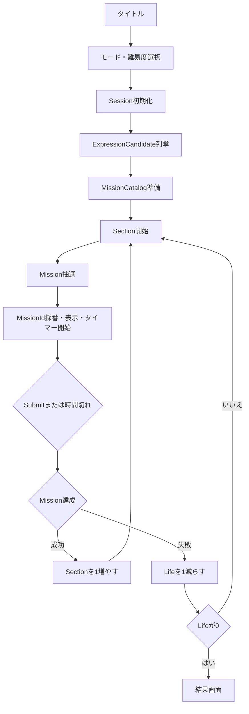

# ゲーム進行

> [ドキュメント一覧](../../README.md) / 区分: 要件

[CCC要件書](../overview.md)から分離した、セッション（Session）、セクション（Section）、ミッション準備・抽選、提出（Submit）、ライフ（Life）、Tier（ティア）、タイマーの進行仕様について説明する。

## ゲーム全体の基本ループ



- **`MissionCatalog` の準備**: Gameplay 開始時に1回だけ実行すること。
- **ミッションの抽選**: 各 Section 開始時、および解答失敗後に同じ Section で再出題するタイミングで実行すること。
- **判定のタイミング**: 操作の途中で式がミッションの条件を満たしても自動クリアはしないこと。手動での `Submit` または時間切れによって確定した瞬間の `CurrentExpression` のみを回答として判定すること。

## Gameplay開始時のMissionCatalog準備

この段階では、実際に出題するミッションの選出は行わない。

1. ゲームモードおよび `GameDifficulty` から Session 設定を確定すること。
2. 数字範囲内の正常な式候補（`ExpressionCandidate`）をすべて列挙すること。
3. 選択Sourceに従ってミッションパラメータ候補を取得すること。
4. 各候補をすべての正常な `ExpressionCandidate` で評価すること。
5. 式適合割合（`MatchRatio`）および最小適合式数の条件をクリアした候補のみを `MissionCatalog` に登録すること。
6. Tier と Kind ごとに抽選可能な状態へ分類・整理すること。

> [!NOTE]
> 製品経路ではProfileと到達可能結果からMissionパラメータ候補を自動生成する。PresetはDebugModeでの限定確認にのみ使用する。共通の成立条件については [Missionカタログ・抽選内部仕様](../missions/catalog-and-draw.md) を参照すること。

## SimpleMissionDrawStrategy：開発確認用抽選

Simple Strategyでは、以下の手順で抽選を行うこと。

1. 現在の Section から、該当する Tier（現在Tier）および解放済みの下位 Tier を求めること。
2. 現在 Tier の相対重みを `0.60`、解放済み下位 Tier 全体の相対重みを `0.40` として対象 Tier を抽選すること。
3. 選択された候補群（現在 Tier、または全下位 Tier をまとめた候補群）内で候補が存在する Kind を一律（等確率）に選定すること。
4. 選ばれた Kind 内のパラメータ候補を等確率で1つ決定すること。
5. 決定されたミッションに対して新しい `MissionId` を採番すること。

※Simple Strategyは製品経路では使用しない。`CurrentExpression`や直前Missionを参照せず、`NegatedMission`や複合Missionも抽選しないこと。
※候補が0件の Tier や Kind は抽選対象から除外すること。利用可能なミッション候補が全体で0件の場合は設定エラーとし、Gameplay を開始しないこと。

## 本実装版：Session中のMission抽選

本実装版のSession中抽選では、以下のステップと条件を適用すること。

1. Session初回は`CurrentExpression`による絞り込みを行わないこと。2問目以降は現在Tier以下の解放済み候補を、現在の `CurrentExpression` で達成できる候補群と達成できない候補群に分け、`CurrentExpressionSatisfiedMissionSelectionRatio`の確率で達成できる候補群を選ぶこと。片方の候補群しか存在しない場合は、その候補群を乱数消費なしで選ぶこと。
2. 現在 Tier と下位 Tier を相対重み `0.60` / `0.40` で選定すること。下位 Tier が選ばれた場合は、全下位 Tier の候補を1つの候補群とすること。
3. 肯定ミッションと反転ミッション（`NegatedMission`）をそれぞれの相対重みに従って選択すること。Negatedの重みが0の場合はNegated候補を完全に除外すること。
4. 代替候補が存在する場合は、直前と同じ Kind かつ同じパラメータの組み合わせを除外すること（連続出題防止）。
5. 候補が存在する Kind を一様（等確率）に選定すること。
6. その抽選で使う目標式適合割合を決め、選択された Kind の候補をその値との差分によって順位付けすること。目標式適合割合は、Sectionが進むほど下限が下がり上限が `TargetExpressionMatchRatio` の範囲から一様に選ぶこと。
7. 上位候補群の中から1件をランダム抽選すること。
8. 決定されたミッションに新しい `MissionId` を採番すること。

※`Negated` の有無のみが異なる候補は、連続出題防止上の同一種類とはみなさないこと。
※直前ミッションの除外は代替候補が存在する場合にのみ適用すること。上位候補群のサイズはConfig設定を使用すること。詳細は [Missionカタログ・抽選内部仕様](../missions/catalog-and-draw.md) を参照すること。

## Sessionと初期式

Gameplay 開始時またはリトライ（再挑戦）時に新しい Session を開始すること。 Session 開始直後の初期式は `1 + 1` とするが、指定された数字範囲に `1` が含まれない場合は `1` に最も近い数字を使用すること。

| 数字範囲 | 第1Sectionの CurrentExpression |
| --- | --- |
| 1〜5 | `1 + 1` |
| 2〜5 | `2 + 2` |
| -5〜-2 | `-2 + -2` |
| -1〜1 | `1 + 1` |

- **成功時**: Submit した式をそのまま次の Section へ引き継ぐこと。
- **失敗時**: Submit した式をそのまま同じ Section の次のミッションへ引き継ぐこと。
- 出題されたミッションに合わせて初期式を自動変更しないこと。
- リトライ時は旧 Session の進行状態を再利用せず、新規 Session を立ち上げること。

## Tier進行

| Section | 現在Tier |
| --- | --- |
| 1〜3 | Tier1 |
| 4〜7 | Tier2 |
| 8〜11 | Tier3 |
| 12以降 | Tier4 |

※Section の区切りと Tier の対応関係は `Config` 設定で調整可能とする。

### Tier抽選ルール

- **現在 Tier の相対重み**: `0.60`
- **解放済み下位 Tier 全体の相対重み**: `0.40`
- **選定パターン**:
  - 現在 Tier にのみ候補がある場合: 現在 Tier を選択すること。
  - 下位 Tier にのみ候補がある場合: 全下位 Tier の候補をまとめた候補群を選択すること。
  - 下位 Tier が選ばれた場合: 候補が存在する全下位 Tier の候補を1つの候補群とし、下位 Tier 間の抽選は行わないこと。後続の Kind 抽選は、この候補群に含まれる全 Kind から等確率で行うこと。
  - 解放済みのいずれの Tier にも候補がない場合: 設定エラーを検出すること。

※重み設定`0.60` / `0.40`はSimple Strategyと本実装版の両方で共通して使用すること。値は`GameDifficulty`ごとにConfigで変更可能とする。

## タイマー

制限時間の計算式は以下の通りとする。

```text
制限時間 = max(
   3秒,
   初期制限時間 - (Section - 1) × 短縮量
)
```

| Section | 制限時間 |
| --- | --- |
| 1 | 10秒 |
| 2 | 9.5秒 |
| 5 | 8秒 |
| 十分に進行した後 | 最低3秒 |

- タイマーのカウント開始と同時に入力受付を開始すること（事前カウントダウンは行わないこと）。
- タイマー通知には対象となる `MissionId` を紐付けること。現在処理中の `MissionId` と一致しない時間切れ通知は無視すること。

## Submitと判定

プレイヤーによる提出（Submit）または制限時間切れによって `CurrentExpression` を確定すること。

- 最初に受信した有効な Submit の時点で入力受付を停止すること。
- 手動 Submit と時間切れが同一タイミングで発生した場合でも、判定処理は1回のみ実行すること。
- 判定処理中および画面遷移中の操作入力は無視すること。

### 成功時の挙動

- Section 数を 1 加算すること。
- Life 数は維持すること。
- Submit した式をそのまま次の Section に引き継ぐこと。
- 成功時の演出（フィードバック）再生後、次のミッションを抽選すること。

### 失敗時の挙動

- Life 数を 1 減算すること。
- Section 数は変更しないこと。
- 画面に正解となる模範回答例（`AnswerExample`）を表示すること。
- Life が残っている場合は、同じ Section のまま次のミッションを抽選すること。
- Submit した式をそのまま次のミッションに引き継ぐこと。
- Life が 0 になった場合も、模範回答例を表示した後にリザルト（結果）画面へ進むこと。

> [!NOTE]
> 本実装版では、成功後・失敗後に新しく抽選するミッションについて、引き継いだ`CurrentExpression`のままクリアできる候補群をConfig設定確率で選ぶこと。Normalの初期値は`0.10`とする。片方の候補群しか存在しない場合は存在する候補群を使用すること（Simple Strategyには本制約を適用しない）。

## ゲームオーバー

ゲームオーバー時はリザルト画面に遷移し、正解問題数・最終到達 Section・最終ミッション・式・結果を表示すること。

正解問題数は `max(0, Section - 1)` として Section 数から導出すること。別個の `ClearCount` 変数は保持しないこと。

---
- 関連内部仕様: [CCC内部仕様](../internals/game-invariants.md)
- ミッション抽選仕様: [Missionカタログ・抽選内部仕様](../missions/catalog-and-draw.md)
- プリセット定義: [Missionパラメータ候補プリセット](../missions/candidate-presets.md)
- テスト検証要件: [CCCテスト仕様](../testing/acceptance-specification.md)
