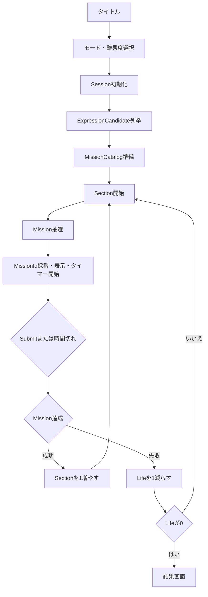

# ゲーム進行

> [ドキュメント一覧](../../README.md) / 区分: 要件
>
> 正本: [Cosense「ゲーム進行」](https://scrapbox.io/proto-TeamL/%E3%82%B2%E3%83%BC%E3%83%A0%E9%80%B2%E8%A1%8C)
> 取得時点の原文更新日時: 2026-08-26T05:28:04.000Z


[CCC要件書](../overview.md)から分離した、Session、Section、Mission準備、Mission抽選、Submit、Life、Tier、タイマーの仕様。

## ゲーム全体の基本ループ



MissionCatalogの準備はGameplay開始時に1回だけ行う。
Missionの抽選は各Section開始時と、失敗後に同じSectionで再出題するときに行う。
式が途中でMissionを満たしても自動クリアしない。
Submitまたは時間切れで確定した瞬間のCurrentExpressionだけを回答として使う。

## Gameplay開始時のMissionCatalog準備

この段階では実際に出題するMissionを選ばない。

- 1. ゲームモードとGameDifficultyからSession設定を確定する。
- 2. 数字範囲内の正常なExpressionCandidateを列挙する。
- 3. 実装段階に対応するMissionパラメータ候補を取得する。
- 4. 各候補をすべての正常なExpressionCandidateで評価する。
- 5. 式適合割合と最小適合式数の条件を通過した候補だけをMissionCatalogへ登録する。
- 6. TierとKindから抽選できる状態に整理する。

簡易版では[Missionパラメータ候補プリセット](../missions/candidate-presets.md)に用意された候補だけを評価する。
簡易版ではパラメータ候補を自動生成しない。
本実装版では到達可能な結果からパラメータ候補を生成できる。
共通の成立条件は[Missionカタログ・抽選内部仕様](../missions/catalog-and-draw.md)に定義する。

## 簡易版：Session中のMission抽選

最初の完成対象では次の手順だけを実装する。

- 1. Sectionから現在Tierと解放済みの下位Tierを求める。
- 2. 現在Tierを相対重み0.60、下位Tier全体を相対重み0.40としてTierを選ぶ。
- 3. 選ばれたTierで候補が存在するKindを一様に選ぶ。
- 4. 選ばれたKindのパラメータ候補を一様に選ぶ。
- 5. 選ばれたMissionに新しいMissionIdを採番する。

簡易版のMission抽選はCurrentExpressionを参照しない。
簡易版のMission抽選は直前のMissionと出題履歴を参照しない。
簡易版ではNegatedMissionを生成も抽選もしない。
簡易版では複合Missionを生成も抽選もしない。
候補が0件のTierまたはKindは抽選母集団から除外する。
利用可能なMission候補が全体で0件の場合は設定エラーとしてGameplayを開始しない。

## 本実装版：Session中のMission抽選

本実装版へ置き換えるときは次の条件を追加する。

- 1. CurrentExpressionでは未達成となるMission候補だけを抽出する。
- 2. 現在Tierと下位Tierを相対重み0.60／0.40で選ぶ。
- 3. 肯定MissionとNegatedMissionを相対重みで選ぶ。
- 4. 代替候補がある場合は直前と同じKindかつ同じパラメータを除外する。
- 5. 候補が存在するKindを一様に選ぶ。
- 6. 選ばれたKindの候補をTargetExpressionMatchRatioとの差で順位付けする。
- 7. 上位候補群から1件を抽選する。
- 8. 選ばれたMissionに新しいMissionIdを採番する。

Negatedの有無だけが異なる候補は、連続出題回避上の同種に含めない。
途中で候補が0件になった場合は、追加した条件を逆順に緩和する。
条件緩和の厳密な順序と上位候補群の大きさは、本実装着手前にConfigとして確定する。
詳細は[Missionカタログ・抽選内部仕様](../missions/catalog-and-draw.md)を参照する。

## Sessionと初期式

Gameplay開始時または再挑戦時に新しいSessionを開始する。
Session開始時の式は 1 + 1 とし、数字範囲に1が含まれない場合は1に最も近い数字を使用する。

| 数字範囲 | 第1SectionのCurrentExpression |
| --- | --- |
| 1〜5 | 1 + 1 |
| 2〜5 | 2 + 2 |
| -5〜-2 | -2 + -2 |
| -1〜1 | 1 + 1 |

- 成功後はSubmitした式を次のSectionへ引き継ぐ。
- 失敗後はSubmitした式を同じSectionの次Missionへ引き継ぐ。
- Missionに合わせて開始式を変更しない。
- 再挑戦では進行状態を再利用せず、新しいSessionを開始する。

## Tier進行

| Section | 現在Tier |
| --- | --- |
| 1〜3 | Tier1 |
| 4〜7 | Tier2 |
| 8〜11 | Tier3 |
| 12以降 | Tier4 |

Section境界とTier対応はConfig対象とする。

### Tier抽選

- 現在Tierの相対重み：0.60
- 解放済み下位Tier全体の相対重み：0.40
- 現在Tierだけに候補がある場合：現在Tierを選ぶ
- 下位Tierだけに候補がある場合：候補が存在する下位Tierを選ぶ
- 下位Tierが複数ある場合：候補が存在する下位Tier間で一様に選ぶ
- どの解放済みTierにも候補がない場合：設定エラー

Tierの0.60／0.40は簡易版と本実装版の両方で使用する。
値はGameDifficultyごとのConfig対象とする。

## タイマー

```text
制限時間 = max(
   3秒,
   初期制限時間 - (Section - 1) × 短縮量
)
```

| Section | 制限時間 |
| --- | --- |
| 1 | 10秒 |
| 2 | 9.5秒 |
| 5 | 8秒 |
| 十分に進行した後 | 最低3秒 |

タイマー開始と同時に入力を受け付ける。
開始前カウントダウンは設けない。
タイマー通知には対象のMissionIdを対応付ける。
現在のMissionIdと一致しない時間切れ通知は無視する。

## Submitと判定

Submitまたは時間切れでCurrentExpressionを確定する。
最初の有効なSubmitを受け付けた時点で入力受付を停止する。
手動Submitと時間切れが重なっても判定は1回だけ行う。
判定中と遷移中の入力は無視する。

### 成功

- Sectionを1増やす。
- Lifeは維持する。
- Submitした式を次のSectionへ引き継ぐ。
- 成功フィードバック後に次のMissionを抽選する。

### 失敗

- Lifeを1減らす。
- Sectionは変更しない。
- 正常な回答例を表示する。
- Lifeが残っていれば同じSectionで次のMissionを抽選する。
- Submitした式を次のMissionへ引き継ぐ。
- Lifeが0の場合も回答例を表示してから結果画面へ進む。

本実装版では、成功後と失敗後の新Missionを引き継いだCurrentExpressionでは未達成の候補から選ぶ。
簡易版ではこの条件を適用しない。

## ゲームオーバー

結果画面へ移動し、正解した問題数、最終到達Section、最後のMission、式、結果を表示する。
正解した問題数は max(0, Section - 1) としてSectionから導出する。
ClearCountは保持しない。

## 関連仕様

- [CCC内部仕様](../internals/game-invariants.md)
- [Missionカタログ・抽選内部仕様](../missions/catalog-and-draw.md)
- [Missionパラメータ候補プリセット](../missions/candidate-presets.md)
- [CCCテスト仕様](../testing/acceptance-specification.md)
