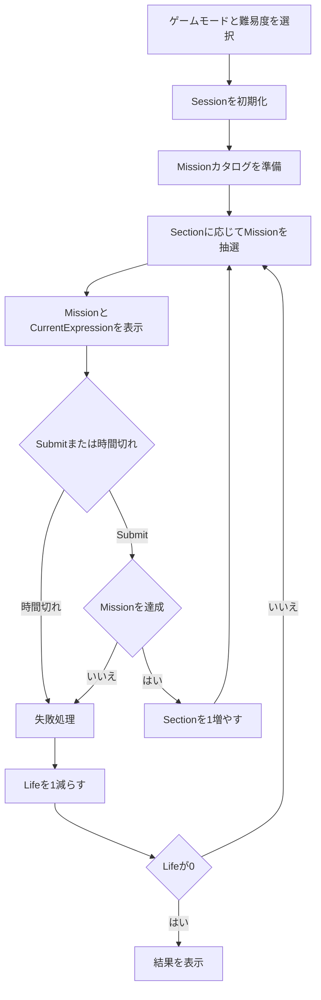

# CCC内部仕様

> [ドキュメント一覧](../../README.md) / 区分: 内部仕様
>
> 正本: [Cosense「CCC内部仕様」](https://scrapbox.io/proto-TeamL/CCC%E5%86%85%E9%83%A8%E4%BB%95%E6%A7%98)
> 取得時点の原文更新日時: 2026-08-26T05:38:04.000Z

## このページの目的

ゲーム内部で保持する状態、計算規則、進行上の不変条件を、特定のクラス構成やフレームワークに依存せず定義する。

- Missionのカタログ生成と抽選：[Missionカタログ・抽選内部仕様](../missions/catalog-and-draw.md)
- 初期実装で用いる候補データ：[Missionパラメータ候補プリセット](../missions/candidate-presets.md)
- テスト：[CCCテスト仕様](../testing/acceptance-specification.md)

## 全体フロー

## Sessionで保持する状態

| 項目 | 意味 |
| --- | --- |
| Section | 進行番号。1から開始し、Mission成功時だけ1増える |
| Life | 残りライフ。失敗時に1減る |
| CurrentExpression | 現在操作している左の数字、演算子、右の数字 |
| CurrentMission | 現在出題中のMission |
| MissionId | Mission表示ごとに1ずつ増える実行時識別子 |
| RemainingTime | 現在のMissionに対する残り時間 |
| IsAcceptingSubmit | Submitを受け付けられるか |
| IsTransitioning | 成功または失敗の遷移処理中か |

正解した問題数は独立して保持せず、常に max(0, Section - 1) として求める。
MissionIdはSession内で1から始め、新しいMissionを表示するたびに1増やす。
タイマー通知とSubmitは、対象のMissionIdがCurrentMissionのMissionIdと一致する場合だけ有効とする。

## 数値計算の不変条件

- Mission判定に用いる値は浮動小数点数ではなく、約分済みの有理数として扱う。
- 分母は常に正とし、0は 0/1 に正規化する。
- 同値な有理数は等しい値として比較され、同じハッシュ値を持つ。
- 除数が0となる式は正常な計算結果を持たない。
- 0除算の表示はすべて ？ に統一する。
- Mission判定、式適合割合の算出、候補式の重複排除は正確な値を用いる。
- 小数への変換は画面表示時だけ行う。

詳細は[式と数値計算](../gameplay/expression-and-calculation.md)を参照する。

## Mission判定の不変条件

- MissionConditionは、計算結果と条件パラメータから真偽を返す。
- NegatedMissionは、元のMissionConditionの判定結果を反転する。
- 複合Missionは、含まれるすべてのMissionConditionを満たしたときだけ達成とする。
- 正常な計算結果を持たない式は、いずれのMissionも達成しない。

Mission選定の詳細は[Missionカタログ・抽選内部仕様](../missions/catalog-and-draw.md)を参照する。

## Tier進行

- Sectionから現在Tierと解放済みTierを決定する。
- 通常のTier抽選では、現在Tierを相対重み0.60、解放済みの下位Tier全体を相対重み0.40として扱う。
- 下位Tierが存在しない場合は現在Tierを選ぶ。
- 重みは[ゲームモード・難易度](../gameplay/game-modes-and-difficulty.md)のConfig対象とする。

## Submitと遷移

- 同じMissionIdに対して有効なSubmitは1回だけとする。
- IsAcceptingSubmitが偽、またはIsTransitioningが真の間はSubmitを無視する。
- 成功時はSectionを増やしてから次のMissionを抽選する。
- 失敗時はSectionを変えず、Lifeを減らしてから次のMissionを抽選する。
- Lifeが0になった場合は次のMissionを抽選せず結果画面へ進む。
- 結果画面に表示する正解数はSectionから導出する。

## 入力処理

数字と演算子の変更はCurrentExpressionに反映する。
同一タッチを複数の操作として処理しない。
遷移中は式の変更とSubmitを受け付けない。
詳細は[入力仕様](../gameplay/input.md)を参照する。

## 表示との境界

ShowCurrentAnswerはCurrentExpressionの現在の計算結果を表示する設定である。
ShowCurrentAnswerが無効でも、内部ではMission判定に必要な計算を行う。
表示、画面遷移、演出の詳細は[画面・UI仕様](../presentation/screens-and-ui.md)および[フィードバック・演出](../presentation/feedback-and-presentation.md)を参照する。
