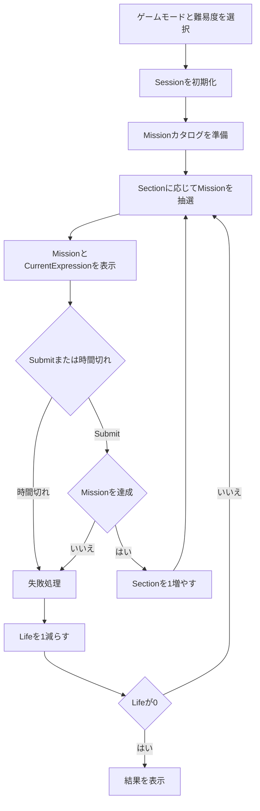

# CCC内部仕様

> [ドキュメント一覧](../../README.md) / 区分: 内部仕様

## ドキュメントの目的

ゲーム内部で保持・管理する状態、数値計算規則、および進行上の不変条件（Invariants）を、特定のアセンブリ構成や実装フレームワークに依存しない形で定義する。

- Mission カタログ構築および抽選ロジック: [Missionカタログ・抽選内部仕様](../missions/catalog-and-draw.md)
- デバッグ確認用候補データ: [Missionパラメータ候補PresetDebug](../missions/candidate-presets.md)
- テスト検証要件: [CCCテスト仕様](../testing/acceptance-specification.md)

## 全体フロー

## Sessionで保持する状態

| フィールド名 | 役割と動作 |
| --- | --- |
| `Section` | 進行番号。`1` から開始し、Mission 成功時にのみ `1` 増算 |
| `Life` | 残りライフ数。Mission 失敗時に `1` 減算 |
| `CurrentExpression` | 現在プレイヤーが操作中の「左の数字・演算子・右の数字」の式状態 |
| `CurrentMission` | 現在出題中の Mission |
| `MissionId` | Mission 出題・表示ごとに `1` ずつ繰り上がる実行時識別子 |
| `RemainingTime` | 現在の Mission に対する制限時間の残り時間 |
| `IsAcceptingSubmit` | 提出（Submit）を受け付け可能な状態であるかを示すフラグ |
| `IsTransitioning` | 成功・失敗演出および画面遷移処理中であるかを示すフラグ |

- 正解した問題数は独立した変数として保持せず、常に `max(0, Section - 1)` により動的算出すること。
- `MissionId` は Session 開始時に `1` から始まり、新しい Mission を出題表示するたびに `1` 加算すること。
- タイマーイベント通知および Submit 要求は、対象の `MissionId` が `CurrentMission` の `MissionId` と合致する場合のみ有効として処理すること。

## 数値計算の不変条件

- Mission 判定に用いる数値は浮動小数点数（`float` / `double`）ではなく、約分済みの有理数（`Rational`）として保持すること。
- 有理数の分母は常に正（`> 0`）とし、ゼロは `0/1` として正規化すること。
- 同値な有理数同士は等しい値として判定され、同一のハッシュ値を保持すること。
- 0で除算（0除算）を行う式は正常な計算結果を持たないこと。0除算発生時の画面表示はすべて `？` に統一すること。
- Mission のクリア判定、式適合割合（`MatchRatio`）の算定、式候補の重複排除には、常に正確な有理数値を使用すること。
- 小数表記への変換は、UI画面への文字列表示処理時にのみ適用すること。

※詳細は [式と数値計算](../gameplay/expression-and-calculation.md) を参照すること。

## Mission判定の不変条件

- `MissionCondition` は、現在の式の計算結果と条件パラメータから成否（`true`/`false`）を判定すること。
- `NegatedMission` は、対象となる `MissionCondition` の判定結果を真偽反転すること。
- 複合ミッション（`CompoundMission`）は、含まれるすべての `MissionCondition` を同時に満たした場合にのみクリア達成と判定すること。
- 0除算など正常な計算結果を持たない式は、いかなるミッション条件（`NegatedMission` を含む）も達成しないこと。

※ミッション選定アルゴリズムの詳細は [Missionカタログ・抽選内部仕様](../missions/catalog-and-draw.md) を参照すること。

## MissionCatalog準備の不変条件

- `MissionCatalog`はGameplay Session開始時に1回だけ構築し、同一Session中に再生成しないこと。
- `MissionParameterCandidate`はTierを保持せず、全式分析後の`MissionCandidate`だけが確定Tierと`AnswerExample`を保持すること。
- 各Conditionは正常な全Expressionに対して一度だけ分析し、正確な`Rational`適合率を採用判定とBetween Tier判定で共有すること。
- 適合率範囲を免除したKindでも、適合式、非適合式、Kind別最小件数、`AnswerExample`の要件を維持すること。
- 同一Conditionは入力順の最初の1件へ正規化し、最終CatalogはTier、Kind、ParameterA、ParameterB、IsNegatedの順へ固定すること。
- 候補生成またはCatalog構築が失敗した場合、Session Context、State、Timerを開始しないこと。

## Tier進行規則

- 現在の `Section` に応じて、該当する「現在Tier」および「解放済みTier」を決定すること。
- 通常の Tier 抽選では、現在 Tier の相対重みを `0.60`、解放済みの下位 Tier 全体を `0.40` と設定して抽出すること。
- 解放済みの下位 Tier が存在しない場合（Tier1進行時など）は、現在 Tier を確定選択すること。
- 重みパラメーターは [ゲームモード・難易度](../gameplay/game-modes-and-difficulty.md) の Config 対象とする。

## Submitと状態遷移

- 同一の `MissionId` に対する有効な Submit 処理は 1回のみ実行すること。
- `IsAcceptingSubmit == false` または `IsTransitioning == true` の間、受信した Submit 要求は無視すること。
- **成功時**: `Section` を 1 加算した後、次の Mission を抽選・セットすること。
- **失敗時**: `Section` は変更せず、`Life` を 1 減算した後に次の Mission を抽選・セットすること。
- `Life` が `0` に達した場合は、次の Mission の抽選を行わずにリザルト（結果）画面へと遷移すること。
- リザルト画面に表示する正解問題数は `Section` から導出すること。

## 入力処理規則

- 画面タッチによる数字および演算子の変更は、即座に `CurrentExpression` へ反映すること。
- 1回のタッチジェスチャーを誤って複数の入力操作として重複処理しないよう制御すること。
- 画面遷移・判定演出処理中（`IsTransitioning == true`）は、式の変更および Submit 操作を一切受け付けないこと。

※詳細は [入力仕様](../gameplay/input.md) を参照すること。

## 表示処理との境界分離

- `ShowCurrentAnswer` は、現在の式 `CurrentExpression` の評価計算結果を画面UI上にリアルタイム表示するか否かを制御するフラグとする。
- `ShowCurrentAnswer` が無効（`false`）に設定されている場合でも、ゲーム内部では Mission 判定に必要な数値評価処理を常時実行すること。

---
- 表示・画面遷移仕様: [画面・UI仕様](../presentation/screens-and-ui.md)
- 演出フィードバック仕様: [フィードバック・演出](../presentation/feedback-and-presentation.md)
