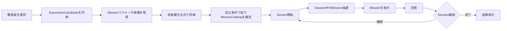

# Missionカタログ・抽選内部仕様

> [ドキュメント一覧](../../README.md) / 区分: 内部仕様

## ドキュメントの目的

Gameplay 開始時の Mission 候補カタログ準備処理と、Session 進行中に出題ミッションを 1件 抽出選定する処理のアルゴリズム・仕様を明確に分離定義する。
※本ドキュメントで定義するのは処理規則および入出力インターフェースであり、特定の C# クラス構成には依存しないこと。

## 主要用語の定義

| 用語 | 意味・定義 |
| --- | --- |
| `ExpressionCandidate` | 設定されたゲーム条件（数字範囲等）において到達可能な、正常な最終式の組み合わせ |
| `MissionParameterCandidate` | Mission の種類（`Kind`）とパラメータ値の組み合わせ。Tierは保持しない |
| `MissionCandidate` | 評価条件を通過し、実ゲーム内で出題可能となった Mission 候補 |
| `MissionCatalog` | Gameplay 開始時に確定・保持される `MissionCandidate` の集合体 |
| `ExpressionMatchCount` | 特定の Mission 条件を満たす `ExpressionCandidate` の総数 |
| `ExpressionMatchRatio` | `ExpressionMatchCount` を正常な `ExpressionCandidate` 全体数で除した「式適合割合」 |
| `MinExpressionMatchRatio` | `MissionCandidate` として採択・登録するための最小式適合割合 |
| `MaxExpressionMatchRatio` | `MissionCandidate` として採択・登録するための最大式適合割合 |
| `TargetExpressionMatchRatio` | 本実装版の抽出処理において優先目標とするターゲット式適合割合 |
| `CurrentExpressionSatisfiedMissionSelectionRatio` | 2問目以降に現在式で達成できるMission候補群を選択する確率 |
| `NegatedMissionSelectionWeight` | 肯定 Mission に対する反転 Mission（`Negated`）の相対抽選重み |

## 処理フロー

Gameplay 開始時の初期処理は `MissionCatalog` の確定まで行い、Session 内での抽選処理は確立された `MissionCatalog` から 1件 を抽出すること。

## Missionパラメータ取得経路

| SourceMode | 用途 | Profile | Preset | 実行条件 |
| --- | --- | --- | --- | --- |
| `Automatic` | 製品経路 | 必須 | 参照しない | 常時 |
| `PresetDebug` | 新Mode・新Missionの限定確認 | 必須 | 必須 | `IRuntimeMode.IsDebugMode == true` |

非Debug環境の`PresetDebug`は設定エラーとし、`Automatic`へフォールバックしないこと。どちらの経路でもProfileの有効Kind、適合率ポリシー、共通Tier規則を適用すること。

## 共通仕様: MissionCatalogの準備

Gameplay 開始時、選択されたゲームモードと `GameDifficulty` から正常な `ExpressionCandidate` を列挙すること。

`Automatic`ではProfileと到達可能結果から候補を生成し、`PresetDebug`ではTierを持たないPreset候補を読み込むこと。重複Conditionは入力順で最初の1件へ正規化すること。各候補は正常なExpression全件に対して一度だけ分析し、同じ分析結果から採用可否、Between Tier、`AnswerExample`を決定すること。

以下の条件をすべて満たす候補のみを `MissionCandidate` として `MissionCatalog` に登録すること。

1. Profileで適合率範囲を適用するKindでは、`ExpressionMatchRatio` が `MinExpressionMatchRatio` 以上であること
2. Profileで適合率範囲を適用するKindでは、`ExpressionMatchRatio` が `MaxExpressionMatchRatio` 以下であること
3. `Zero` および `Prime` 以外の Kind では `ExpressionMatchCount >= 2` であること
4. `Zero` および `Prime` では `ExpressionMatchCount >= 1` であること
5. 適合式と非適合式が各1件以上存在すること
6. 正常な`AnswerExample`が最初の適合Expressionとして存在すること
7. Kind固有のパラメータ制約条件を満たすこと

※`ExpressionCandidate` が 0件、または条件を満たす `MissionCatalog` が 0件 となった場合は設定エラーとし、Gameplay を開始しないこと。`MissionCatalog` は Session 開始時に 1回 のみ生成され、Session 中に再構築されないこと。

### デフォルト設定値

| パラメーター項目 | デフォルト値 |
| --- | --- |
| `MinExpressionMatchRatio` | `0.10` |
| `MaxExpressionMatchRatio` | `0.60` |
| `CurrentExpressionSatisfiedMissionSelectionRatio` | `0.10` |
| `TargetExpressionMatchRatio` | `0.20` |
| `MissionParameterSelectionPoolSize` | `3` |
| `CurrentTierSelectionWeight` | `0.60` |
| `LowerTierSelectionWeight` | `0.40` |
| `NegatedMissionSelectionWeight` | `0.60` |
| `CompoundMissionSelectionWeight` | `0` |

※上記パラメーターは難易度ごとにConfig設定可能とする。`CurrentExpressionSatisfiedMissionSelectionRatio`と`TargetExpressionMatchRatio`はSession内抽選でのみ参照すること。

## Missionパラメータ候補の自動生成

パラメータドメインは明示値一覧、または包含範囲と正のstepで定義し、重複除去後の昇順で扱うこと。列挙順は`MissionKind`数値順、ParameterA、ParameterB、肯定、Negatedの順とする。

- `AtLeast`・`AtMost`・`Exact`: 到達可能整数との積集合
- `Multiple`: `N >= 2`かつ到達可能整数にNの倍数が存在
- `Absolute`: `N >= 1`かつNまたは-Nが到達可能
- `OnesDigit`: `0～9`かつ対応する到達可能整数が存在
- `DecimalFirstDigit`: `0～9`かつ対応する到達可能非整数が存在
- `Between`: `lowerBound × width`の直積。`width >= 1`、加算がオーバーフローせず、両端が到達可能整数であること。上限は保持しない
- `Modulo`: `divisor × remainder`の直積。`divisor >= 2`、`0 <= remainder < divisor`、対応するユークリッド剰余を持つ到達可能整数が存在すること

上限判定はドメイン正規化、到達可能性との積集合、Kind固有制約、Negated展開後の生成予定件数に対して、全式との適合率評価前に行うこと。Kind別または全体上限超過、件数オーバーフロー、有効Kindの候補0件は設定エラーとし、切り捨て・部分Catalog・Presetフォールバックを行わないこと。

## 本実装版: Session中の抽選アルゴリズム

1. `NegatedMissionSelectionWeight == 0`の場合はNegated候補を抽選対象から完全に除外すること。続いて現在Tier以下の解放済み候補を確定すること。Session初回は`CurrentExpression`を評価せず、そのまま手順2へ進むこと。2問目以降は解放済み候補を、現在式で達成できる候補群と達成できない候補群に分けること。両群に候補がある場合は`[0, 1)`の乱数sampleが`CurrentExpressionSatisfiedMissionSelectionRatio`未満なら達成できる候補群を、以上なら達成できない候補群を選ぶこと。片方の群だけに候補がある場合は、その群を乱数消費なしで選ぶこと。比率`0`は両群がある限り達成できない候補群、比率`1`は達成できる候補群を乱数消費なしで選ぶこと。
2. 現在 Tier と下位 Tier を重み `0.60` / `0.40` で決定すること。下位 Tier が選ばれた場合は、全下位 Tier の候補を1つの候補群とし、下位 Tier 間の抽選は行わないこと。
3. 肯定 Mission（基準重み `1.00`）と `NegatedMission`（相対重み `NegatedMissionSelectionWeight` 例: `0.60`）のいずれかを選択すること。
4. 直前の出題と同一の Kind かつ同一パラメータの候補を除外すること（代替候補が存在する場合）。
5. 残った Kind の中から一様抽選すること。
6. 選択された Kind の候補を `TargetExpressionMatchRatio` との差分が小さい順に並べ替え、ConfigのMissionパラメータ抽選プール数までを上位候補群としてランダム抽選すること。
7. 直前Missionの除外は代替候補が存在する場合にのみ適用すること。手順1で解放済みの利用可能候補が0件の場合は設定エラーとすること。

## NegatedMission（判定反転ミッション）

- 本実装版でのみ導入すること。
- 肯定 Mission と同一のパラメータ候補を使用し、その成否判定結果を反転（`Not`）すること。
- 肯定 Mission と `NegatedMission` では実効 Tier が異なっていても差し支えないこと。
- `NegatedMissionSelectionWeight` は Config 設定可能とし、暫定デフォルト値は `0.60` とすること。

## 複合Mission（CompoundMission）

- 簡易版では `CompoundMissionSelectionWeight` を `0` とし、複合ミッションの生成・評価・抽選・表示は一切行わないこと（明確に将来拡張として先送り）。
- 将来実装時の条件については [複合Mission](./compound-missions.md) に定義すること。

---
- パラメータプリセット: [Missionパラメータ候補プリセット](./candidate-presets.md)
- ミッション種別: [生成するMission](./mission-types.md)
- 複合ミッション仕様: [複合Mission](./compound-missions.md)
- テスト検証要件: [CCCテスト仕様](../testing/acceptance-specification.md)
