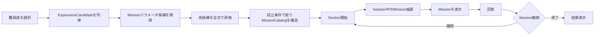

# Missionカタログ・抽選内部仕様

> [ドキュメント一覧](../../README.md) / 区分: 内部仕様

## ドキュメントの目的

Gameplay 開始時の Mission 候補カタログ準備処理と、Session 進行中に出題ミッションを 1件 抽出選定する処理のアルゴリズム・仕様を明確に分離定義する。
※本ドキュメントで定義するのは処理規則および入出力インターフェースであり、特定の C# クラス構成には依存しないこと。

## 主要用語の定義

| 用語 | 意味・定義 |
| --- | --- |
| `ExpressionCandidate` | 設定されたゲーム条件（数字範囲等）において到達可能な、正常な最終式の組み合わせ |
| `MissionParameterCandidate` | Mission の種類（`Kind`）とパラメータ値の組み合わせ |
| `MissionCandidate` | 評価条件を通過し、実ゲーム内で出題可能となった Mission 候補 |
| `MissionCatalog` | Gameplay 開始時に確定・保持される `MissionCandidate` の集合体 |
| `ExpressionMatchCount` | 特定の Mission 条件を満たす `ExpressionCandidate` の総数 |
| `ExpressionMatchRatio` | `ExpressionMatchCount` を正常な `ExpressionCandidate` 全体数で除した「式適合割合」 |
| `MinExpressionMatchRatio` | `MissionCandidate` として採択・登録するための最小式適合割合 |
| `MaxExpressionMatchRatio` | `MissionCandidate` として採択・登録するための最大式適合割合 |
| `TargetExpressionMatchRatio` | 本実装版の抽出処理において優先目標とするターゲット式適合割合 |
| `NegatedMissionSelectionWeight` | 肯定 Mission に対する反転 Mission（`Negated`）の相対抽選重み |

## 処理フロー

Gameplay 開始時の初期処理は `MissionCatalog` の確定まで行い、Session 内での抽選処理は確立された `MissionCatalog` から 1件 を抽出すること。

## 実装段階（簡易版 / 本実装版）の差分

| 項目 | 簡易版（初期実装） | 本実装版（拡張時） |
| --- | --- | --- |
| **パラメータ候補** | 定義済みプリセット（[候補プリセット](./candidate-presets.md)）を使用 | 到達可能な計算結果から自動生成可能 |
| **CurrentExpressionの考慮** | 考慮しない | 現在の式（`CurrentExpression`）で未達成の候補に限定 |
| **Tier抽選重み** | 現在Tier `0.60` / 解放済み下位Tier `0.40` | 現在Tier `0.60` / 解放済み下位Tier `0.40` |
| **Kind抽選** | 候補が存在する Kind 間で等確率抽選 | 候補の条件評価状況に応じた選定 |
| **パラメータ抽選** | 該当 Kind 内で等確率抽選 | 目標式適合割合（`TargetExpressionMatchRatio`）に最も近いものを優先 |
| **NegatedMission** | 生成・抽選を行わない | 相対重みに基づいて抽選 |
| **連続出題回避** | 行わない | 同一 Kind かつ同一パラメータの連続出題を回避 |
| **複合Mission** | 生成・抽選を行わない | 将来拡張 |

※簡易版から本実装版へ拡張した場合でも、「`MissionCatalog`・`Section`・Session状態」を入力とし、「選定された `Mission`」を出力とするモジュール境界は変更しないこと。

## 共通仕様: MissionCatalogの準備

Gameplay 開始時、選択されたゲームモードと `GameDifficulty` から正常な `ExpressionCandidate` を列挙すること。

簡易版では [Missionパラメータ候補プリセット](./candidate-presets.md) にあらかじめ定義された `MissionParameterCandidate` を読み込むこと。各候補をすべての正常な `ExpressionCandidate` に適用して評価し、`ExpressionMatchCount` および `ExpressionMatchRatio` を導出すること。

以下の条件をすべて満たす候補のみを `MissionCandidate` として `MissionCatalog` に登録すること。

1. `ExpressionMatchRatio` が `MinExpressionMatchRatio` 以上であること
2. `ExpressionMatchRatio` が `MaxExpressionMatchRatio` 以下であること
3. `Zero` および `Prime` 以外の Kind では `ExpressionMatchCount >= 2` であること
4. `Zero` および `Prime` では `ExpressionMatchCount >= 1` であること
5. Kind 固有のパラメータ制約条件を満たすこと
6. 同一 Kind かつ同一パラメータを持つ重複候補でないこと

※`ExpressionCandidate` が 0件、または条件を満たす `MissionCatalog` が 0件 となった場合は設定エラーとし、Gameplay を開始しないこと。`MissionCatalog` は Session 開始時に 1回 のみ生成され、Session 中に再構築されないこと。

### デフォルト設定値

| パラメーター項目 | デフォルト値 |
| --- | --- |
| `MinExpressionMatchRatio` | `0.10` |
| `MaxExpressionMatchRatio` | `0.50` |
| `TargetExpressionMatchRatio` | `0.25` |
| `CurrentTierSelectionWeight` | `0.60` |
| `LowerTierSelectionWeight` | `0.40` |
| `NegatedMissionSelectionWeight` | `0.60` |
| `CompoundMissionSelectionWeight` | `0` |

※上記パラメーターは難易度ごとに Config 設定可能とする。`TargetExpressionMatchRatio` は本実装版での抽選処理のみで参照され、簡易版のランダム抽選には影響しないこと。

## 簡易版: Session中の抽選アルゴリズム

1. 現在の `Section` から「現在Tier」および「解放済みの下位Tier」を求めること。
2. 解放済みの下位 Tier が存在する場合、現在 Tier の相対重みを `0.60`、下位 Tier 全体の相対重みを `0.40` として対象 Tier を決定すること（下位 Tier が選ばれた場合は、該当する下位 Tier 群から等確率で 1つ を選択）。
3. 選択された Tier に属する `MissionCandidate` の中から、候補が存在する `Kind` を等確率で選定すること。
4. 選択された Kind に属する `MissionCandidate` の中から、パラメータ候補を等確率で選定すること。
5. 決定した Mission に対して新しい `MissionId` を割り当てて画面出題すること。

> [!CAUTION]
> 簡易版では以下を行わないこと。
> - `CurrentExpression` で既にクリア済みであるかのチェック
> - 直前の回答・出題履歴の参照
> - `NegatedMission` や複合ミッションの生成・抽選

※選ばれた Tier または Kind に候補が 0件 の場合は、候補が存在する母集団のみで重みを正規化し再選定すること。利用可能な `MissionCandidate` が全体で 0件 の場合は設定エラーとして処理すること。

## Betweenの簡易版パラメータ構造

- `Between` は画面表示上「N以上 (N+W) 以下」として取り扱うこと。
- 内部パラメータとしては「下限 N」と「範囲幅 W」を保持し、上限値は `N + W` として動的計算すること（`W >= 1`）。
- N と W を無制限に組み合わせるのではなく、許可された組み対をプリセットにて明示指定することで、出題範囲の広さと適合候補数をコントロールすること。

## 本実装版: Missionパラメータ候補の自動生成

本実装版では、正常な `ExpressionCandidate` から計算到達可能な整数値の集合（`IntegerResults`）を自動抽出すること。

境界値を必要とする Kind では、無作為な数値範囲からではなく `IntegerResults` をベースにパラメータ候補を動的生成すること。生成後の候補評価および `MissionCatalog` への登録条件は、簡易版と同一のフィルタリングルールを適用すること。

## 本実装版: Session中の抽選アルゴリズム

1. `MissionCatalog` のうち、プレイヤーの現在の式 `CurrentExpression` では**未達成**の `MissionCandidate` のみを抽出し抽選対象とすること。
2. 現在 Tier と下位 Tier を重み `0.60` / `0.40` で決定すること。
3. 肯定 Mission（基準重み `1.00`）と `NegatedMission`（相対重み `NegatedMissionSelectionWeight` 例: `0.60`）のいずれかを選択すること。
4. 直前の出題と同一の Kind かつ同一パラメータの候補を除外すること（代替候補が存在する場合）。
5. 残った Kind の中から一様抽選すること。
6. 選択された Kind の候補を `TargetExpressionMatchRatio` との差分が小さい順に並べ替え、上位候補群の中からランダム抽選すること。
7. 途中の条件絞り込みで候補が 0件 になった場合は、加えた制約を逆順に緩和すること（`CurrentExpression` 未達成条件まで緩和しても候補が 0件 の場合は設定エラー）。

## NegatedMission（判定反転ミッション）

- 本実装版でのみ導入すること。
- 肯定 Mission と同一のパラメータ候補を使用し、その成否判定結果を反転（`Not`）すること。
- 肯定 Mission と `NegatedMission` では実効 Tier が異なっていても差し支えないこと。
- `NegatedMissionSelectionWeight` は Config 設定可能とし、暫定デフォルト値は `0.60` とすること。

## 複合Mission（CompoundMission）

- 簡易版では `CompoundMissionSelectionWeight` を `0` とし、複合ミッションの生成・評価・抽選・表示は一切行わないこと（明確に将来拡張として先送り）。
- 将来実装時の条件については [複合Mission](./compound-missions.md) に定義すること。

---
- パラメータプリセット: [Missionパラメータ候補プリセット](./candidate-presets.md)
- ミッション種別: [生成するMission](./mission-types.md)
- 複合ミッション仕様: [複合Mission](./compound-missions.md)
- テスト検証要件: [CCCテスト仕様](../testing/acceptance-specification.md)
