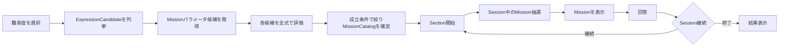

# Missionカタログ・抽選内部仕様

> [ドキュメント一覧](../../README.md) / 区分: 内部仕様
>
> 正本: [Cosense「Missionカタログ・抽選内部仕様」](https://scrapbox.io/proto-TeamL/Mission%E3%82%AB%E3%82%BF%E3%83%AD%E3%82%B0%E3%83%BB%E6%8A%BD%E9%81%B8%E5%86%85%E9%83%A8%E4%BB%95%E6%A7%98)
> 取得時点の原文更新日時: 2026-08-26T05:45:49.000Z

## このページの目的

Mission候補を準備する処理と、Session中に1件を抽選する処理を分離して定義する。
ここで定義するのは処理規則と入出力であり、具体的なクラス構成は定義しない。

## 用語

| 用語 | 意味 |
| --- | --- |
| ExpressionCandidate | ゲーム設定で到達可能な正常な最終式 |
| MissionParameterCandidate | MissionのKindとパラメータの組 |
| MissionCandidate | 評価を通過し、出題可能になったMission候補 |
| MissionCatalog | Gameplay開始時に確定するMissionCandidateの集合 |
| ExpressionMatchCount | Missionを満たすExpressionCandidateの数 |
| ExpressionMatchRatio | ExpressionMatchCountを正常なExpressionCandidate総数で割った式適合割合 |
| MinExpressionMatchRatio | MissionCandidateとして採用する最小式適合割合 |
| MaxExpressionMatchRatio | MissionCandidateとして採用する最大式適合割合 |
| TargetExpressionMatchRatio | 本実装版の抽選で目標とする式適合割合 |
| NegatedMissionSelectionWeight | 肯定Missionに対するNegatedMissionの相対抽選重み |

## 処理を挟む位置

Gameplay開始時の処理はMissionCatalogの確定までである。
Session中の抽選は、確定済みのMissionCatalogから1件を選ぶ処理である。

## 実装段階

| 項目 | 簡易版 | 本実装版 |
| --- | --- | --- |
| パラメータ候補 | 用意済み候補を使用 | 到達可能な結果から自動生成可能 |
| CurrentExpressionの考慮 | しない | 現在の式で未達成の候補に限定 |
| Tier抽選 | 現在0.60／下位0.40 | 現在0.60／下位0.40 |
| Kind抽選 | 一様 | 候補状況に応じた規則 |
| パラメータ抽選 | 一様 | 目標式適合割合を使用 |
| NegatedMission | 生成・抽選しない | 相対重みで抽選 |
| 連続出題回避 | 行わない | 同一Kind・同一パラメータを回避 |
| 複合Mission | 生成・抽選しない | 将来拡張 |

簡易版から本実装版へ移行しても、抽選処理の入力を「MissionCatalog、Section、必要なSession状態」、出力を「選ばれたMission」とする境界は変えない。

## 共通：MissionCatalogの準備

Gameplay開始時に、選択されたゲームモードと難易度からExpressionCandidateを列挙する。
簡易版では、[Missionパラメータ候補プリセット](./candidate-presets.md)に用意されたMissionParameterCandidateを読み込む。
各MissionParameterCandidateをすべての正常なExpressionCandidateに適用し、ExpressionMatchCountとExpressionMatchRatioを求める。
次の条件をすべて満たす候補をMissionCandidateとしてMissionCatalogへ登録する。

- MinExpressionMatchRatio以上である
- MaxExpressionMatchRatio以下である
- ZeroおよびPrime以外はExpressionMatchCountが2以上である
- ZeroおよびPrimeはExpressionMatchCountが1以上である
- Kind固有のパラメータ条件を満たす
- 同じKindと同じパラメータの重複候補ではない

正常なExpressionCandidateが0件の場合はGameplayを開始できない設定エラーとする。
MissionCatalogが0件の場合はGameplayを開始できない設定エラーとする。
MissionCatalogはGameplay開始時に1回だけ確定し、同じSession中は再生成しない。

初期の共通値は次とする。

| 項目 | 値 |
| --- | --- |
| MinExpressionMatchRatio | 0.10 |
| MaxExpressionMatchRatio | 0.50 |
| TargetExpressionMatchRatio | 0.25 |
| CurrentTierSelectionWeight | 0.60 |
| LowerTierSelectionWeight | 0.40 |
| NegatedMissionSelectionWeight | 0.60 |
| CompoundMissionSelectionWeight | 0 |

これらは難易度ごとに変更可能なConfig対象とする。
TargetExpressionMatchRatioは本実装版の抽選でのみ使用し、簡易版の一様抽選には影響しない。

## 簡易版：Session中の抽選

Sectionから現在Tierと解放済みの下位Tierを求める。
下位Tierが存在する場合は、現在Tierを重み0.60、下位Tier全体を重み0.40としてTierを選ぶ。
下位Tierを選んだ場合は、その範囲に含まれるTierを一様に選ぶ。
選ばれたTierに属するMissionCandidateからKindを一様に選ぶ。
選ばれたKindに属するMissionCandidateからパラメータ候補を一様に選ぶ。
選ばれたMissionへ新しいMissionIdを付けて表示する。

初期実装版の注意
- CurrentExpressionで達成済みかを確認しない。
- 直前の回答、直前のMission、出題履歴を参照しない。
- NegatedMissionを生成も抽選もしない。
- 複合Missionを生成も抽選もしない。

選ばれたTierに候補が0件の場合は、同じ抽選対象範囲のうち候補が存在するTierだけで重みを正規化して再抽選する。
選ばれたKindに候補が0件になる抽選手順は使用せず、候補が存在するKindだけを抽選母集団とする。
利用可能なMissionCandidateが全体で0件の場合は設定エラーとしてSessionを開始しない。

## Betweenの簡易版パラメータ

Betweenは画面上では「N以上、N+W以下」として扱う。
内部パラメータは下限Nと幅Wを保持し、上限は N + W から求める。
Wは1以上とする。
NとWは独立に総当たりせず、許可する組をプリセットに明示する。
これによりWの候補を限定し、範囲幅と候補数を制御する。

## 本実装版：Missionパラメータ候補の自動生成

本実装版では、正常なExpressionCandidateから到達可能な整数結果IntegerResultsを求める。
境界値を必要とするKindでは、ThresholdMinからThresholdMaxまでの全整数ではなくIntegerResultsを生成元とする。
Betweenの境界候補も到達可能な結果を基準に生成し、無制限なNとMの組合せを作らない。
生成後の候補評価とMissionCatalogへの登録条件は簡易版と共通とする。

## 本実装版：Session中の抽選

MissionCatalogから、CurrentExpressionでは未達成のMissionCandidateだけを抽選対象にする。
現在Tierと下位Tierの重み0.60／0.40でTierを選ぶ。
肯定Missionを基準重み1.00、NegatedMissionを相対重みNegatedMissionSelectionWeightとして選ぶ。
NegatedMissionSelectionWeightが0.60の場合、候補数など他条件が同じならNegated対肯定の期待出題比率は6対10となる。
NegatedMissionSelectionWeightが1.00でもNegatedMissionだけにはならず、期待比率は1対1となる。
直前と同一のKindかつ同一パラメータの候補を、代替候補がある場合は除外する。
Negatedの有無だけが異なる候補は同種として扱わない。
残ったKindから一様に選ぶ。
選ばれたKindの候補をTargetExpressionMatchRatioとの差が小さい順に並べ、上位候補群から抽選する。
上位候補群の大きさと同点処理は、本実装着手前にConfigとして確定する。
途中の条件で候補が0件になった場合は、追加した条件を逆順に緩和する。
CurrentExpression未達成条件まで緩和しても候補が0件の場合は、MissionCatalogの設定エラーとして扱う。

## NegatedMission

NegatedMissionは本実装版でのみ生成・抽選する。
肯定Missionと同じパラメータ候補を基に判定を反転する。
肯定MissionとNegatedMissionはTierが異なってよい。
NegatedMissionSelectionWeightは難易度ごとのConfig対象とし、暫定値を0.60とする。

## 複合Mission

簡易版ではCompoundMissionSelectionWeightを0とし、複合Missionの生成、評価、抽選、表示を行わない。
複合Missionの本実装は明確に先送りする。
将来の成立条件は[複合Mission](./compound-missions.md)に定義する。

## 未決定事項

- 本実装版の目標式適合割合に対する上位候補群の件数または範囲
- 本実装版で条件緩和が必要になった際の厳密な優先順位
- 難易度EasyおよびHardの各Config値
- 自動生成へ切り替える時期と移行判定
