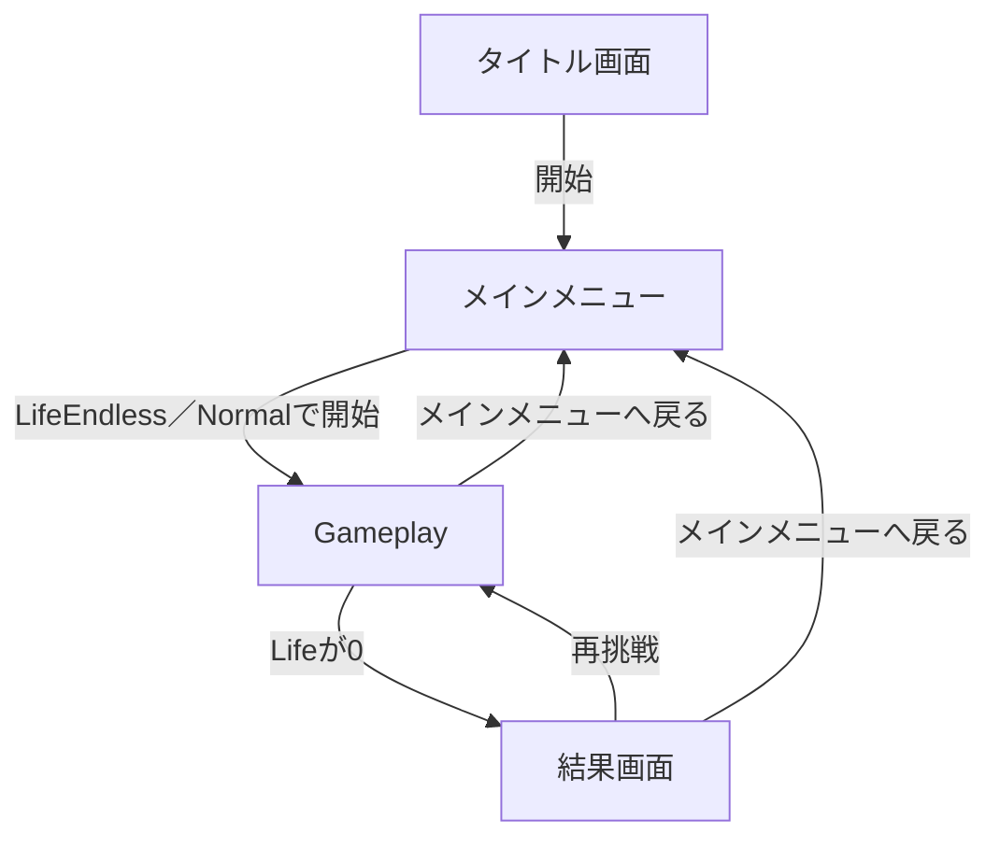

# 画面・UI仕様

> [ドキュメント一覧](../../README.md) / 区分: 要件

[CCC要件書](../overview.md)から分離した、各画面の構成・表示項目および画面遷移の仕様について記述する。

## タイトル画面

- タイトル名: `Change Change Change` （略称: `CCC`）
- メインメニューへ移動する「Touch to Start」等の開始ボタン

## メインメニュー画面

- `LifeEndless` モード / `Normal` 難易度で Gameplay を開始するスタートボタン
- オプション設定メニューへの遷移ボタン
- クレジット画面表示（開発スケジュールに応じて対応）
- Gameplay 開始失敗時のエラー通知メッセージ表示

## オプションメニュー画面

- メインメニューへ戻るボタン
- SE（効果音）音量を切り替える `CycleSelectorView`
- BGM（背景音楽）音量を切り替える `CycleSelectorView`

## Gameplay（ゲームプレイ）画面

- 現在の `Section` 数
- 現在選択中の `GameMode` 名
- 選択された `GameDifficulty`（難易度）名
- 残り `Life` 数（ハート表示等）
- 現在出題中の `Mission` テキスト
- タイマーの残り時間表示（`RemainingTime`）
- `CurrentExpression`（プレイヤーが変更中の式）
- **計算結果表示**: `ShowCurrentAnswer == true` の場合は `CurrentExpression` の評価計算結果をリアルタイム表示。`false` の場合は伏せ字表示（0除算時は `？`）とする。
- `SUBMIT` ボタン
- メインメニューへ中断復帰するボタン
- メインメニュー復帰失敗時のエラー通知メッセージ表示

> [!NOTE]
> 現在の式が Mission 条件を満たしているかどうかのクリア可否情報は、Submit ボタンを押下するまで表示しないこと。また、タイマーの残り時間が `3秒以下` になった時点で、タイマー表示を警告色（赤色等）へ変化させること。

## 結果（リザルト）画面

- セッション終了理由（`GAME OVER` 等）
- 最後に挑戦した `Mission`
- 最終の式およびその計算結果
- **正解した問題数**: `max(0, Section - 1)` により算出した結果を表示すること。
- **最終到達Section**: プレイ中到達した最高 `Section`
- 同一モードでリトライする「再挑戦」ボタン
- メインメニューへ戻るボタン
- 再挑戦開始失敗時のエラー通知メッセージ表示
- メインメニュー復帰失敗時のエラー通知メッセージ表示

※「再挑戦」選択時は、終了した旧 Session の状態を再利用せず、新しい Session を完全新規に生成・起動すること。再挑戦の開始処理に失敗した場合は、結果画面を維持したまま再挑戦ボタンを非活性（Disabled）にし、メインメニューへ戻るボタンのみを有効化すること。

## 画面遷移図

## スマートフォン表示レイアウト

- **画面向き**: 横画面固定（Landscape）のみに対応すること。
- タッチ領域の詳細な画面配置・レイアウトについては別紙グラフィックデザイン資料を参照すること。

---
- 関連内部規則: [CCC内部仕様](../internals/game-invariants.md)
- 受け入れ検証要件: [CCCテスト仕様](../testing/acceptance-specification.md)
