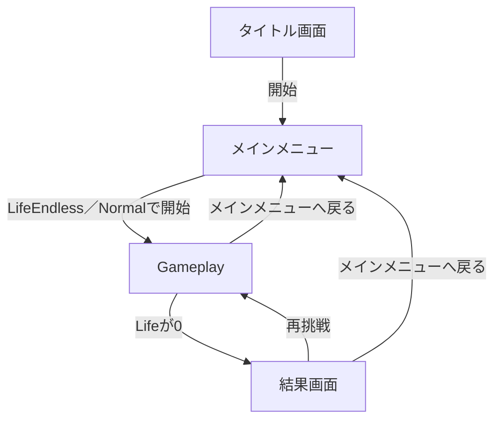

# 画面・UI仕様

> [ドキュメント一覧](../../README.md) / 区分: 要件
>
> 正本: [Cosense「画面・UI仕様」](https://scrapbox.io/proto-TeamL/%E7%94%BB%E9%9D%A2%E3%83%BBUI%E4%BB%95%E6%A7%98)
> 取得時点の原文更新日時: 2026-08-29T22:39:27.000Z

[CCC要件書](../overview.md)から分離した、各画面の表示項目と画面遷移の仕様。

## タイトル画面

- タイトル`Change Change Change`
- 略称`CCC`
- メインメニューへ進む開始ボタン

## メインメニュー

- `LifeEndless`／`Normal`でGameplayを開始するボタン
- オプション
- クレジット（時間があれば）
- Gameplay開始失敗メッセージ

## オプションメニュー

- Menuに戻るボタン
- SE音量を変更する`CycleSelectorView`
- BGM音量を変更する`CycleSelectorView`

## Gameplay画面

- Section
- 現在のGameMode
- 選択したDifficulty
- Life
- Mission
- 残り時間
- CurrentExpression
- ShowCurrentAnswerがtrueならCurrentExpressionの計算結果、falseなら伏せ字。0除算は`？`
- Submit
- メインメニューへ戻る
- メインメニュー復帰失敗メッセージ

現在Missionを満たしているかはSubmitまで表示しない。残り3秒以下ではタイマーを警告色にする。

## 結果画面

- 終了理由
- 最後のMission
- 最後の式と結果
- 正解した問題数。`max(0, Section - 1)`として導出
- 最終到達Section
- 同じモードで再挑戦
- メインメニューへ戻る
- 再挑戦開始失敗メッセージ
- メインメニュー復帰失敗メッセージ

再挑戦では終了したSessionを再利用せず、新しいSessionを開始する。
再挑戦開始に失敗した場合は結果画面を維持し、再挑戦ボタンを無効化してメインメニューへ戻るボタンを有効にする。

## 画面遷移

## スマートフォンレイアウト

- 横向きのみ対応する。
- タッチ領域の詳細レイアウトは別資料で提示する。

関連する内部規則：[CCC内部仕様](../internals/game-invariants.md)
受け入れ条件：[CCCテスト仕様](../testing/acceptance-specification.md)
